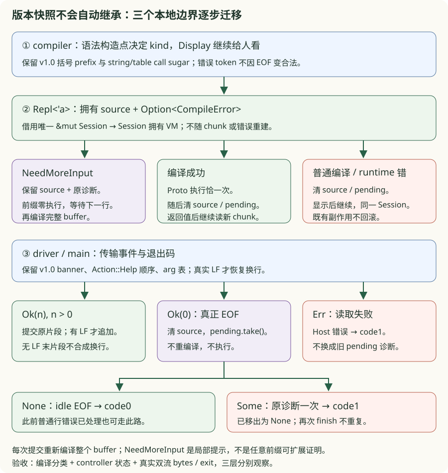
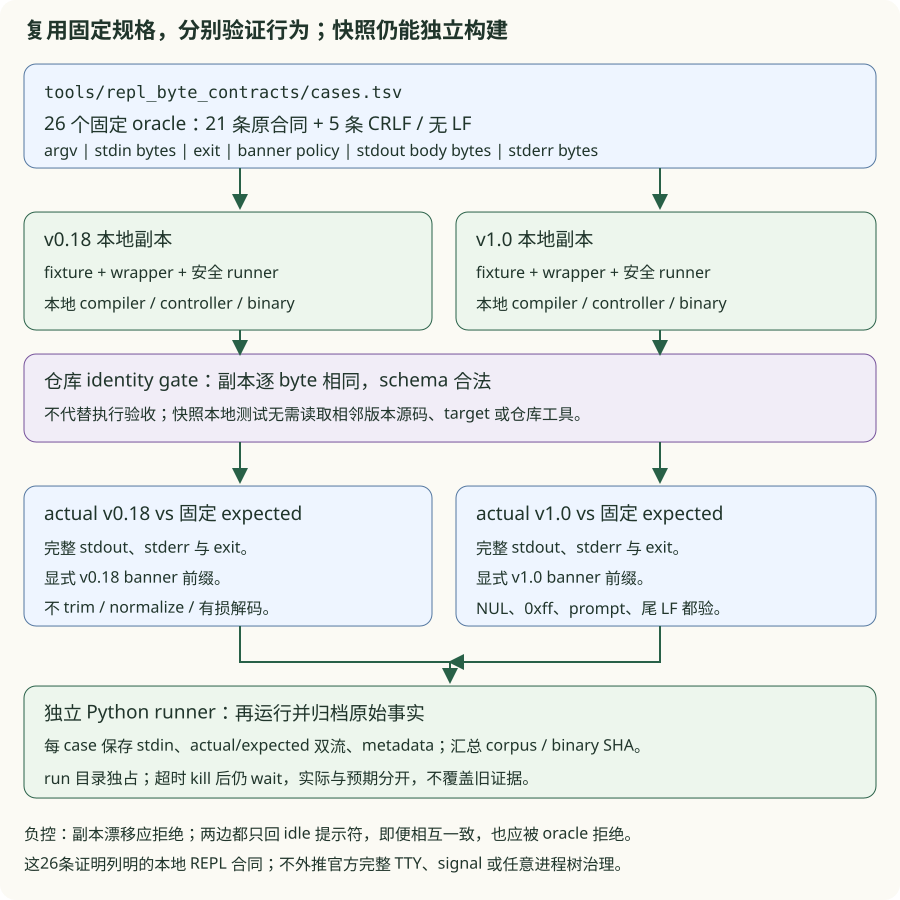
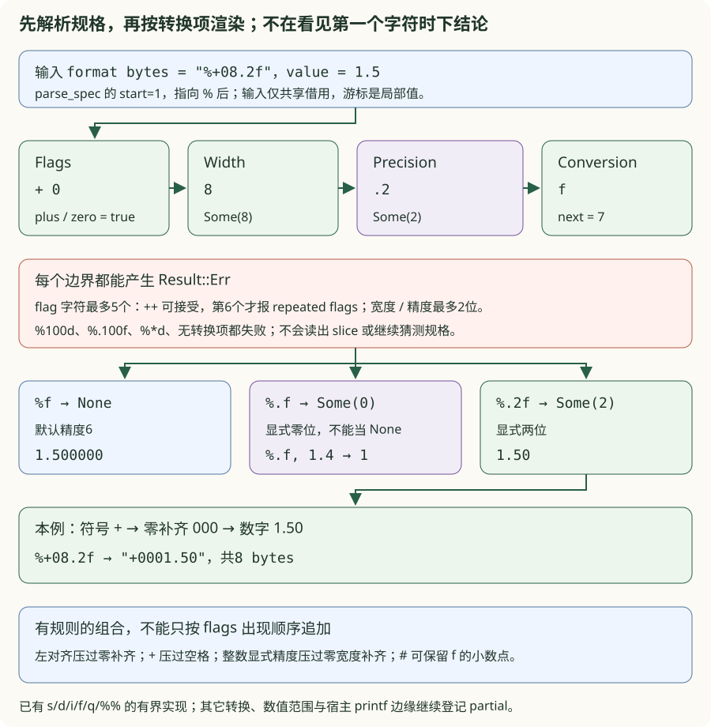
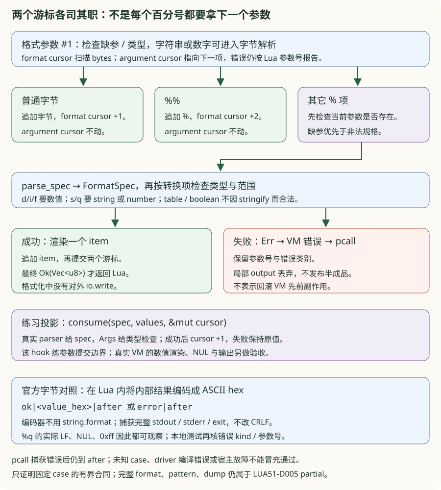

# v1.0 · Lua 5.1 语言运行时兼容收口

<div class="lesson-meta"><span>核心增量：从“有实现”变为“有证据的发布合同”</span><span>6-crate workspace</span><span>checkpoint v1.0</span></div>

<a id="learning-task-card"></a>
## 学习任务卡

<div class="task-card">
  <strong>让每个兼容结论都有可追溯证据</strong>
  <p>前置：v0.18 的语言、CLI 和观察协议。新知识：闭世界矩阵、双向引用校验、schema
  version、oracle provenance、差分子进程与 release gate。完成后你应能区分代表性通过、
  partial deviation 和被明确排除的版本边界。先把结构化 REPL 协议迁入本地快照，
  再用同一份原始字节合同验证两个独立 binary；随后从 string.format 的真实差异
  推导格式规格、参数检查与有界兼容证据。</p>
</div>

v0.18 已经能运行脚本、模块和协程，也能观察 bytecode、CFG 与 trace。但功能数量不是兼容性证据：如果测试没有说明参照物、平台归一化规则和允许差异，“测试通过”仍可能只是与自己一致。本版完成三件事：**补齐核心源码语法缺口、冻结可观察协议、让每项兼容结论都能追溯到测试或偏差 ID**。

<a id="learning-predict"></a>
## 先预测再运行

判断以下证据各能证明什么：一个 golden output、五个 official-oracle fixtures、38 项语义
映射、完整官方测试套件。它们强度不同，不能互相冒充。再为 complete/partial/excluded
各写一行能力矩阵，检查是否需要 test evidence、deviation ID 或 future-version boundary。

再预测：v0.18 已能将两行 `return 40 +`、`2` 合成42，v1.0 是否自然拥有这个行为？
输入未闭合 block 后直接 EOF，退出码应该是多少？最后一个短字符串片段有没有 LF，
会不会改变分类？先保留这些预测，运行下方迁移反例再核对。

再写下 `string.format('%f', 1.5)`、`string.format('%04d', 7)` 和
`pcall(string.format, '%s', {})` 的预期。若本地测试把错误结果写成 expected，
测试全绿还能说明兼容吗？下面的问题四至六将把这个差异变成可执行规格。

<a id="learning-code-map"></a>
## 代码阅读地图

1. capabilities.tsv：闭世界列出功能、状态、证据和 deviation；
2. deviations.tsv：为 partial 项登记范围、处置和目标版本；
3. release tests：双向检查 capability↔deviation，不允许孤儿或假 complete；
4. versioned JSON/trace envelope：冻结 consumer 可观察协议；
5. Lua51Opcode audit：覆盖官方 ordinal，但明确不是 binary compatibility；
6. oracles.toml：固定版本、commit、URL 与 hash；
7. differential runner：三个真实进程、唯一归一化、timeout 与 lane 结果；
8. release gate：本地质量门与可选外部 oracle 证据分层报告。

本轮 REPL 微课另按调用顺序读：本地 `src/main.rs::repl` → `src/lib.rs::run_repl`
→ `Repl` → `Session::execute_multi` → 本地 `lua_compiler::compile` → VM。先看
compiler 返回的 kind，再看 controller 保留的 source/诊断，最后看 adapter 的 EOF；
`tests/repl_byte_contract.rs` 负责从进程外核对这条链。

格式化另沿 `Vm::invoke_string` → `string_format::format_arguments` → `format`
→ `parse_spec` → 各 renderer 阅读；`tests/string_format_contract.rs` 从实际 binary
验固定字节，再单独检查本地错误 kind、参数号与分类。

本版阅读顺序从证据到实现：先问“这个结论由什么证明”，再进入 parser/opcode/tool 代码。
测试存在并不自动成为证据；只有覆盖对象、参照物和允许归一化都明确时，才能支撑对应行。

## 先定义“完成”

v1.0 使用闭世界模型管理发布范围：

```text
能力矩阵中的每一行
├── complete ──> 必须指向自动测试，不得绑定偏差
├── partial  ──> 必须绑定已登记偏差
└── excluded ──> 必须绑定 v1.1+ 的明确边界

偏差注册表中的每个 ID ──> 必须反向出现在能力矩阵
```

这两个方向都由 `tests/lua51_release.rs` 检查。删除能力引用、拼错 ID、给 `complete` 项偷偷绑定例外，都会让普通 `cargo test` 失败。能力真相源位于：

- `compatibility/capabilities.tsv`：功能、状态、测试证据与偏差 ID；
- `compatibility/deviations.tsv`：范围、处置状态、目标版本和精确描述；
- `compatibility/oracles.toml`：外部参照物的版本、URL、commit 与 SHA-256；
- `compatibility/differential-baseline.json`：已经实际得到的双差分结果。

选择 TSV 是为了让 Rust 测试无需第三方解析库也能执行 closed-world 校验；选择 TOML/JSON 保存 provenance 与结果，是因为字段层级更自然，也方便外部工具读取。

## 补齐 Lua 的三种调用形式

Lua 5.1 的函数参数不只有括号形式：

```lua
consume("lua")
consume "lua"
consume { answer = 42 }
```

v0.18 的 `postfix` parser 只在遇到 `(` 时生成 `Call`。v1.0 把 `(`、字符串 token 和 `{` 都视为参数起点；table constructor 和 string 会包装成单一实参。语句入口也接受括号 prefix expression，因此 `(function() ... end)()` 可以作为独立调用语句。

这处改动揭示一个 Lua 边界：换行不是 statement terminator。下面的 `(` 可能成为上一行表达式的调用后缀，因此需要分号消除歧义：

```lua
local result = 0;
(function() result = 42 end)()
```

端到端测试同时执行三种参数形式、括号调用语句和多返回，证明改动最终穿过 Codegen 与 VM，而不只是 AST snapshot 正确。

## 问题一：前一版修好了，独立快照为什么仍然失败？

### 先重现：版本号不会替我们迁移代码

迁移前的 v1.0 和 v0.18 各有自己的 compiler、controller 与 main。旧 v1.0 的
`is_incomplete` 在 message 中搜索 `expected 'end'`、`unexpected end`、
`unterminated`；`return 40 +` 实际得到 `expected an expression`，漏判后清空
source，下一行 `2` 也无法接上。对旧提交 `7776fd4` 的真实 binary 输入
`return 40 +\n2\n=42\n`，结果是两次诊断，只有最后的新 chunk 输出42。

本地固定反例仍能复现这个决策，不需要下载历史 binary：

```powershell
cargo run --quiet --manifest-path book/code/v100-lua51-runtime/Cargo.toml --example repl_migration_problem_chain -- all
```

`faults` 重放关键词漏判、静默 EOF、clone 重复诊断；`migration` 调用当前本地
compiler/Repl/driver。缺省 `all` 共12条不同的 `[ok]`，只运行固定参考；它没有
替你完成 learner，也不替代完整进程双流与退出码合同。

### 最小迁移：先迁移分类，再迁移消费者

```diff
-Err(AppError::Compile(error)) if is_incomplete(&error) => continue,
+Err(AppError::Compile(error)) if error.kind == CompileErrorKind::NeedMoreInput => {
+    self.pending = Some(error);
+    Ok(ReplEvent::NeedMoreInput)
+}
```

先给本地 `CompileError` 增加 kind，再迁移具体词法/语法错误构造点，最后迁移
consumer。原 `compile(&[u8]) -> Result<Proto, CompileError>` 与 Display 保留；
Rust 调用者若自己构造错误，需要补 kind 字段。

```rust,ignore
{{#include ../../code/v100-lua51-runtime/crates/lua_compiler/src/lib.rs:repl_compile_error}}
```

EOF 处还期待表达式、名称或闭合符时可返回 NeedMoreInput；错误 token、畸形数字、
非法 escape、未转义的短串换行和 codegen 错误仍是 Invalid。延迟 unfinished
literal 的词法错误，才能让更早已确定的普通语法错误优先返回。这是**具体构造点的
局部提示**，不是“任意前缀总能补成合法程序”的证明；每次仍重编译完整 buffer。
完整分类推导见[上一版的问题十一](v18-cli-tools.md)。

### 保留本版增量：不能整份覆盖 parser

v1.0 已比 v0.18 多了括号 prefix expression，以及 string/table call sugar。
迁移要把新的分类接入这些本地路径，保留它们接受的合法程序：

```rust,ignore
{{#include ../../code/v100-lua51-runtime/crates/lua_compiler/src/lib.rs:repl_v100_call_arguments}}
```

例如 `consume { answer =` 可以等待值，而 `consume { answer = )` 必须立即拒绝；
`consume 'unfinished` 无 LF 可以等待闭合，有真实 LF 则不能继续短字符串。
`(function() return 42 end)()` 仍能作为语句执行。这样读者能看见“迁移协议”与
“保留版本增量”分别由哪些路径承担。

```powershell
cargo test --manifest-path book/code/v100-lua51-runtime/Cargo.toml -p lua_compiler tests::v100_prefix_and_call_sugar_keep_structured_error_kinds -- --exact
cargo test --manifest-path book/code/v100-lua51-runtime/Cargo.toml -p lua_compiler tests::v100_prefix_and_call_sugar_still_complete_valid_protos -- --exact
```

第一项逐个核对 unfinished/Invalid，第二项把分段 source 补齐并检查成功 Proto；
真实 controller 与 CLI 回归再验证执行结果。只有“能编译”不足以证明执行次数与状态。

## 问题二：谁保存输入，谁消费 EOF，谁保留 VM？

### 一个迁移，三个 owner 边界



`Session` 拥有 VM；`Repl<'a>` 借用同一个 `&'a mut Session`，自己拥有 source
与 `Option<CompileError>`；`run_repl` 借用输入输出，识别传输事件。main 只接线
并把最终错误转换为退出码。不能为复用 controller 把 main 覆盖回旧版：本版
`Action::Help` 仍参与 action 顺序，`-e/-l/-v/-i`、arg table 与 v1.0 banner 都要保留。

每次提交先编译整个 source；只有编译成功才执行那个 Proto 一次。未完成时保留
source 与最近一次编译诊断，**前缀零执行**；成功或普通错误返回后清当前输入，Session 不重建，
已经发生的 runtime 副作用不回滚。调用者用公开 `submit` 提交不含末尾 LF 的完整物理行；driver
内部用 `submit_fragment` 保留末片段是否真的带 LF。

```rust,ignore
{{#include ../../code/v100-lua51-runtime/src/lib.rs:repl_structured_submit}}
```

### EOF 不是“再试一次编译”

旧 v1.0 的 `read_line -> Ok(0)` 直接 break。输入 `if true then\nprint('never')\n`
后 EOF，真实旧 binary 无诊断且 exit0，未执行的输入就这样丢了。正确路径消费
已经保存的诊断：

```diff
-if input.read_line(&mut line)? == 0 { break; }
+if count == 0 { return repl.finish_eof(); }

-// 丢弃未完成的 source，正常返回
+self.source.clear();
+match self.pending.take() {
+    Some(error) => Err(AppError::Compile(error)),
+    None => Ok(()),
+}
```

`take()` 将 Some 移出并留下 None；clone 会让第二次 finish 仍报同一诊断。EOF
不会重编译或执行；pending EOF 将原错误交给顶层打印一次并 exit1，idle EOF 为0。
此前普通行错误已经报告、buffer 已清时，最后仍可走 idle EOF。

```rust,ignore
{{#include ../../code/v100-lua51-runtime/src/lib.rs:repl_structured_eof}}
```

只有 `read_line -> Ok(0)` 是 EOF。正数是片段，有 LF 才移除 LF 与可选 CR，再按
有换行提交；Err 是宿主错误，不能换成旧 pending 编译诊断。完整无 LF `=42`
照常执行；`return 'broken` 无 LF 是 NeedMoreInput 后 pending EOF=1，加 LF 是
短串非法换行，报告并清 buffer 后 idle EOF=0。旧 v1.0 在无 LF 情况也会合成换行，
因此它原先报告 `newline in short string` 后 exit0；不能把这条历史路径说成静默等待。

```rust,ignore
{{#include ../../code/v100-lua51-runtime/src/lib.rs:repl_structured_transport}}
```

input 使用 UTF-8 String，非 UTF-8 属于 Host 错误；泛型 writer 承接提示符与返回值，
Lua `print` 仍走进程 stdout。它不是全局输出拦截器，也没有实现增量 parser。

### 验收练习：把原诊断移动一次

只改[迁移练习包](https://github.com/YanqingXu/lua_rust/blob/main/book/code/v100-lua51-runtime/exercises/repl_migration/README.md)
的 `starter.rs::finish(&mut PendingInput)`，保留其他文件、合同与 ignore。
PendingInput 用本地真实 compiler 生成诊断，是所有权教学投影；实际 controller
另验，不能用投影通过冒充 VM 行为通过。

```rust,ignore
{{#include ../../code/v100-lua51-runtime/exercises/repl_migration/starter.rs:repl_migration_starter}}
```

合同要求 idle 成功、pending 返回原 kind/位置/message 一次、source 与 Option 清空，
约束禁止重编译/执行。hook 不接收 Session，不代表 Rust 禁止调用任何全局函数。

```powershell
cargo test --manifest-path book/code/v100-lua51-runtime/Cargo.toml --test repl_migration_exercises migrated_eof_consumes_original_diagnostic_once -- --ignored --exact
cargo test --manifest-path book/code/v100-lua51-runtime/Cargo.toml --test repl_migration_reference migrated_eof_consumes_original_diagnostic_once -- --exact
cargo test --manifest-path book/code/v100-lua51-runtime/Cargo.toml --test repl_input_protocol pending_chunks_execute_once_and_keep_the_same_session -- --exact
```

第一条初始应失败，补完后通过；第二条固定参考通过不表示 learner 完成。第三条
沿真实 Session 验证前缀不运行、成功恰一次和状态保留；包内还有普通错误恢复、I/O
Err、binary 返回值与 shorthand 边界验收。Release 加 `--release` 重验同一规格。

## 问题三：怎样复用合同，又让两个快照独立构建？

### 相同输出不一定正确

若两边都静默丢掉 pending EOF，只比较两份实际输出仍会通过。expected 必须来自
固定 oracle。仓库的 `tools/repl_byte_contracts/cases.tsv` 保存26条场景：前21条
沿用 v0.18 字节验收，再补5条 CRLF 与末片段无 LF 边界；每行固定 argv、stdin、
退出码、banner 策略、stdout body、stderr，bytes 用小写 hex 保存。



```diff
-// 只比较两个实际 stdout，或 trim/归一化后检查“有42”
-assert_eq!(v18_output, v100_output);
+assert_eq!(actual.status.code(), Some(case.exit));
+assert_eq!(actual.stdout, case.stdout(version));
+assert_eq!(actual.stderr, case.stderr);
```

两个目录各保存完整 fixture、测试 wrapper 和安全 process runner；没有跨版本
`include!`、path dependency 或读取相邻 target。仓库 gate 检查三份 corpus 与
两份测试/runner 逐 byte 相同，防止复制后漂移；每个快照的本地测试不需要仓库 gate
也能运行。版本差异只有显式的 banner 映射：

```rust,ignore
{{#include ../../code/v100-lua51-runtime/tests/support/repl_byte_contract.rs:repl_contract_banner}}
```

不能 trim 输出、丢弃 stderr、将 0xff 有损解码、改 CRLF 或忽略尾 LF。NUL、提示符、
诊断次数都在 expected bytes 内。runner 写完关闭 stdin，同时 drain 两流，deadline
后 kill/wait 并 join；这是有界、无后代 fixture 的合同，不外推任意进程树治理。

```powershell
py -3 tools/check_repl_byte_contracts.py --check
cargo test --manifest-path book/code/v18-cli-tools/Cargo.toml --test repl_byte_contract real_binary_matches_all_shared_raw_byte_cases -- --exact
cargo test --manifest-path book/code/v100-lua51-runtime/Cargo.toml --test repl_byte_contract real_binary_matches_all_shared_raw_byte_cases -- --exact
```

同一测试在两个独立 binary 上各跑全部26条；完整 stdin/stdout/stderr 与 exit 各自
对固定 oracle。独立 Python runner 还能另启真实进程、归档 actual 与 expected 双流、
metadata、corpus/harness/binary SHA，运行目录独占，拒绝覆盖。构建及传路径命令见
[共享合同说明](https://github.com/YanqingXu/lua_rust/blob/main/tools/repl_byte_contracts/README.md)。本合同不作通用文本
normalize；下文语言 differential runner 的 CRLF 规则属于另一组明确声明的合同。

先故意改坏一份副本，应被身份 gate 拒绝；再设想两个只输出正确 banner、固定 idle
提示符的 binary，它们相互一致，仍应被固定 oracle 拒绝。发布结论需要这些失败路径
也能观察，不能只看两边 exit0 或示例打印 `[ok]`。这26条证明本地 REPL 策略与列明
边界，不代表官方 Lua 全部 TTY 行为；signal、编辑器、增量解析仍要另立规格。

## 问题四：`%f` 有输出，为什么仍然不兼容？

### 从一个错误的绿色测试开始

迁移前的真实 v1.0 用 `f64::to_string()` 实现 `%f`。旧 `tests/stdlib.rs` 还将
`'%s:%d:%f:%%'` 的预期写成 `x:7:1.5:%`，因此测试通过恰好固定了偏差。
对提交 `74fe6ca` 的 binary 和官方 Lua 5.1.5 实际运行，可观察到：

| 输入 | 修改前 v1.0 | 官方 Lua 5.1.5 |
| --- | --- | --- |
| `string.format('%f', 1.5)` | `1.5` | `1.500000` |
| `string.format('%04d', 7)` | 报 unsupported `%0` | `0007` |
| `string.format('%.2f', 1.5)` | 报 unsupported `%.` | `1.50` |
| `pcall(string.format, '%s', {})` | `true` | `false` |

先用固定反例对照当前真实 VM：

```powershell
cargo run --quiet --manifest-path book/code/v100-lua51-runtime/Cargo.toml --example string_format_problem_chain -- all
```

缺省 `all` 共12条不同 `[ok]`：`faults` 四条重放通用显示、单字节规格、宽泛
stringify 和过早推进游标，`format` 八条调用本地 parser/VM。固定参考与反例的
通过不代表 learner 完成，也不代替后面的官方进程字节对照。

### 最小变化：精度成为独立输入

```diff
-output.extend(number.to_string().as_bytes());
+let precision = usize::from(spec.precision.unwrap_or(6));
+let digits = format!("{:.*}", precision, number.abs()).into_bytes();
+// 符号和宽度补齐由独立步骤处理。
```

通用显示与格式协议有不同目标。`%f` 没有 precision 时默认6；`%.2f` 指定2，
`%.f` 指定0。后两者不能被“去掉多余零”实现。`Option<u8>` 把未提供与显式0
区分开，renderer 才能选对默认规则。旧测试的预期也必须随已确认的官方合同修正。

```rust,ignore
{{#include ../../code/v100-lua51-runtime/crates/lua_vm/src/string_format.rs:format_render_numbers}}
```

数值先校验，再分离符号与绝对值数字；零宽度补齐应位于符号之后。`+` 压过空格，
左对齐压过零补齐；整数显式 precision 压过零宽度补齐。`%#.0f` 在零小数位时仍
保留小数点，`-0.0` 的符号也不能在取绝对值后丢掉。

```powershell
cargo test --manifest-path book/code/v100-lua51-runtime/Cargo.toml -p lua_vm string_format::tests::fixed_floats_have_six_default_digits_and_sign_aware_zero_padding -- --exact
```

该测试同时观察默认6位、符号后补零、`#`、左对齐与负零，并明确拒绝非有限值。
本次 `d/i` 有界支持共同的 signed i32 范围；超范围返回错误，C locale、宿主浮点
舍入边缘与其它转换仍登记 partial，不把几组普通数值外推为完整 printf。

## 问题五：为什么 `%` 后不能只读取一个字符？

### 让输入迫使数据结构出现

`%+08.2f` 的第一个字符 `+` 是 flag，第二个 `0` 也是 flag，`8` 才是 width；
`.` 后的 `2` 是 precision，最后的 `f` 是 conversion。单字符 match 把这些层次
混成一个“未知转换”，读者无法逐步补齐。先把五个 flag 的语义与可选数值存下来：

```rust,ignore
{{#include ../../code/v100-lua51-runtime/crates/lua_vm/src/string_format.rs:format_spec}}
```



parser 共享借用 `&[u8]`，局部 cursor 按 flags → width → precision → conversion
前进；成功返回 `(FormatSpec, next)`，由 dispatcher 提交 next。失败走 Result，
不按错误文字猜测已经消费多少，也不把某个数字默认成0继续运行。

```diff
-let specifier = format[cursor];
-cursor += 1;
+let (spec, next) = parse_spec(format, cursor)?;
+// 用 spec 渲染成功后，再将 format cursor 设为 next。
```

这里的 start 紧接 `%`；`%%` 已在 dispatcher 提前处理，不进入规格 parser。
Lua 5.1 的 scanformat 有两个值得亲自预测的限制：flag **字符数**最多5个，
`%++d` 可以接受，第6个才报 repeated flags；width/precision 最多两位，第三位
报错。两位十进制累积不会超出 u8，范围由语法本身约束。

```rust,ignore
{{#include ../../code/v100-lua51-runtime/crates/lua_vm/src/string_format.rs:format_parse_digits}}
```

```rust,ignore
{{#include ../../code/v100-lua51-runtime/crates/lua_vm/src/string_format.rs:format_parse_spec}}
```

`%100d`、`%.100f`、`%*d`、末尾 `%` 和未知转换分别触发相应失败路径；`%.f`
则合法地返回 `Some(0)`。这里继续只支持已有 `s/d/i/f/q/%%`，不会因为 scanner
能识别规格结构，就声称已实现 `%x/%e/%g/%c` 等转换。

```powershell
cargo test --manifest-path book/code/v100-lua51-runtime/Cargo.toml --test string_format_reference actual_parser_checks_the_whole_bounded_specification -- --exact
```

测试直接借用真实 `parse_spec`，检查字段、next、重复 flag 与长度边界；练习没有
再写一个简化 parser。规则依据可查[Lua 5.1.5 的 scanformat/str_format 源码](https://www.lua.org/source/5.1/lstrlib.c.html#scanformat)。

## 问题六：参数能显示出来，为什么仍必须报错？

### 两个游标，各有成功与失败边界

`%s/%q` 接受 string 或 number，`%d/%i/%f` 接受 number 或可转换的数字字符串；
table、boolean 和 nil 不因通用显示能生成文字而合法。第一参数格式串也要检查
缺参与类型，数字格式串使用同一 number-to-string 路径，不绕回 Rust 通用显示。

```rust,ignore
{{#include ../../code/v100-lua51-runtime/crates/lua_vm/src/string_format.rs:format_arguments}}
```



普通字节只推进格式游标，`%%` 输出一个 `%` 且不拿参数。其它转换先检查下一项
是否存在，再 parse 规格、检查类型并渲染。因此 `string.format('%100d')` 先报
缺参数 #2，提供参数后才报 width 太长；每个转换的诊断参数号还要包含格式串 #1。

```rust,ignore
{{#include ../../code/v100-lua51-runtime/crates/lua_vm/src/string_format.rs:format_dispatch}}
```

局部 `Vec<u8>` 累积的前缀不会在后续错误时成为成功返回值。Err 经 VM 的 Type
错误传到 pcall 或 CLI；format 没有中途输出字符串。此前 chunk 的 globals/I/O
副作用仍已发生，这不是整个 VM 的事务回滚。

```powershell
cargo test --manifest-path book/code/v100-lua51-runtime/Cargo.toml --test string_format_contract format_type_errors_keep_kind_and_argument_number -- --exact
cargo test --manifest-path book/code/v100-lua51-runtime/Cargo.toml --test string_format_contract missing_values_take_priority_before_format_parsing -- --exact
cargo test --manifest-path book/code/v100-lua51-runtime/Cargo.toml --test string_format_contract invalid_format_errors_do_not_become_argument_errors -- --exact
```

三条命令分别检查 Type + 参数号、缺参优先级、格式错误分类。不能把任何异常都
吞成“预期失败”就算通过，也不要求不同引擎的 traceback/源码路径完全相同。

### bytes 的边界也要由反例决定

Lua 5.1.5 的短 `%s` 路径按 C 字符串处理 NUL；没有 precision 且输入长度至少100
时，源码走保留原 bytes 的 fast path，并绕过 width。显式 precision 则回到短路径。
`%q` 转义 NUL、引号、反斜杠和换行，供 Lua 重新读入；实际 LF 被编码为反斜杠后
跟 LF（`5c0a`），不能仅因为 `5c6e` 也可回读成 LF，就把两份输出称为逐字节一致。

这些实现细节连同数字字符串转换，以[官方格式说明](https://www.lua.org/manual/5.1/manual.html#pdf-string.format)
和固定 5.1.5 源码、实际 binary 对照。固定 byte fixture、真实输出和 `loadstring`
回读都分别验证，不用宽泛“支持二进制字符串”替代每个路径的合同。

### 验收练习：先验证，再提交参数游标

只改[格式化练习包](https://github.com/YanqingXu/lua_rust/blob/main/book/code/v100-lua51-runtime/exercises/string_format/README.md)
的 `starter.rs::consume`。spec 来自真实 parser，values 共享借用完整参数切片，
index0 是格式串，cursor 从1开始。成功返回一个 Value clone 并推进一项；缺参或
类型错误返回 HostError，cursor 保持原值。Value clone 不深拷贝 Lua heap 对象。

```rust,ignore
{{#include ../../code/v100-lua51-runtime/exercises/string_format/starter.rs:string_format_starter}}
```

```rust,ignore
{{#include ../../code/v100-lua51-runtime/exercises/string_format/solution.rs:string_format_solution}}
```

这是参数检查与游标提交的教学投影，复用真实 Args；它不替代真实 formatter 的
数字范围、数字字符串边缘、NUL 和渲染。`?` 在失败处立即返回，只有全部检查成功
才改 cursor。fixed eager fault 提前推进，让缺参/类型错误也消耗了位置。

```powershell
cargo test --manifest-path book/code/v100-lua51-runtime/Cargo.toml --test string_format_exercises argument_cursor_commits_only_after_validation -- --ignored --exact
cargo test --manifest-path book/code/v100-lua51-runtime/Cargo.toml --test string_format_reference argument_cursor_commits_only_after_validation -- --exact
```

初始 learner 应失败；只补 hook 后通过。默认 ignored、9项固定参考和12条示例
marker 不能替代 learner 完成；Release 加 `--release` 验同一边界。

### 官方 Lua 5.1.5 字节合同

固定 TSV 和独立 Lua driver 共57个 case：数字默认精度、flags/宽度/精度、参数
消费、缺参/非法规格、类型、首参数 coercion、短串 NUL/长串 fast path、q bytes
与回读。预期手写固定，driver 不读取预期，不用 string.format 编码输出。

```rust,ignore
{{#include ../../code/v100-lua51-runtime/tests/string_format_contract.rs:format_binary_contract}}
```

Windows C stdout 会把 LF 转成 CRLF；要观察 q 的内部 `5c0a`，先在 **Lua 层**
把结果 bytes 编成 ASCII hex，再 `io.write('ok|...|after')`。错误 case 输出
`error|after`，本地三组诊断测试另核类别和参数号。Python/Rust 捕获完整双流与
exit，不 trim、不替换 CRLF，也不用 formatter 自己生成 expected。未知 case、
driver 编译失败或宿主故障不能作为合法 error case 通过。

```powershell
cargo test --manifest-path book/code/v100-lua51-runtime/Cargo.toml --test string_format_contract real_binary_matches_fifty_seven_fixed_format_byte_cases -- --exact
py -3 book/code/v100-lua51-runtime/tools/check_string_format_contract.py --check
```

`--check` 只检查 schema/driver 一致，明确打印 candidate/official NOT_RUN。实际
对照必须同时给 candidate binary、official binary 与固定源码归档：

```powershell
py -3 book/code/v100-lua51-runtime/tools/check_string_format_contract.py --candidate-bin book/code/v100-lua51-runtime/target/x86_64-pc-windows-msvc/debug/lua_app.exe --official-bin target/oracles/lua-5.1.5/build/Release/lua51.exe --official-archive target/oracles/lua-5.1.5/lua-5.1.5.tar.gz --output target/string-format-review
```

先 `cargo build --manifest-path book/code/v100-lua51-runtime/Cargo.toml --bin lua_app`
构建所选 profile；自定义 target/triple 时按实际产物改路径，Release 使用对应 binary。
runner 保存唯一 run/case 的实际/预期原始双流、状态、版本与 corpus/source/binary
SHA；超时后 kill/wait，缺 oracle 或归档失败显式失败。字段与复现边界见
[官方合同说明](https://github.com/YanqingXu/lua_rust/blob/main/book/code/v100-lua51-runtime/tools/string_format_contract/README.md)。

本次能力矩阵新增 format 子集证据，byte-string 与 format 行仍为 **partial**，
继续引用 `LUA51-D005`。旧2026-08-21双 oracle baseline保持原版本归属；本轮官方
format证据单独归档，不把已有转换子集通过升级为完整 string library。

## 38 Opcode：语义覆盖不等于二进制兼容

Lua 5.1 `lopcodes.h` 定义 38 个 Opcode。教学 VM 从 v0.5 起使用自己的 32 位寄存器格式，v0.18 已演进为 39 个更显式的 Opcode：

| Lua 5.1 Opcode | 教学 ISA | 原因 |
|---|---|---|
| `LOADBOOL` / `LOADNIL` | `LoadK` | boolean 与 nil 都进入普通常量表 |
| `SELF` | `GetTable + Move` | 方法查找和 self 布置显式展开 |
| `TESTSET` | 条件跳转 + `Move` | 短路复制由 codegen 明确表达 |
| `TFORLOOP` | `Call + JumpIfNil + Move` | iterator 协议拆成可观察步骤 |
| `SETLIST` | `SetList` / `SetListOpen` | 固定宽度与 MULTRET 分开 |

`lua_bytecode::compatibility` 按官方顺序定义 `Lua51Opcode`，并为全部 38 项给出非空映射、direct/composite 标记与说明。测试验证 ordinal 0–37 没有重复或缺项。运行：

```powershell
cargo run --manifest-path `
  book/code/v100-lua51-runtime/crates/lua_bytecode/Cargo.toml -- `
  --format opcode-audit
```

输出 schema 为 `lua-rust-lua51-opcode-audit/v1`，同时固定 `binary_chunk_compatible=false`。源码语义覆盖属于 v1.0，Lua 5.1 binary chunk 编解码与 verifier 属于 v1.1。

## 冻结 bytecode 与 trace 工具协议

v0.18 的 JSON 有稳定形状但没有版本号。本版给 Proto JSON 增加 `lua-rust-bytecode/v1`，给 VM trace 增加 `lua-rust-vm-trace/v1` 顶层 envelope：

```json
{"schema":"lua-rust-vm-trace/v1","events":[...]}
```

byte string 仍以 hex 输出，NaN/Infinity 仍不能冒充 JSON number。进程测试锁定 schema、错误退出码和 38-op audit 的行数。添加兼容字段可保持 v1；改变既有字段语义则必须升级 schema。

## 双 oracle 不是“双份 expected string”

官方 Lua 5.1.5 是语言参照，固定 C++ commit 是工程迁移参照。身份固定为：

- Lua 5.1.5 source SHA-256：`2640fc56...b0738695333`；
- official tests SHA-256：`49e4ca65...67f18ad`；
- C++ oracle commit：`87c15e69...635711`；
- exact-commit codeload archive SHA-256：`66c9506a...1bbfb8`。

`tools/run_differential.ps1` 对每个 fixture 启动三个真实进程，只做已声明的 CRLF→LF 归一化，然后比较 stdout、stderr 与 exit code。每个进程有十秒 timeout，超时只终止该 child process tree。

本次实际基线为 5/5 fixture 同时匹配两个 oracle：

| Fixture | 覆盖 | 结果 |
|---|---|---|
| `language-core` | 循环、多返回、短路、拼接 | 双 lane 通过 |
| `byte-strings` | NUL、0xff、byte/sub/length | 双 lane 通过 |
| `metatables` | `__index` 与 `__call` | 双 lane 通过 |
| `coroutines` | yield/resume 多值与状态 | 双 lane 通过 |
| `core-stdlib` | math/string/table 代表接口 | 双 lane 通过 |

baseline 只证明这五个可观察合同，不等于官方全量测试套件通过。依赖 C API、binary chunk、native module 或尚登记标准库差异的部分不能被静默过滤；能力矩阵必须保持 `partial`/`excluded`，直到对应差异真正关闭。

## Release gate

普通快照验收不依赖外部下载：

```powershell
cargo test --manifest-path book/code/v100-lua51-runtime/Cargo.toml --workspace
```

完整本地发布门执行 Debug/Release 测试、严格 Clippy、示例 stdout、38-op audit；提供 oracle 路径后再执行双差分：

```powershell
book/code/v100-lua51-runtime/tools/release_gate.ps1 -RunOracles `
  -OfficialLua path/to/lua51.exe `
  -CppLua path/to/lua_app.exe `
  -CppRoot path/to/pinned-source
```

不传 `-RunOracles` 时脚本明确打印 skipped，而不是把缺少 oracle 当作通过证据。

## Rust 知识映射与设计选择

- `#[repr(u8)]` 和固定数组把官方 opcode ordinal 变成可编译的不变量；
- `&'static [Opcode]` 表达一个官方语义由多个教学指令组合；
- `BTreeMap/BTreeSet` 让 registry 的重复、引用和顺序检查确定；
- versioned envelope 把 Rust struct 演进与 JSON consumer 解耦；
- 子进程异步读取 stdout/stderr，避免管道缓冲导致 differential deadlock；
- source/archive hash 与 commit 一起固定，避免 oracle 随网络分支漂移。
- `Repl<'a>` 借用唯一 Session，`Option::take` 将 EOF 诊断所有权转移一次；
- 独立快照复制固定 byte fixture 与测试，仓库身份 gate 阻止副本分叉。
- `FormatSpec` 与 `Option<u8>` 区分未指定和显式0；共享 byte slice 与局部 cursor
  分离解析/提交，Result 将格式、缺参和类型错误带回 VM；
- 符号、数值精度与宽度补齐分开，按规则处理优先级，不依赖通用 Display。

替代方案是把教学 ISA 强行改成官方 38 条并立即读取官方 chunk。这会把语言收口与二进制格式、端序、数字宽度、安全 verifier 混成一次破坏性迁移，因此留给 v1.1。另一个方案是只保存 golden output；真实双进程差分能在平台和错误合同改变时暴露差异，证据更强。

## 从 v0.18 迁移了什么

- 新增：Lua string/table call sugar 与 parenthesized prefix statement；
- 修复：help 不再在 option parser 内调用 `process::exit`，而是正常 action；
- 冻结：bytecode JSON 与 VM trace v1 schema；
- 新增：官方 38 Opcode enum、完整语义映射和机器可读 audit；
- 新增：能力矩阵、偏差注册表、oracle manifest 与 verified baseline；
- 新增：5 个双 oracle fixture、provenance-aware runner 和 release gate；
- 保留：v0.18 的语言、VM、GC、Coroutine、标准库、模块、CLI 与工具测试；
- 显式移植：结构化 CompileErrorKind、同一 Session 的 Repl 与真实 LF/EOF adapter；
- 共用合同：26个 raw byte 场景，本地自含副本与仓库身份/进程 gate；
- 收口子集：既有 string.format 的规格/参数边界与57场景官方字节合同，D005仍partial；
- 未伪装：标准库剩余差异和 v1.1+ 能力继续显式登记。

## 运行与验收

```powershell
cargo run --manifest-path book/code/v100-lua51-runtime/Cargo.toml -- `
  book/code/v100-lua51-runtime/examples/demo.lua
cargo test --manifest-path book/code/v100-lua51-runtime/Cargo.toml --workspace
```

示例输出：

```text
100
```

Release gate 还要求相同测试在 `--release` 下通过、Clippy 零 warning、示例 stdout 精确匹配，并检查 38-op audit 没有宣称 binary compatibility。

## 本版本暂不支持

- Lua 5.1 binary chunk、`string.dump` 与官方 opcode 二进制编码（v1.1）；
- Lua C API/ABI、headers、lauxlib 和外部 C consumer（v1.2）；
- `package.loadlib` 与动态 native module（v1.3）；
- string pattern 全集、完整 `string.format`、函数 environment API；
- io/os/package/debug 的全部平台与边缘 API；
- C runtime `rand` 序列、完整 locale/timezone/DST 合同；
- Windows argv/path 的无损宽字符 adapter；
- readline、signal-aware REPL、沙箱、配额和跨平台 SDK。

后三组 v1.0 范围内差异分别由 `LUA51-D004`–`LUA51-D011` 登记；它们不是未声明通过项。

<a id="learning-exercises"></a>
## 章末练习

<div class="exercise understanding">
  <strong>理解题</strong>
  <p>选择一个 composite opcode，从源码行为、教学 bytecode 与 VM trace 三层描述证据，并
  解释为什么仍不能读取官方 binary chunk。</p>
</div>

<div class="exercise implementation">
  <strong>实现题</strong>
  <p>给 capability evidence 增加内容 hash，检测文件存在但证据漂移；同时为错误 fixture
  设计不依赖绝对路径的分类 schema。</p>
</div>

<div class="exercise debugging">
  <strong>调试题</strong>
  <p>故意删除一条 deviation 反向引用或给 complete 项绑定 deviation，运行 release test，
  沿失败信息验证闭世界检查能准确指出非法关系。</p>
</div>

<div class="exercise understanding">
  <strong>理解题：迁移后谁还拥有原诊断？</strong>
  <p>对照状态图，逐步写出 source、pending 与 Session 的 owner。成功条件是能说明
  NeedMoreInput 不执行前缀，EOF take 后再 finish 不报错，普通错误不会新建 VM，
  以及真实 LF 与末片段无 LF 为什么走不同分类。</p>
</div>

<div class="exercise implementation">
  <strong>实现题：补齐迁移包的一个 EOF hook</strong>
  <p>只补 starter::finish，先运行 --ignored 精确验收，再运行真实 controller 与两版
  byte 合同。要求原诊断只返回一次、清空输入，并保留 v1.0 调用语法糖与 Help action。
  固定参考、示例或默认 ignored 结果均不算完成 learner。</p>
</div>

<div class="exercise debugging">
  <strong>调试题：相同错误输出为什么骗过相互比较？</strong>
  <p>运行三个 faults，指出每次状态丢失或复制的位置；再说明固定 oracle 如何拒绝
  两边都静默 EOF 的实现。成功条件是用完整双流 bytes、退出码与 source/Option 状态
  给出证据，并区分副本身份检查、实际行为检查和官方语言 oracle 的覆盖范围。</p>
</div>

<div class="exercise understanding">
  <strong>理解题：两个零为什么不是同一个含义？</strong>
  <p>分别手推 %f、%.f、%05.3d 的 spec、默认精度与输出。成功条件是说明 None、
  Some(0)、零宽度 flag 的区别，并解释整数显式 precision 为什么改变补零规则。</p>
</div>

<div class="exercise implementation">
  <strong>实现题：补齐格式化包的参数提交 hook</strong>
  <p>只补 consume，要求成功后前移一次、缺参或类型错误保持 cursor；运行 --ignored
  exact，再验真实 parser、VM 和固定57场景。Args 投影通过不等于真实 formatter
  的数字范围、NUL 和字节渲染均已正确。</p>
</div>

<div class="exercise debugging">
  <strong>调试题：expected 自己写对了吗？</strong>
  <p>复现旧 %f 预期、单byte规格与 table stringify 三个故障，定位每次必要改动；
  再解释为什么直接捕获 Windows stdout 中的 q 换行会混入文本模式转换。成功条件
  是从固定oracle、Lua层hex、本地错误分类各给证据，且D005仍准确标partial。</p>
</div>

<a id="learning-checkpoint"></a>
## 完成检查点

读者应能解释：为什么双 oracle 比单个 expected output 强；为什么“38 项语义映射”不等于“binary chunk 兼容”；为什么偏差注册表必须双向闭合；以及为何外部 oracle 缺失必须显示为 skipped 而不能假绿。

还应能在本地快照完成分类→controller→adapter 的小步迁移，保留本版 parser/main
增量；手推 NeedMoreInput、普通错误、idle/pending EOF 与 I/O Err 的状态；完成 EOF
TODO；独立构建 v1.0 并让两版逐字节满足同一固定合同，而非只互相相等。

格式化还应能从一个失败输入推导 FormatSpec、默认精度与符号/补齐的顺序，区分
格式游标与参数游标；完成 consume TODO；解释短串 NUL、长串 fast path 与 q 回读
的不同合同，并用官方字节证据支撑子集进展，保留D005的剩余边界。

## 与成熟实现和专题章节的对应

- 成熟实现的 differential runner、M0/M1 gate、official source manifest 和 living deviation log 是本版最小发布治理的扩展目标；
- [Bytecode](../ch03-compiler/bytecode.md) 对照教学 ISA 编码；
- [寄存器虚拟机](../ch04-vm/register-vm.md) 对照 composite opcode；
- [用测试守住兼容性](../ch05-engineering/testing.md) 深入 fixture、oracle 与进程级证据；
- 根目录 `book_plan.md` 继续定义 v1.1–v1.4 路线。
- 下一步按 capability/deviation 中的具体失败 fixture 继续推进其它转换或 pattern；
  REPL 的 TTY、signal、增量 parser 分别立项，REPL固定26条与format官方57条各保留覆盖归属。
