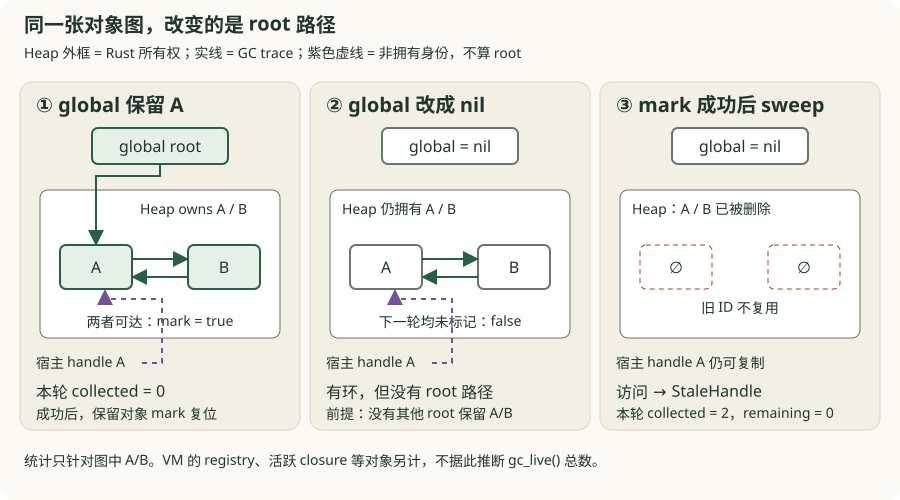
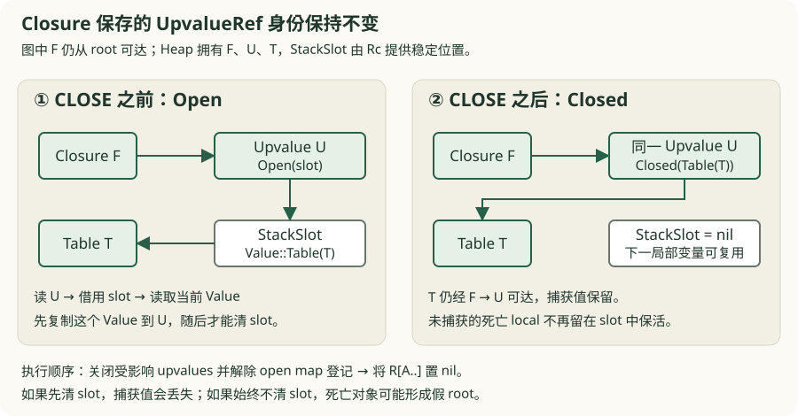

# v0.13 · Runtime 所有权与完整 GC

<div class="lesson-meta"><span>核心增量：可回收的对象图</span><span>workspace</span><span>checkpoint v0.13</span></div>

<a id="learning-task-card"></a>
## 学习任务卡

<div class="task-card">
  <strong>从引用计数迁移到唯一 Heap owner</strong>
  <p>前置：v0.12 的 Rc 对象图、closure/upvalue 与 metatable。新知识：typed handle、
  PhantomData、arena、roots/edges、迭代 mark-sweep 与 stale/foreign 校验。完成后你应能
  为一张对象图手工执行完整 GC。</p>
</div>

v0.12 的 table、closure 和 upvalue 都由 `Rc` 强引用。这个模型便于先讲清共享身份，却无法回收 `table.self = table`，closure 捕获自身也会形成环。本版只完成一个核心迁移：**运行时统一拥有 heap 对象，语言值只携带经过校验的非拥有 handle，并加入一次完整 mark/sweep 回收**。在这个快照中，运行时由 `Vm` 表达，唯一对象 owner 是它的 `heap: Heap` 字段；尚没有名为 `Runtime` 的 Rust 类型。

本章按六个 15–25 分钟的微课拆开这次迁移。先完成身份与访问边界，再处理 closure/upvalue、roots、作用域退出，最后开放回收。章末实验用同一组不变量验收，允许先看到失败，再修复自己的练习。

<a id="learning-predict"></a>
## 先预测再运行

画两张图：一张自引用 table 已离开 scope；另一张同样的 table 仍被 global 指向。分别从
roots 开始涂色，前者必须在 sweep 删除，后者必须保留。再把 global 改成宿主持有的裸
GcRef：非拥有 handle 不是 root，若不登记 registry，对象仍可被回收并使 handle stale。



图中的 A/B 都是 table，实线箭头表示 GC 要追踪的值引用，紫色虚线表示宿主只保存身份。
外框表示 Heap 的 Rust 所有权，**外框本身不算 root**。第一轮即使有环，也能从 global
到达 A/B；清掉 global 且没有其他 root 后，下一轮必须删除两者。图中只统计 A/B，
实际 VM 还有 registry 等常驻对象，不能把图上的数字当作 `gc_live()` 的总数。

## 本版完成后能做什么

```lua
do
    local cycle = {}
    cycle.self = cycle
end

local reclaimed = gc_collect()
return reclaimed >= 1 -- true
```

同一机制也必须证明相反方向：只要从 stack、global、registry、closure/upvalue 或 metatable 可达，对象就不能被误回收。

<a id="learning-code-map"></a>
## 代码阅读地图

1. `GcRef<T>`：heap_id/object_id 加类型标记，不拥有对象；
2. `HeapRecord`：唯一拥有 Table/Closure/Upvalue 等 payload；
3. handle lookup：依次验证 heap、object existence 和 kind；
4. VM root collector：active frames、globals、registry、metatables、temporaries；
5. object tracer：从 Table/Closure/Upvalue 枚举 edges；
6. mark stack：只访问未标记对象并继续压入 children；
7. sweep 与失败恢复：删除 white，或在错误时清空本轮 mark；
8. shutdown：唯一 owner 一次性 drain 全部 record。

本章第一次要求把 Rust owner 与语言可达性彻底分开：Heap 是 Rust owner；GcRef 只是逻辑
身份；GC roots 决定 Lua 对象是否继续存在。引用计数把这三件事混在 strong count 中，
因此无法表达任意环。

## GcRef 不拥有对象

`GcRef<T>` 只保存两个整数和一个零大小类型标记：

```text
GcRef<TableObject> { heap_id, object_id }
             │          │
             │          └─ 在一个 heap 内单调递增且不复用
             └─ 防止把另一个 Runtime 的 handle 混入当前对象图
```

访问句柄时始终遵守同一验证顺序：

```text
heap has shut down              → Shutdown
handle.heap_id != heap.id        → ForeignHandle
records lacks handle.object_id  → StaleHandle
record kind != requested kind   → WrongObjectKind
otherwise                       → borrow payload through Heap
```

[查看完整 GcRef/Heap 实现](https://github.com/YanqingXu/lua_rust/blob/main/book/code/v13-runtime-gc/crates/lua_core/src/lib.rs)

复制 `GcRef` 不增加引用计数，也不延长对象寿命。Heap arena 的 `HashMap<object_id, HeapRecord>` 才拥有 Table、Closure 和 Upvalue。每次访问先检查 heap ID、对象是否仍存在以及对象种类：foreign handle 返回 `ForeignHandle`，已经 sweep 的 ID 返回 `StaleHandle`，不会解引用悬空地址。

Object ID 永不复用，因此旧 handle 不会在下一次分配后意外指向另一个对象。展示身份时组合 heap ID 与 object ID；Lua 的 table/function 相等仍比较 handle 身份。

## 为什么先用安全 arena

生产 GC 常用指针压缩、页分配器和受控 `unsafe` 来减少间接访问成本。本 checkpoint 先把危险边界压缩到零：arena 查表、typed handle 和显式错误足以教学对象图不变量，全快照没有 `unsafe`。读者仍应掌握受控 `unsafe` 的审核标准：唯一 owner、指针稳定期、写屏障覆盖、sweep 后失效与任何回调重入点都必须能逐项证明。

替代方案是 `Rc<RefCell<_>>` 加 `Weak` 手工拆环，但 Lua 程序能动态构造任意强连通图，无法要求用户选择哪条边为 weak。另一个方案是直接把裸指针放进 Value；它更快，却会把 foreign/stale 检查和对象移动约束扩散到整个 VM，不适合这一教学阶段。

## Mark：根集合必须完整

VM 在 stop-the-world 回收点收集以下 roots：

| 根 | 为什么需要 |
|---|---|
| 活跃 frame 的寄存器 | local、参数与尚未消费的结果 |
| global table 映射 | 脚本全局可达值 |
| registry | 宿主显式固定的值 |
| 活跃 Function handle | 标记 closure，再递归访问其 Proto 常量与子 Proto |
| open upvalue map | 先保留 Upvalue 对象，再追踪它所引用的栈槽值 |
| primitive metatable | 类型级动态行为 |
| temporary roots | 元方法/调用参数在写回寄存器前的短暂存活期 |

```rust
{{#include ../../code/v13-runtime-gc/crates/lua_vm/src/lib.rs:gc_roots}}
```

Closure 会标记它的 Proto 常量和全部 upvalue；upvalue 再标记 open stack slot 或 closed Value；Table 会遍历数组、哈希 key/value 和 metatable。因此 root walker 最终覆盖完整对象图，而不是只扫一层 table。`Proto` 本身仍由 `Rc<Proto>` 拥有，不是 arena 中的 HeapRecord；`trace_proto` 递归访问它携带的 heap Value，不能把 Proto 当成第四种可 sweep 对象。

宿主从 `execute` 取回 table/function handle 后，若要跨显式 GC checkpoint 持有它，应先写入 registry；清掉 registry entry 后对象才重新具备可回收性。测试同时覆盖固定和解除固定。

## Scope 退出也是 GC 正确性的一部分

编译器从 v0.11 起会在块、break 和每轮 for 退出时发出 `CLOSE A`。此前它只关闭 open upvalue，寄存器里仍可能残留已经离开词法作用域的 table。若 GC 扫描这些残值，自环永远看起来可达。

v0.13 的 `CLOSE A` 先把 upvalue 从位置迁移成 closed Value，再把 `R[A..]` 清为 nil：



这样逃逸 closure 仍保留值，普通死亡 local 则不再成为假 root。调用帧结束时也会统一关闭 upvalue，并从 active-frame root 集合移除。

## Sweep 与失败恢复

完整回收先清点对象数量，再从 roots 做迭代 mark，最后保留 marked record 并重置 mark bit：

```rust
{{#include ../../code/v13-runtime-gc/crates/lua_core/src/lib.rs:mark_sweep}}
```

Heap 的标记遍历遇到 foreign/stale handle 或 stack borrow 冲突时，本次回收失败，已经设置的 mark bit 会全部复位；不会在半标记状态继续 sweep。若 VM 在收集 roots 时就遇到借用冲突，尚未进入 `Heap::collect`，也就没有本轮 mark 需要撤销。成功结果返回 `GcStats { before, collected, remaining }`，满足 `before = collected + remaining`；这些是对象数量，尚不是内存字节计量。

| 阶段 | 对象状态 | 可以删除对象吗？ |
|---|---|---|
| 开始 | 全部 `marked = false` | 不可以，尚未证明不可达 |
| Mark | 从 roots 到达的对象置 true；环上的重复访问跳过 | 不可以，遍历可能仍失败 |
| 成功 Sweep | 删除 false；留下的 true 复位为 false | 可以，完整可达集合已确定 |
| Mark 失败 | 所有 mark 复位，保留原来的全部对象，返回错误 | 不可以，下一轮必须重新遍历 |

本版使用 stop-the-world 完整回收，所以 mutator 与 marker 不会并行修改对象图，尚不需要 write barrier。v0.14 将把同一不变量拆成可暂停阶段。

## Runtime 关闭

`Heap::shutdown` 一次清空所有 record、返回释放数量并拒绝后续分配/访问。`Vm::drop` 始终调用它，因此正常结果、运行时错误和宿主提前结束最终都在 Vm 被释放时走同一 drain 路径。`execute` 返回错误并不会立刻关闭仍被宿主持有的 Vm。对象资源现在由唯一 owner 统一释放，不再依赖能否打破 `Rc` 环。

栈槽仍用 `Rc<RefCell<Value>>` 提供 open upvalue 所需的稳定位置，但它不拥有任何 HeapObject；slot 中的 `GcRef` 仍是非拥有 handle。Table、Closure、Upvalue 三类 heap 身份已经全部迁出 `Rc`。

## Rust 知识映射与设计选择

- `PhantomData<fn() -> T>` 给整数 handle 增加编译期对象类型；
- `AtomicU64` 为每个 Heap 分配进程内唯一 ID；
- 单调 object ID 避免 ABA 式 stale-handle 复活；
- `HashMap<u64, HeapRecord>` 表达唯一所有权和稳定逻辑身份；
- `Result<_, HeapError>` 让 foreign、stale、wrong-kind、shutdown 可测试；
- 显式 graph traversal 训练 roots、edges 与三色算法之前的基本不变量；
- 受控 `unsafe` 作为性能替代路线被审计，而不是提前散布进 Value API。

## 从 v0.12 迁移了什么

- 删除：Table/Closure/Upvalue 对 HeapObject 的 `Rc` 强所有权；
- 新增：typed `GcRef<T>`、唯一 Heap owner、heap/object ID 与句柄校验；
- 重构：所有 table、function、upvalue 访问都显式经过 Heap；
- 新增：完整 mark/sweep、root registry、active frame/function 与 temporary root 跟踪；
- 重构：`CLOSE` 在关闭 upvalue 后清理死亡寄存器；
- 新增：确定性 `shutdown` 和失败时 mark bit 恢复；
- 新增：临时教学诊断 `gc_collect`、`gc_live`；
- 保留：v0.12 的 metatable 语义与已登记的 table `__len` 教学扩展。

## 六个小步推导迁移

从仓库根目录执行本章命令，先设置快照入口：

```powershell
$gcManifest = 'book/code/v13-runtime-gc/Cargo.toml'
```

下面的步骤是 **v0.12 与最终 v0.13 的源码对照微课**。短片段只展示关键变化，
不是完整补丁；仓库没有六份中间快照。每步的命令验证最终 v0.13 的对应合同，
如果在自己的 v0.12 副本逐步实现，应先通过编译，再把对应行为测试移入自己的副本。
不要在 roots 和 edges 尚未完整接入时启用 sweep。

### 第 1 步：把对象身份从所有权中拆出来

**问题：** `a` 与 `b` 指向同一张表时必须看见同样的更新；复制这个身份为什么一定要
增加 Rust 强引用计数？先只改变“由谁存储对象”，保留 Lua 的别名和相等语义。

在 core 中对照以下形状：

```rust,ignore
// v0.12：TableRef 同时表示身份和强所有权。
pub struct TableRef(Rc<RefCell<Table>>);

// v0.13：HeapRecord 拥有 payload，GcRef 只表示身份。
pub struct GcRef<T> {
    heap_id: u64,
    object_id: u64,
    marker: PhantomData<fn() -> T>,
}
pub type TableRef = GcRef<TableObject>;
```

阅读 `Heap::allocate_table`、`GcRef::eq` 与 `GcRef::identity`，确认新 handle 来自唯一
Heap，复制 handle 不分配对象，两个 Heap 的相同 object ID 也不是同一身份。
[v0.12 的 TableRef](https://github.com/YanqingXu/lua_rust/blob/main/book/code/v12-metatable/crates/lua_core/src/lib.rs)
与 [v0.13 的 GcRef/Heap](https://github.com/YanqingXu/lua_rust/blob/main/book/code/v13-runtime-gc/crates/lua_core/src/lib.rs)
可并排阅读；暂时不讨论哪些对象会被删除。

```powershell
cargo test --manifest-path $gcManifest -p lua_core tests::handles_share_identity_without_owning_the_object -- --exact
cargo test --manifest-path $gcManifest --test pipeline aliases_observe_updates_and_equality_uses_identity -- --exact
```

**完成条件：** 两个命令各运行 1 个测试并通过；能解释“同一身份”和“继续存活”是两个
不同问题。只复制 `GcRef` 不能成为宿主保活方案。

### 第 2 步：让读写先经过 Heap 校验

**问题：** 非拥有 handle 可能来自另一个 VM，也可能已经被回收。此时不能再通过
`TableRef` 自己借用 payload。把 table 的读写入口逐项移到 Heap：

```rust,ignore
// 访问方式的变化；错误处理由调用者继续向上传播。
let value = table.get(&key)?;           // v0.12
let value = heap.table_get(table, &key)?; // v0.13
heap.table_set(table, key, value)?;
```

沿 `table_get → table → record → validate → validate_heap` 读一遍；写入则先校验
key/value，再借用目标 table。这样不仅拒绝非法目标，也防止 foreign handle 混入
当前对象图。把 arena 借用限制在本次操作内，避免跨 VM 调用保留 payload 引用。

```powershell
cargo test --manifest-path $gcManifest -p lua_core tests::foreign_and_stale_handles_are_rejected -- --exact
cargo test --manifest-path $gcManifest -p lua_core tests::table_array_hash_and_deletion_rules_are_explicit -- --exact
```

**完成条件：** foreign/stale 返回分类错误；数组、哈希与 nil 删除的旧行为仍通过。
指出验证顺序中 Shutdown 与对象种类检查的位置，而不是把所有错误概括为“指针无效”。

### 第 3 步：迁移 Closure 与 Upvalue，保留共享身份

**问题：** 两个 sibling closure 共享同一个局部变量，不能为每个 closure 复制一份
upvalue。保留 `Closure.upvalues: Vec<UpvalueRef>` 的字段形状，把 `UpvalueRef` 从 `Rc`
包装改成 typed `GcRef`，通过 Heap 分配和读写 Upvalue；
`capture_upvalue` 仍按 frame/register 查找已经创建的对象。

```text
Closure F ─┐
           ├── 同一 UpvalueRef ── Open(StackSlot) ── Value
Closure G ─┘
```

阅读 core 的 `allocate_open_upvalue`、`upvalue_get/set`、`close_upvalue`，再阅读 VM 的
`capture_upvalue`、`close_upvalues`。此时 `StackSlot = Rc<RefCell<Value>>` 仍有用途：
保证 open upvalue 的栈位置稳定。它携带的 table/function handle 不拥有 HeapObject。
`Closure.proto` 也仍为 `Rc<Proto>`；迁移目标是三类 arena 对象，不是删除所有 `Rc`。

```powershell
cargo test --manifest-path $gcManifest -p lua_core tests::closing_an_upvalue_detaches_it_from_the_stack_slot -- --exact
cargo test --manifest-path $gcManifest --test pipeline sibling_closures_share_one_upvalue_cell -- --exact
```

**完成条件：** 共享更新不变；close 后修改旧 slot 不再改变捕获值。用上面的 CLOSE 图
说明变的是 Upvalue 的状态，closure 保存的 UpvalueRef 身份不变。

### 第 4 步：分别列全 roots 和对象 edges

**问题：** Heap 拥有所有对象，但 GC 只保留语言与宿主仍能到达的对象。先逐项填写上面的
root inventory，再为每一种 payload 列出 outgoing edges：

| 对象 | 必须追踪的 edges |
|---|---|
| Table | array values、map 的 key 和 value、metatable |
| Closure | upvalue handles、Proto 与子 Proto 内的 heap Value |
| Open Upvalue | 栈槽当前 Value |
| Closed Upvalue | 已复制保存的 Value |

不要漏掉“表作为 key”这条边，也不要只保留当前 callee 的 frame。宿主保留的返回值
先登记 registry，解除登记后才允许回收；宿主 Rust 变量中的裸 handle 不在 root inventory。

```powershell
cargo test --manifest-path $gcManifest --test pipeline caller_frames_remain_roots_while_a_callee_collects -- --exact
cargo test --manifest-path $gcManifest --test pipeline stack_globals_closures_and_metatables_are_gc_roots -- --exact
cargo test --manifest-path $gcManifest -p lua_vm tests::registry_keeps_host_values_alive_until_the_entry_is_removed -- --exact
```

**完成条件：** callee 触发回收后 caller 的 local 仍可读；closure、metatable 和 registry
路径都保活。沿第一幅图解释为何删除唯一 global root 能使一个完整的环变成不可达。

### 第 5 步：作用域退出时消除假 root

**问题：** 词法作用域结束不等于寄存器内容已经消失。GC 扫描 active frame 的所有 slot，
一个残留的 table handle 足以让已离开 scope 的环继续存活。

编译器沿用 v0.11/v0.12 已发出的 `CLOSE A`；本步改的是 VM 执行含义，顺序为：

```text
close_upvalues(frame_id, A) → 将 R[A..] 置 nil → 之后才允许回收
```

先保存捕获值，否则清 slot 会把逃逸 closure 的值一同丢掉。普通 local 则不再形成
假 root。frame 返回的清理同样先 close，再移除 active frame/function 登记。

```powershell
cargo test --manifest-path $gcManifest --test pipeline full_gc_reclaims_an_unreachable_self_referential_table -- --exact
cargo test --manifest-path $gcManifest --test pipeline leaving_a_block_closes_before_register_reuse -- --exact
```

**完成条件：** 一个测试证明死亡 local 能被回收，另一个证明捕获值能继续读。这两个方向
必须同时成立。章末的 CLOSE 实验会临时损坏编译后的 Proto，在独立测试内观察捕获值
被寄存器复用污染；上面的自环测试则检查死亡 local 造成的假存活。

### 第 6 步：最后接入 Sweep、失败撤销和关闭

**问题：** mark 已经访问一半对象时发生错误，能否删除尚未标记的对象？不能，因为它们
可能只是尚未访问到。先阅读 `collect` 的成功与失败两条路径，再阅读独立的
`shutdown`。arena 对象用显式 worklist 遍历；Proto 树仍递归访问，不把本例外推为
任意深度的宿主栈安全证明。

```powershell
cargo test --manifest-path $gcManifest -p lua_core tests::mark_and_sweep_collects_cycles_but_keeps_reachable_graphs -- --exact
cargo test --manifest-path $gcManifest -p lua_core tests::shutdown_releases_every_object_and_rejects_new_work -- --exact
```

**完成条件：** 保留可达环、删除不可达环，统计满足守恒关系；shutdown 后拒绝新分配。
这两个旧测试没有证明部分 mark 的错误撤销，章末参考验收另外制造 Open upvalue 的
借用冲突，检查失败不 sweep，以及解除冲突后的下一轮确实重新遍历。

## 运行与验收

```powershell
cargo run --manifest-path book/code/v13-runtime-gc/Cargo.toml -- `
  book/code/v13-runtime-gc/examples/demo.lua
cargo test --manifest-path book/code/v13-runtime-gc/Cargo.toml --workspace
```

示例先回收一个不可达自环，再证明 closure 捕获的另一个自环仍存活：

```text
type=number value=142
```

基础快照保留 72 个测试：52 个端到端测试、7 个编译器测试、10 个 core 测试和 3 个
VM 测试。本章实验包新增 6 个参考验收，默认 workspace 测试合计 78 项通过，并有
4 个尚待读者完成的练习验收被显式 ignored。默认通过不代表练习已经完成；需要按
下面的命令单独运行练习验收。覆盖范围包括自环、可达图、caller frame、global、
metatable、closure/upvalue、registry、foreign/stale、shutdown 和部分 mark 的失败恢复。

## 本版本暂不支持

- 只有显式 stop-the-world 完整回收，没有自动 allocator checkpoint；
- 没有增量 phase、gray queue 持久化或 write barrier；
- 没有 weak key/value、ephemeron、finalizer、resurrection 和二次死亡；
- 没有 userdata 与 coroutine；
- `gc_collect` / `gc_live` 是教学接口，不是最终 `collectgarbage` 合同；
- arena 以正确性和可读性优先，尚未实现页分配、压缩或性能基线。

<a id="learning-exercises"></a>
## 章末练习

<div class="exercise understanding">
  <strong>理解题</strong>
  <p>先在双表环图上划掉 global 边，预测哪轮删除 A/B；再解释宿主持有两个相同 GcRef
  为何不保活。最后为允许 slot 复用的 <code>(object_id,generation)</code> handle 列出
  防止 ABA 所需的验证，并与本版“ID 永不复用”比较。</p>
</div>

<div class="exercise implementation">
  <strong>实现题</strong>
  <p>只修改 <code>exercises/cycle_starter.lua</code> 的 TODO 与
  <code>exercises/starter.rs</code> 的 pin/unpin：保留两张 table 之间的环，删除最后一条
  global root；让宿主返回值在 registry 登记期间存活，解除登记后成为 stale。</p>
</div>

<div class="exercise debugging">
  <strong>调试题</strong>
  <p>在 <code>exercises/starter.rs</code> 恢复故障 Proto 中的 CLOSE，并补齐 primitive
  metatable roots。解释捕获值从 10 变成 99，以及 metatable 访问得到 StaleHandle 的
  原因；修复后运行同一份验收。故障注入只修改测试内的 Proto 或小模型根集合。</p>
</div>

### 实验入口与预期结果

[实验包说明与渐进提示](https://github.com/YanqingXu/lua_rust/blob/main/book/code/v13-runtime-gc/exercises/README.md)
给出每个 TODO 的修改范围、独立命令和参考解。四个练习共用
[行为合同](https://github.com/YanqingXu/lua_rust/blob/main/book/code/v13-runtime-gc/exercises/contracts.rs)，
只读合同文件，不要把断言改成当前错误输出。

```powershell
# 初始状态：4 项都失败，退出码非零。完成 TODO 后：4 项都通过。
cargo test --manifest-path $gcManifest --test gc_exercises -- --ignored

# 参考解与额外的失败恢复验收：初始即可运行，6 项通过。
cargo test --manifest-path $gcManifest --test gc_reference
```

| 练习验收 | 初始失败说明 | 完成条件 |
|---|---|---|
| `two_table_cycle_loses_its_last_global_root` | Lua 返回 false，global 仍保留环 | 删除唯一 global 边；有根时保留、无根时回收，返回 true |
| `host_registry_lifetime` | registry 返回 nil，宿主租约没有建立 | pin 期间存活；unpin 后旧 handle 为 stale；registry 仍能继续使用 |
| `close_before_register_reuse` | 故障 Proto 返回 99，捕获值被新 local 覆盖 | 恢复 CLOSE 后返回 10，指令数量与跳转位置不变 |
| `primitive_metatable_root_lifetime` | 根集合缺项，metatable 已 stale | 保留 metatable 及其 child，回收无关对象；解除根后回收两者 |

若要先观察 Lua 输出，可运行：

```powershell
cargo run --manifest-path $gcManifest -- book/code/v13-runtime-gc/exercises/cycle_starter.lua
cargo run --manifest-path $gcManifest -- book/code/v13-runtime-gc/exercises/primitive_metatable.lua
```

前者初始输出 `type=boolean value=false`，补齐 TODO 后为 true；后者输出
`type=number value=42`。所有 `gc_*`、`settypemetatable` 名称都属于教学快照入口，
不要用 stock Lua 执行后据此判断 Lua 5.1 标准行为。

参考包的 `mark_failure_preserves_heap_and_clears_partial_marks` 会在多个对象已经标记后
制造 Open upvalue 借用冲突。失败后先检查无对象被 sweep，再解除借用、增加 child 并换
roots 重试：旧对象必须能回收，新边必须能被重新遍历。它同时检查“残留 mark 造成假
存活”和“残留 mark 跳过新 child”。另一项真实 VM 验收检查离开局部 scope 后，
primitive metatable 在 GC 后仍能提供 `n.bonus`。

**进阶练习：** 在 pin/unpin 已通过后，再设计 HostRoot RAII guard。明确 guard 如何
保持 Vm 的借用或生命周期、Drop 时如何移除相同 key，以及两个 guard 使用相同 key
会怎样冲突；不能让 guard 中的裸 GcRef 自动承担保活职责。本包没有提供完整 RAII
接口，进阶设计不要混同为上述四项已自动验收的内容。

<a id="learning-checkpoint"></a>
## 完成检查点

- 能区分 owner、handle、root 和 edge；
- 能列出完整 root inventory 并手推 mark/sweep；
- 能说明 foreign、stale、wrong-kind 三类失败；
- 能解释为什么 close upvalue 必须先于清空死亡寄存器。
- 四个练习验收从初始失败变为通过，并能说明每个失败破坏了哪条 root/edge 合同；
- 能区分默认的 78 项通过、4 项 ignored 和自己显式完成的 4 项练习。

## 与成熟实现和专题章节的对应

- 当前成熟实现的 Runtime/Heap、root visitor 和对象 header 是本版 arena 的性能化映射目标；
- [Table、所有权与共享对象](../ch02-runtime/table.md) 可回顾 v0.8 的 `Rc<RefCell<_>>` 为什么只是阶段模型；
- [用 enum 表示 Lua Value](../ch02-runtime/value.md) 可对照拥有数据的 primitive 与非拥有 `GcRef`；
- 下一 checkpoint：[v0.14 · 增量 GC、弱表与 Finalizer](v14-incremental-gc.md)，把完整 mark/sweep 拆成可暂停阶段。
