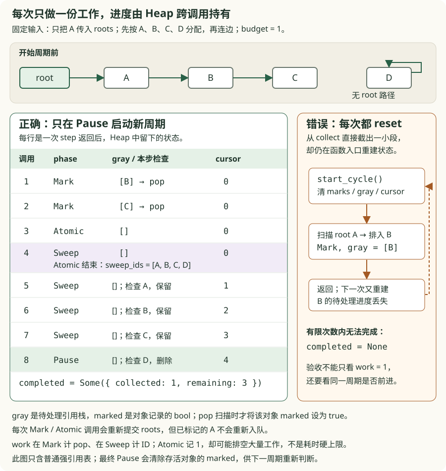
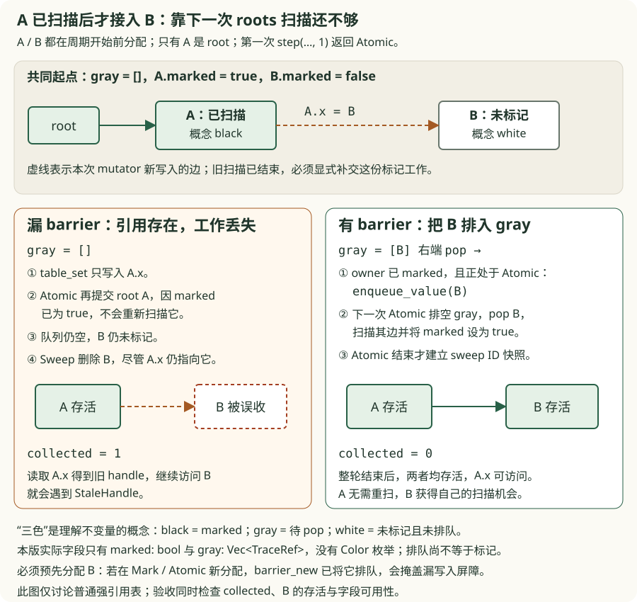
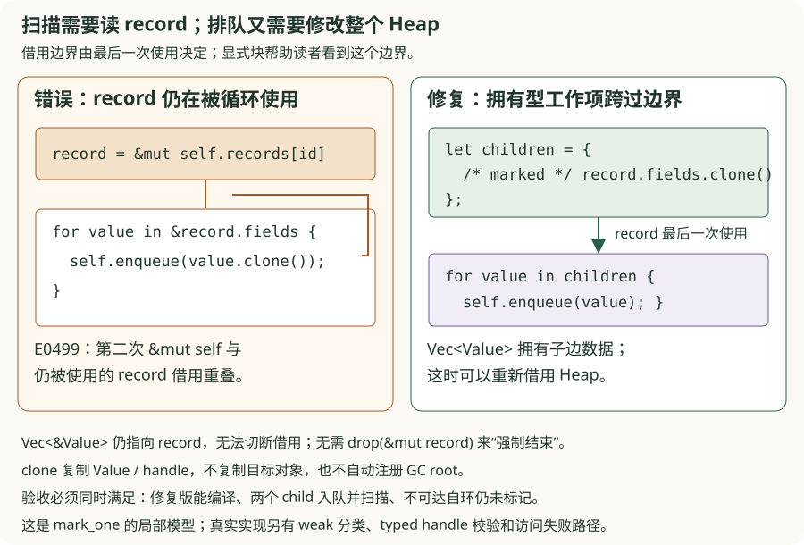
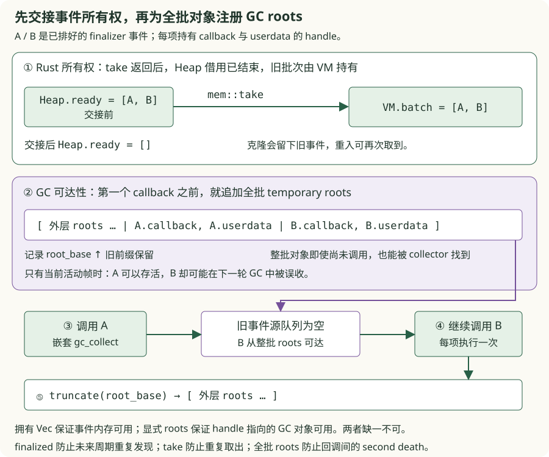
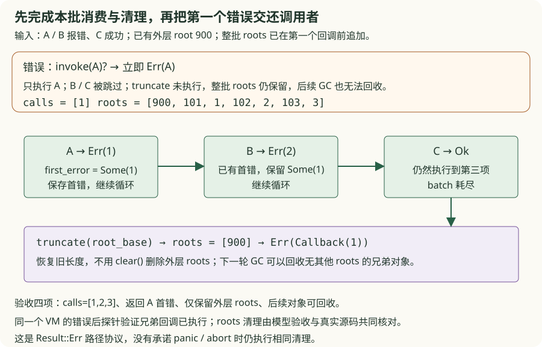
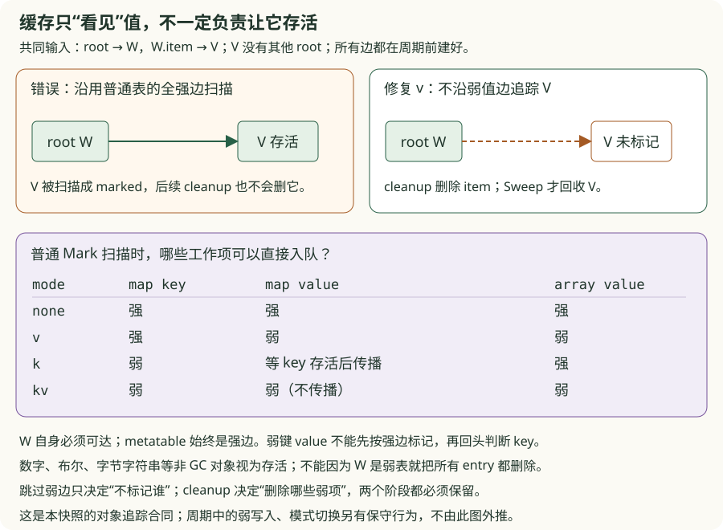
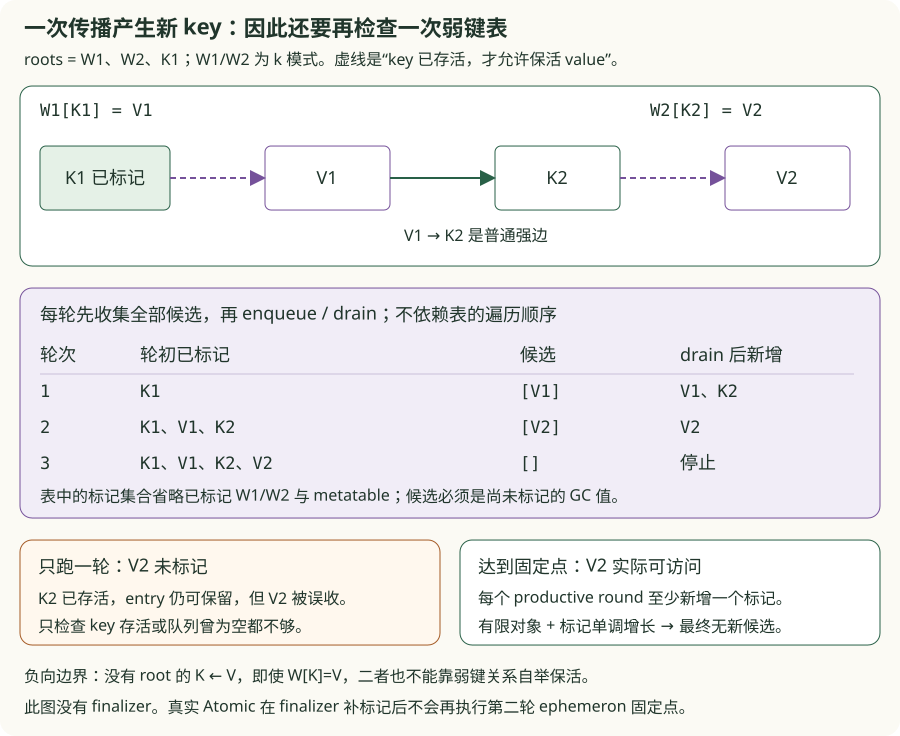
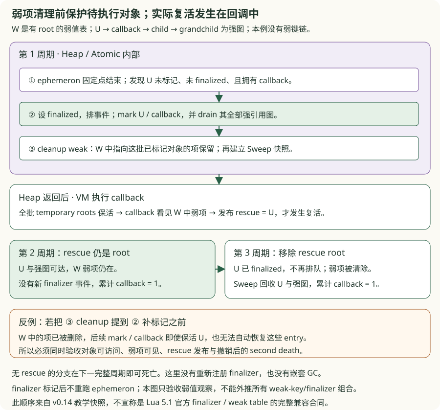

# v0.14 · 增量 GC、弱表与 Finalizer

<div class="lesson-meta"><span>增量状态 → 借用与回调 → 弱边与固定点 → 复活顺序</span><span>workspace</span><span>checkpoint v0.14</span></div>

<a id="learning-task-card"></a>
## 学习任务卡

<div class="task-card">
  <strong>把一次完整遍历拆成可暂停、可回调的状态机</strong>
  <p>前置：v0.13 的 roots/edges、mark/sweep 与 Heap owner。先解决分步、保存进度和
  写入修复，再追问：扫描时怎样结束短借用、谁拥有待执行事件、回调重入和报错时谁负责
  保活与收尾；最后处理弱表怎样分类边、ephemeron 为什么需要固定点、复活前怎样清理。
  产出是十个 TODO：强引用三题、短借用一题、回调三题、弱表/固定点两题、清理顺序一题。
  每次改动都用同一反例前后对照；自动调度保留为扩展阅读。</p>
</div>

v0.13 的一次 `collect` 要做完本轮 mark/sweep 才返回。现在让 VM 在回收步骤之间继续
执行 Lua，就会依次遇到三个问题：**怎样交还控制权，怎样记住进度，怎样修复扫描之后
新增的边**。前三问讲强引用状态机，问题四至七沿着“扫描 → 交还事件 → 调用 Lua”
追踪 Rust 借用、事件所有权、GC roots 与错误路径。问题八至十继续追问：弱边为什么
不能照常扫描，一轮条件传播为什么不够，待执行 finalizer 的补标记为何必须早于弱项清理。
各组可以独立运行，先完成前一组再读下一组。

配套代码分层验证：`exercises/model.rs` 是只含强引用的可运行小模型，用来替换
错误设计、观察确定性轨迹；真实快照仍在 `crates/` 中，另用真实 `Heap` 对照验收。
小模型不是三份历史 VM 快照，也不支持 weak/finalizer。它复用真实 core 的
`GcPhase`、`GcStep` 和 `GcStats`。`exercises/borrow/` 用 rustc 检验真实借用冲突；
`exercises/callbacks/` 从已排好的事件批次开始模拟重入，另以真实 Heap/VM 验证保活、
调用次数和错误后续执行。后者不模拟 Atomic、weak 或完整 Lua VM。

`exercises/weak/` 与 `exercises/resurrection/` 再把弱边/固定点、待执行对象的补标记/
清理顺序拆成两个独立模型。它们另有真实 Heap/VM 对照，不能把两包拼起来当成完整
collector。下面讲的是 **v0.14 教学快照的可观察合同**，没有宣称全部 Lua 5.1
弱表/finalizer 组合已经兼容；尤其要保留问题十列出的晚标记 key 边界。

<a id="learning-predict"></a>
## 先预测再运行

先画 `root → A → B → C`，旁边还有一个不可达对象 D，所有对象都在周期开始前分配。
预测下面三个输出，再运行命令：

1. 给 `step` 传预算 1，但内部直接调用完整 `collect`，第一次调用是否已经完成？
2. 每次调用重新建 gray stack、重置游标，能否最终扫到 B/C 并回收 D？
3. 另起一张只有 A/B 的图，root 只指向 A。扫描 A 后才加入 `A.x = B`，B 会不会存活？

```powershell
$gcManifest = 'book/code/v14-incremental-gc/Cargo.toml'
cargo run --quiet --manifest-path $gcManifest --example gc_problem_chain
```

CLI 在同一次运行中并列展示错误和修复后的行为；预期错误被记录为实验结果，进程正常
退出表示重放执行完毕，不表示错误设计通过。章末行为验收单独检查正确性，学习者的
三个 TODO 初始会以非零退出码失败。CLI 固定重放前后设计，不读取 starter 的修改；
完成练习后它仍会展示原反例，练习完成以 `gc_exercises -- --ignored` 为准。
所有命令都从仓库根目录运行。

<a id="learning-code-map"></a>
## 代码阅读地图

1. [小模型](https://github.com/YanqingXu/lua_rust/blob/main/book/code/v14-incremental-gc/exercises/model.rs)：先只看对象边、step 和写入；
2. [三个错误入口](https://github.com/YanqingXu/lua_rust/blob/main/book/code/v14-incremental-gc/exercises/starter.rs) 与 [参考改动](https://github.com/YanqingXu/lua_rust/blob/main/book/code/v14-incremental-gc/exercises/reference/solution.rs)：每次替换一处设计；
3. 真实 core 的 `Heap`、`GcPhase`、`GcStep`：谁拥有跨调用状态，怎样表达未完成与完成；
4. `Heap::step` 的 Pause/Mark/Atomic/Sweep 分支，再看 `collect` 怎样循环调用 step；
5. `table_set → write_barrier → enqueue_value`：集中处理新增边；
6. 运行 `budget=1`/完整回收对照与 late child 保活验收；
7. `mark_one` 的 record 借用 → 拥有型子边 → `enqueue_value`，对照短借用实验；
8. `Heap::take_finalizers → Vm::gc_step_internal → invoke_callable`：先移走事件、
   再保护全批 roots、最后调用 Lua 并收尾；
9. `mark_one` 的弱边分类 → `atomic_phase` 的条件传播 → `cleanup_weak_tables`；
10. Atomic 的 finalizer 补标记 → 弱项清理 → Heap 返回 → callback 发布 rescue root。

## 问题一：怎样在回收尚未完成时交还控制权？

### 先让旧设计暴露问题

预算为 1，但入口只是给完整回收换了个名字：

```diff
- heap.collect(roots)       // 一次做完；调用者没有机会在中途继续执行
+ heap.step(roots, budget) // 返回本步结果，下次还能继续
```

这是实验中 `split_step` 的核心替换，完整函数见 starter/reference。错误版本的第一次
调用已经回收 D；修复后第一次只扫描 A，`completed` 仍为 None。

错误入口（可以直接编译运行）：

```rust
{{#include ../../code/v14-incremental-gc/exercises/starter.rs:exercise_split}}
```

修复后的同一入口：

```rust
{{#include ../../code/v14-incremental-gc/exercises/reference/solution.rs:solution_split}}
```

```powershell
cargo run --quiet --manifest-path $gcManifest --example gc_problem_chain -- split
```

预期关键输出中，`completed` 的三个数字依次是 before/collected/remaining：

```text
before collect-as-step: phase=Pause work=8 completed=4/1/3
after one step: phase=Mark work=1 completed=none
```

这里 work=8 是小模型 `collect` 汇总的整轮工作量；真实 `Heap::collect` 返回 GcStats，
没有这个 work 汇总字段。比较的是“一次做完”与“一次交还控制权”的可观察差别。

问题不在函数名。只要内部仍循环到周期结束，就仍没有交还控制权的中间点。真实快照中，
`Heap::step` 一次只执行一个 phase 分支，而完整 `collect` 是它的驱动者：

```rust,ignore
loop {
    let step = self.step(roots, upvalue_roots, usize::MAX)?;
    if let Some(stats) = step.completed {
        return Ok(stats);
    }
}
```

这段与真实 `collect` 对应。Rust 的 `Result` 表达操作是否失败，`completed: Option<GcStats>`
表达本步成功后整个周期是否完成：`Ok + None` 是正常进度，不应被当作失败。

### 给每个返回点定义状态

| Phase | 本阶段工作 | 本次调用可能返回什么 |
|---|---|---|
| `Pause` | 显式 step 开始新周期；自动调度则先判断是否到 checkpoint | 同一次调用进入 Mark，开始处理 |
| `Mark` | 至多弹出 budget 个 gray 条目，枚举它们的边 | 仍为 Mark，或 gray 为空后变 Atomic；未完成 |
| `Atomic` | 完成一致性边界，最后生成排序的 sweep IDs | 变为 Sweep；未完成 |
| `Sweep` | 至多检查 budget 个 snapshot ID，删除其中 white 对象 | 仍为 Sweep，或回到 Pause 并返回 Some(stats) |

`GcStep.phase` 是执行后的阶段。Mark 返回 Atomic 不表示 Atomic 已经执行；Atomic
返回 Sweep 时，才刚准备好清扫快照。

**预算边界：** 本快照把 `budget=0` 归一为 1；Mark 的重复队列条目也计一次 work，
Sweep 的存活 ID 也计一次 work。启动周期的全堆重置、roots 扫描、单个大表的边遍历、
整个 Atomic 和结束时重置 marks 都可能做额外工作。因此预算是对象/条目的工作计数，
不能解释成每次最多 1 毫秒或恒定暂停时间。小模型保留这个接口含义，不提供延迟保证。

```powershell
cargo test --manifest-path $gcManifest --test pipeline explicit_gc_step_reports_completion_without_auto_step_stealing_it -- --exact
```

**完成条件：** 能区分“本次 step 返回”和“本轮 GC 完成”，指出完整驱动循环该放在哪里。
接着会遇到下一问：函数已经返回，gray stack 和游标由谁保管？

## 问题二：下一次调用怎样接着上次的位置做？

### 每次重新开始，预算越小反而越做不完

`resume_step` 的错误版本在每次调用前都重启周期。局部工作队列随调用结束而丢失，
下一次又把 A 当成未访问对象。给循环加“最多 8 次”的边界，观察它反复停在相同位置：

```powershell
cargo run --quiet --manifest-path $gcManifest --example gc_problem_chain -- progress
```

```diff
- heap.step_restarting(roots, budget) // helper 内部无条件重置周期
+ heap.step(roots, budget)            // 只有 Pause 才启动新周期
```

这两个调用来自以下可运行入口，改动无需碰模型的 mark/sweep 实现：

```rust
{{#include ../../code/v14-incremental-gc/exercises/starter.rs:exercise_resume}}
```

```rust
{{#include ../../code/v14-incremental-gc/exercises/reference/solution.rs:solution_resume}}
```

删除无条件 restart 的理由是“进度必须属于一个持续存在的 owner”。不是永远不重置，
而是只在 Pause 开始新周期时重置。真实快照将需要跨调用的局部状态移进 `Heap`：

```rust,ignore
pub struct Heap {
    // objects、heap_id 等已有字段省略
    phase: GcPhase,
    gray: Vec<TraceRef>,
    sweep_ids: Vec<u64>,
    sweep_cursor: usize,
    cycle_before: usize,
    cycle_collected: usize,
    // allocation / finalizer 等扩展字段省略
}
```

`Vec` 拥有队列，`usize` 游标记录已检查多少 ID；它们都由 Heap 保存，不需要持有上一
次函数调用的局部引用。`GcPhase` 让 `match` 明确选择本步工作，但这些字段仍需靠运行时
不变量共同维护，enum 本身不会自动排除“错误游标配上错误 phase”的全部组合。



### 在同一张图上手推八次调用

gray 是 LIFO stack，下表右端是下一次 pop；A/B/C/D 按分配顺序取 ID。

| 返回次数 | 执行后的 phase | gray | sweep cursor | 本次效果 |
|---|---|---|---|---|
| 1 | Mark | [B] | 0 | A 已扫描，返回调用者 |
| 2 | Mark | [C] | 0 | 接着扫描 B |
| 3 | Atomic | [] | 0 | C 已扫描，等待下一次执行 Atomic |
| 4 | Sweep | [] | 0 | Atomic 完成，生成 [A,B,C,D] 清扫快照 |
| 5 | Sweep | [] | 1 | 检查并保留 A |
| 6 | Sweep | [] | 2 | 检查并保留 B |
| 7 | Sweep | [] | 3 | 检查并保留 C |
| 8 | Pause | [] | 4 | 删除 D；返回 before=4、collected=1、remaining=3 |

模型与真实 Heap 使用相同的四对象图作对照。真实 `Heap::step` 的 Mark/Atomic 会
重新播种当前 roots，但只 enqueue 尚未扫描的 root；Sweep 不重扫 roots。若把已扫描的
A 反复压回 LIFO 顶部，预算 1 也会被重复工作耗尽。跨调用保存队列与正确播种根两件事
都要满足。

CLI 的错误分支只打印前 3 次重复状态，独立验收会检查完整的 8 次上界。修复分支的
末行应为 `after call=8: phase=Pause work=1 completed=4/1/3`。Pause 中保留的对象已
清掉 mark，诊断输出会重新显示 white；这表示准备下一周期，不表示本轮误删了存活对象。

```powershell
cargo run --quiet --manifest-path $gcManifest --example gc_problem_chain -- real
cargo test --manifest-path $gcManifest -p lua_core tests::incremental_and_full_collection_reach_the_same_result -- --exact
```

**完成条件：** 修复版在有界调用次数内完成；与完整回收得到相同统计，而且 A/B/C
实际可访问、D 实际被删除。只比较一个完成布尔值不够，也不能用无限 while 掩盖无进展。
一旦 VM 能在这些返回点继续执行，第三个问题就出现了：对象边会在两步之间改变。

## 问题三：已经扫描的 parent 又指向白对象，怎样修复？

### 固定“先扫描，再写入”的交错顺序

另建一张只有 A/B 的图，root 只指向 A，B 在周期开始前已经分配。第一次 step 扫描 A
并返回 Atomic，此时 A 已扫描、B 未扫描。然后才写入 `A.x = B`。

```powershell
cargo run --quiet --manifest-path $gcManifest --example gc_problem_chain -- barrier
```

遗漏 barrier 的版本只更新容器。Atomic 重扫 root A 时发现 A 已扫描，便不重新遍历
它的字段；B 没有进入待处理队列，Sweep 随后删除 B。对象图里留下指向已回收 B 的边。

```diff
- heap.set_edge_without_barrier(parent, child);
+ heap.set_edge(parent, child);
```

完整的前后入口分别是：

```rust
{{#include ../../code/v14-incremental-gc/exercises/starter.rs:exercise_barrier}}
```

```rust
{{#include ../../code/v14-incremental-gc/exercises/reference/solution.rs:solution_barrier}}
```

以上是小模型中 `connect` 的替换；真实 `Heap::table_set` 在写入前校验 key/value，
分别调用 `write_barrier`，随后修改 table。核心判断是：owner 已扫描，且 phase 仍为
Mark/Atomic，就把尚未扫描的 child 放入 gray。B 在本例的 Atomic 内被扫描，然后才能
建立 Sweep 快照。

```text
before raw-write: phase=Pause work=3 completed=2/1/1
before raw-write child_live=false
after barrier: phase=Pause work=3 completed=2/0/2
after barrier child_live=true
```

`table_get(parent, key)` 返回一个 handle 本身不能证明 child 存活；真实 Heap 验收还要
用 `is_live(child)` 或实际访问 child 检查。模型中 `child_live=false` 明确指出误回收，
它不会伪装成真实 Heap 返回的 `StaleHandle` 错误类型。



```rust
{{#include ../../code/v14-incremental-gc/crates/lua_core/src/lib.rs:write_barrier}}
```

图中的 white/gray/black 是教学上的三种角色。真实对象只有 `marked: bool`，并用
`gray: Vec<TraceRef>` 记录待处理工作：`mark_one` 在 pop 后才设置 marked。B 入 gray
时并没有变成一个名为 Gray 的 Rust enum variant。用“加入待处理队列”解释操作，才能
把图与源码对应起来。

本例选择周期前已分配的 B，是为了确保测到写入 barrier。Mark/Atomic 中**新分配**
对象会经过 `barrier_new`，可能掩盖遗漏写入 barrier 的故障；Sweep 中的新对象则标记
为存活，且不属于 **Atomic 结束时** 已建立的 sweep snapshot。

```powershell
cargo test --manifest-path $gcManifest -p lua_core tests::write_barrier_keeps_a_white_child_added_to_a_marked_table -- --exact
```

**完成条件：** 同一交错顺序下，错误版让 B 不可访问，修复版保留 B；根集合中始终
只有 A，不能把 B 偷偷添加为直接 root 来通过测试。说明这条补丁修复的是新增引用的
追踪，不是增加一次分配，也不是每步重新扫描所有已标记对象。

## 三个问题怎样映射到真实快照？

| 小模型中的改动 | 真实 Rust 实现 | 保持的不变量 |
|---|---|---|
| 完整 collect 驱动与 step 分开 | `Heap::collect` 循环调用 `Heap::step` | 成功返回可未完成，只有 Some(stats) 表示周期结束 |
| 只在新周期重置，保存队列和游标 | `Heap` 字段与 `start_cycle`，由 `GcPhase` 决定调用时机 | 每步从上次进度继续，不丢工作、不无限重启 |
| 集中写入并 enqueue 新 child | `table_set → write_barrier → enqueue_value` | Mark/Atomic 中已扫描 owner 的新引用不会漏扫 |

[完整 core 源码](https://github.com/YanqingXu/lua_rust/blob/main/book/code/v14-incremental-gc/crates/lua_core/src/lib.rs)
还覆盖 table key、metatable、upvalue、userdata 等 mutation family。三个练习只证明
上面的强引用案例；不能把模型验收外推为全部写入路径、weak table 或 finalizer 已验收。

## 问题四：借着 record，为什么不能继续修改 Heap？

### 编译通过前，先让编译器指出冲突

扫描 parent 时，我们已借用 `self.records[id]`，却还要调用需要 `&mut self` 的
`enqueue`。先预测：把以下循环写进 `mark_one`，rustc 会接受吗？

```rust,ignore
{{#include ../../code/v14-incremental-gc/exercises/borrow/before.rs:long_borrow_before}}
```

循环每轮还要读取 `record.fields`，由 Heap 派生的可变借用仍在使用；调用整个 Heap 的
可变方法就与之重叠。这里应观察到 **E0499**，不是 GC 运行时报错。反例作为独立
rustc 输入保存，不是 Cargo 自动编译的 target；下面两项默认验收分别检查编译失败
的错误码，以及修复后的编译和运行结果。

```powershell
cargo test --manifest-path $gcManifest --test gc_borrow_reference -- --nocapture
```

这条命令通过表示“错误版确实被拒绝，修复版行为正确”。如果把第二次调用改成只修改
互不相交的字段，编译器有时能拆分字段借用；本例的冲突来自 `enqueue(&mut self, …)`
借用整个 Heap，不能概括成“借过一个字段就不能改其他任何字段”。

### 先拥有待处理子边，再结束 record 借用

我们需要离开 record 后仍能使用子边，所以应提取 `Vec<Value>`，而非仍指回 record
的 `Vec<&Value>`。最小差异是把读取与队列修改分开：

```diff
- for value in &record.fields { self.enqueue(value.clone()); }
+ let children = { /* 借用 record、设置 marked */ record.fields.clone() };
+ for value in children { self.enqueue(value); }
```

可编译的完整方法如下：

```rust
{{#include ../../code/v14-incremental-gc/exercises/borrow/solution.rs:short_borrow_solution}}
```

Rust 的 NLL（非词法生命周期）在最后一次使用后结束借用；显式块使边界容易看见，
不需要 `drop(&mut record)`。`clone` 复制 Value 和 handle，不复制目标 GC 对象，也
不自动把对象加入 roots。此时只解决了“工作项离开借用后还可使用”，保活还要由后续
入队、扫描和真实 GC roots 完成。



验收要求 parent 扫描后 `gray=[1, 2]`，继续排空后 parent 与两个 child 都 marked，
不可达自环仍未标记。删掉循环虽然可能消除 E0499，却不能通过行为验收。

真实 `Heap::mark_one` 将 table 条目、closure/upvalue 或 userdata 的待追踪值提取成
本地 `values` / `references`，在 record 最后一次使用后执行 `self.gray.extend` 与
`self.enqueue_value`。它还处理 weak 分类和访问错误；四对象借用模型没有这些合同。

**完成条件：** 只改 `borrow/starter.rs::mark_one`，让显式学习者测试从 E0499 失败变为
编译且行为通过。随后考虑：GC 扫描结束，要把 finalizer 交给能再次调用 GC 的 Lua，
还可以借着 Heap 内部队列遍历吗？

## 问题五：事件交给 VM 后，为什么必须从 Heap 队列移走？

### 拥有一份 clone，原队列仍然在那里

本节从已发现的两个 finalizer 事件 A/B 开始。事件只包含 userdata/callback 的 handle。
先预测：VM 克隆事件 Vec，再执行 A；A 重入回收并再次取队列，是否还会取到 A/B？

```powershell
cargo run --quiet --manifest-path $gcManifest --example finalizer_problem_chain -- ownership
```

错误版只允许**总共一次重入**，因此不会无限递归；仍会得到 `calls=[1, 1, 2, 2]`，
且源队列 `pending=2`。错误来自重复取到同一批事件，不能靠增加递归上限来修复。

```rust
{{#include ../../code/v14-incremental-gc/exercises/callbacks/starter.rs:callback_take_starter}}
```

只替换事件交接这一处：

```diff
- pending.clone()
+ std::mem::take(pending)
```

```rust
{{#include ../../code/v14-incremental-gc/exercises/callbacks/solution.rs:callback_take_solution}}
```

`mem::take` 移走旧 Vec，并在原位置留下空 Vec；返回值拥有整批事件，函数返回后对
Heap 的借用已经结束。执行 A 时重入只会看到空的源队列，于是本例变为 `calls=[1, 2]`、
`pending=0`。真实 `Heap::take_finalizers` 使用相同操作，VM 随后才调用需要
`&mut self` 的 `invoke_callable`。

Atomic 在发现事件时先设 `finalized=true`，防止以后周期再次**发现**同一 userdata；
移走 ready 队列防止当前事件再次被**取出**。两处解决不同的问题，不能互相替代。

```powershell
cargo test --manifest-path $gcManifest --test gc_callbacks_reference transferred_batch_is_invisible_to_reentry -- --exact
```

**完成条件：** 源队列在第一个 callback 前已经为空，重入不会重复执行当前批次。
但这份拥有型 Vec 里只有 GC handle；下一问仍然必须回答它们在嵌套 GC 中怎样存活。

## 问题六：拥有事件 Vec，为什么仍会误收尚未执行的兄弟事件？

### 当前调用帧只能保护当前事件

沿用 A/B，改回正确的 `take`，只移除“全批临时 roots”。A 正在执行时，其活动帧能
保护 A 的 callback/参数；B 还没有调用帧。A 发起下一轮 GC，collector 不会自动扫描
Rust 栈中所有 Vec，B 的 userdata 与 callback 便可能消失。

```powershell
cargo run --quiet --manifest-path $gcManifest --example finalizer_problem_chain -- roots
```

错误版得到 `calls=[1]` 和 `Err(Stale(2))`；它仍拥有 B 的事件，却不能继续访问 B。
这是独立模型的错误类型，不是伪造真实 Heap 的诊断。修复必须在**第一个回调之前**
保护整批事件：

```rust
{{#include ../../code/v14-incremental-gc/exercises/callbacks/starter.rs:callback_pin_starter}}
```

```diff
- // 只依赖当前 invoke 的活动帧；没有保护尚未调用的事件
+ for event in events {
+     roots.push(event.callback);
+     roots.push(event.userdata);
+ }
```

```rust
{{#include ../../code/v14-incremental-gc/exercises/callbacks/solution.rs:callback_pin_solution}}
```

真实 VM 的 `gc_roots` 包含 `temporary_roots`。`gc_step_internal` 先记录旧长度
`root_base`，再把整批 callback 和 userdata 的 Value 都推入，最后才逐个调用。图中
“Rust 事件所有权”和“collector 的可达根”是两个维度：



### 用真实访问证明保活

```powershell
cargo test --manifest-path $gcManifest --test gc_callbacks_reference real_heap_owned_vec_requires_explicit_roots -- --exact
cargo test --manifest-path $gcManifest --test gc_callbacks_reference real_vm_reentrant_finalizer_keeps_sibling_alive_and_runs_once -- --exact
```

第一项保留真实 `Heap::take_finalizers` 返回的 Vec，再启动完整下一周期。仅 root 当前
事件时，B 的 `userdata_is_finalized` 与 `function_proto` 都访问失败；root 全批时两者
都成功。检查 object ID 只能证明 handle 中还有数字，不能证明对象仍存在。

第二项运行以下真实 VM 输入（Rust 包装只负责 compile/execute）：

```rust
{{#include ../../code/v14-incremental-gc/exercises/callbacks/real.rs:callback_real_pair}}
```

A 内调用两次 `gc_collect`，避免一次只完成外层剩余 Sweep 而没有真正进入下轮的
假阳性。B 的 callback 仍能调用，并用 `setfinalizer(value, nil)` 实际访问 userdata；
最后序列必须为 **123**，从而同时证明 A 重入返回后继续执行、B 存活且每项只调用一次。
这是同步重入，没有涉及线程或 async。

**完成条件：** 小模型从 stale 变为 `calls=[1, 2]` / `Ok(())`，真实 Heap 的两个对象
访问都成功，真实 VM 得到 123。下一问是：已保活整批事件，如果 A 报错，B 和临时
roots 又由谁收尾？

## 问题七：第一个 callback 报错，为什么不能立即用 `?` 返回？

### 提前传播错误会同时跳过事件与清理

先预测 A、B、C 三个事件，A/B 都报错，C 成功。外层已有一个 root 900，drain 前
追加全批 roots。下面的 `?` 会使调用序列、最后的 roots 分别变成什么？

```rust
{{#include ../../code/v14-incremental-gc/exercises/callbacks/starter.rs:callback_drain_starter}}
```

```powershell
cargo run --quiet --manifest-path $gcManifest --example finalizer_problem_chain -- errors
```

错误版只得到 `calls=[1]`，返回 `Callback(1)`，全批 roots 还留在 Vec 中。下一次 GC
仍保留本应可回收的兄弟对象；只检查“返回了错误”会漏掉这两处副作用。

```diff
- vm.invoke(event)?;
+ if let Err(error) = vm.invoke(event) {
+     if first_error.is_none() { first_error = Some(error); }
+ }
  // 遍历完剩余事件后
  vm.truncate_roots(root_base);
- Ok(())
+ first_error.map_or(Ok(()), Err)
```

完整修复如下，重点是先保存长度、继续 drain、恢复长度，再返回首错：

```rust
{{#include ../../code/v14-incremental-gc/exercises/callbacks/solution.rs:callback_drain_solution}}
```



修复后必须得到 `calls=[1, 2, 3]`，仍返回 `Callback(1)`，roots 精确恢复为 `[900]`。
这里不能 `clear()`，否则会删除外层调用的 roots；也不能用 B 的错误覆盖 A。后续 GC
可以回收无其他 roots 的兄弟对象，说明清理没有泄漏。

```powershell
cargo test --manifest-path $gcManifest --test gc_callbacks_reference callback_error_drains_and_restores_roots -- --exact
cargo test --manifest-path $gcManifest --test gc_callbacks_reference real_vm_callback_error_still_executes_the_sibling -- --exact
```

真实 VM 对照中，A 触发 Type 错误，但 B 仍设置 `sibling_after_error=true`；随后在
**同一个 VM** 执行探针读取该值。真实实现也在 `gc_step_internal` 中保存首错并清理
temporary roots；但重新 `execute` 本身会清空临时 roots，所以该探针只证明错误类型
和兄弟回调已执行，精确清理由模型合同与真实源码中的 `truncate(root_base)` 核对。
这一协议处理这里的 `Result::Err` 路径，没有承诺 panic/abort 时也
执行相同清理；callback 还可能推进 GC，因此外层先前捕获的 step 结果不代表回调后的
即时 phase。

**完成条件：** 调用次数、首错、外层 roots 保留、后续对象可回收四项一起成立。
这些实验验证事件消费协议；下面再用独立反例验证 weak/ephemeron 与 resurrection。

## 问题八：缓存里只剩一个弱引用，为什么对象仍然回收不了？

### 给表加了模式，扫描算法却仍把所有边当成强边

先预测下面的 Lua 返回什么。这里的 `cache` 与 metatable 有长期 root，临时表没有
其他 root；所有对象和边都在 GC 开始之前建好：

```lua
local cache = setmetatable({}, { __mode = "v" })
do cache.item = {} end
gc_collect()
return cache.item == nil
```

如果仅保存 `weak_values=true`，仍按普通表扫描全部值，临时表就被标记成可达，
cleanup 也找不到该删除的弱项。实验固定同一张图，分别使用“全部强追踪”和模式分类：

```powershell
cargo run --quiet --manifest-path $gcManifest --example weak_problem_chain -- weak
```

分类前的入口可编译运行：

```rust
{{#include ../../code/v14-incremental-gc/exercises/weak/starter.rs:weak_edges_starter}}
```

修复只改变“哪些值作为普通强边入队”，先不改对象存储或 cleanup：

```rust
{{#include ../../code/v14-incremental-gc/exercises/weak/solution.rs:weak_edges_solution}}
```

```diff
- let mut edges = table.array.clone();
+ let mut edges = Vec::new();
+ if !table.mode.weak_values() { edges.extend(table.array.iter().copied()); }
  for &(key, value) in &table.map {
-     edges.extend([key, value]);
+     if !table.mode.weak_keys() { edges.push(key); }
+     if !table.mode.weak_keys() && !table.mode.weak_values() { edges.push(value); }
  }
```

前后差异可以逐类核对：

| mode | 普通 Mark 的 map key | 普通 Mark 的 map value | array value |
|---|---|---|---|
| 无弱模式 | 强追踪 | 强追踪 | 强追踪 |
| `v` | 强追踪 | 不追踪 | 不追踪 |
| `k` | 不追踪 | 延迟到 key 已存活时传播 | 强追踪 |
| `kv` | 不追踪 | 不追踪，不做 ephemeron 传播 | 不追踪 |

metatable 在所有模式下都是强边。数组索引是数字，不是 GC 对象，所以 `k` 不会让
array value 变弱。表中数字、布尔、字节字符串等没有 arena object ID 的 key/value
视为存活，弱表不会让它们凭空消失。weak table **自身也必须可达**才谈得上向外追踪。



### 跳过弱边之后，还要删掉死亡弱项

“不沿弱边标记”并不等于“已经删除 entry”。真实 `cleanup_weak_tables` 先从 Heap 的
标记位提取拥有型 `HashSet<object_id>`，结束这次读取，再借用各表修改其内容。map 的
`retain` 要同时满足所有启用的弱条件；array 中死亡弱值改成 nil，再收缩尾部。

```text
保留 map entry = (!weak_keys || key 存活) && (!weak_values || value 存活)
```

小模型的 cleanup 是已给出的公共步骤，TODO 只修边分类。验收同时检查弱槽被清除、
目标对象实际不可访问，以及仍有外部 root 的对象和 primitive entry 继续存活。
只检查总对象数不足以区分“清理了错误的值”和“清理了正确的弱项”。

真实 `table_set_metatable` 读取 `__mode`，`table_set` 更新 `__mode` 时刷新所有依赖
表的缓存 flags。本包额外验证**完整周期之间**切换模式，并同时检查共享 metatable
的两张表。周期中 weak→strong 只改 flags，不重新扫描已标记表；弱写入 barrier 也
可能保守地让新增弱值多活一轮。因此本节的组图与模式切换都固定在 Pause，不能外推
为“任意时刻修改模式都立即补扫”。

**完成条件：** `v/k/kv`、array、metatable、primitive 的分类分别成立；错误强扫描
确实保留了本应回收的弱目标。接着追问 `k` 模式延迟的 value：只等一次 key 就够了吗？

```powershell
cargo test --manifest-path $gcManifest --test gc_weak_reference weak_edges_follow_table_mode -- --exact
```

## 问题九：key 已经存活，为什么它对应的 value 还会被误收？

### 第一轮传播才产生第二张表需要的 key

准备两张有 root 的 `k` 表 W1/W2，只有 K1 是直接 root：

```text
W1[K1] = V1       V1 --强边--> K2       W2[K2] = V2
roots = [W1, W2, K1]
```

普通 Mark 不沿弱 key，也不直接沿这些 map value。第一次条件传播发现 K1 已标记，
才能排入 V1；排空 V1 的强边后 K2 才被标记。此时 W2 的条件刚刚成立，必须重新检查。
先预测“只传播一轮”的版本是否会保留 V2，再运行：

```powershell
cargo run --quiet --manifest-path $gcManifest --example weak_problem_chain -- ephemeron
```

错误入口与修复入口如下；唯一新增的设计是重复“收集候选 → 入队 → 排空强边”，
直到没有新候选，而不是人为把轮数写死为二：

```rust
{{#include ../../code/v14-incremental-gc/exercises/weak/starter.rs:ephemeron_starter}}
```

```rust
{{#include ../../code/v14-incremental-gc/exercises/weak/solution.rs:ephemeron_solution}}
```

```diff
+ loop {
      let candidates = heap.candidates();
      heap.record_round(&candidates);
+     if candidates.is_empty() { break; }
      for value in candidates { heap.enqueue(value); }
      heap.drain(classify);
+ }
```

真实 Atomic 每轮先只读收集 `Vec<Value>`，结束对 Heap 对象的遍历后再 enqueue 并
排空 gray；候选为空则直接结束这段固定点循环，不会在循环入口无条件 drain 已有 gray。
这也使用了问题四的短借用边界。因为本轮候选先统一收集，第一轮不会因
HashMap 恰好按 W1/W2 顺序遍历而提前得到 V2，反例不依赖随机迭代顺序。



### 停止条件为什么是“没有新候选”？

候选只来自**已标记的 k 且非 v 表**，要求 key 已存活、value 是尚未标记的 GC
对象。每个有工作的轮次至少新增一个标记；对象集合有限且本例无分配，标记只增不减，
所以最终必然停止。primitive value 已视为存活，不能反复把它作为“新工作”加入。
真正的固定点还要求把候选的强边排空，不能只把候选 push 进队列就认为传播结束。

只跑一轮时，K2 已标记，weak-key cleanup 可能保留 `W2[K2]`，但 V2 未标记，随后
被 Sweep 回收。得到一个 handle 仍不能证明成功；参考验收要求 V2 的实际访问成功。
反过来，没有外部 root 的 `W[K]=V、V→K` 不能靠二者相互支撑而自举存活；如果一开始
就把 V 当强边扫描，恰好会错误地制造这条“活 key”。

本节不含 finalizer。真实 `atomic_phase` 在 finalizer 补标记之后不会再执行第二遍
ephemeron 固定点，因此不能从这个两表链外推到任意晚标 key 和 finalizer 混合图。

**完成条件：** V2 可访问，移除 K1 root 后链上对象可回收，无根环也可回收；改变表
遍历顺序不改变结果。修复不能靠把 K2/V2 加成直接 roots，或只增大固定循环上限。

```powershell
cargo test --manifest-path $gcManifest --test gc_weak_reference ephemerons_reach_a_fixed_point_without_bootstrapping_cycles -- --exact
cargo test --manifest-path $gcManifest --test gc_weak_reference real_heap_cross_table_ephemerons_reach_a_fixed_point_then_release -- --exact
```

## 问题十：对象还要交给 finalizer，为什么弱项已经消失了？

### 先清理，再补标记，无法恢复已经删除的 entry

沿用问题五至七的事件协议，再增加一张有 root 的弱值表 W，观察以下强图：

```text
U → callback → child → grandchild
W 的四个弱值槽分别指向上述四个对象；它们没有其他 root。
```

U 已注册 finalizer、尚未 finalized。先预测：若 Atomic 在保护待执行对象之前就清理
W，随后 U 与整张强图仍能保活，W 中的弱项会自动恢复吗？

```powershell
cargo run --quiet --manifest-path $gcManifest --example resurrection_problem_chain -- order
```

错误和修复只交换两个步骤，均从同一输入开始：

```rust
{{#include ../../code/v14-incremental-gc/exercises/resurrection/starter.rs:resurrection_order_starter}}
```

```rust
{{#include ../../code/v14-incremental-gc/exercises/resurrection/solution.rs:resurrection_order_solution}}
```

```diff
- heap.cleanup_weak();
  heap.mark_pending_graph();
+ heap.cleanup_weak();
```

错误版会出现“对象当轮仍存活，但弱项已丢失”。所以统计 live 数量或只验证 callback
被执行都不能发现问题。正确版要把 pending userdata/callback 的**整个强引用图**
drain 完成，再根据最终标记清弱项，最后才准备 Sweep snapshot。



### 把“本轮保护”和“回调复活”分成两个时间点

真实快照按以下次序推进，不能把第 4 步搬进 Heap 的 Atomic 借用中：

1. Atomic 先执行问题九的 ephemeron 固定点；
2. 找到未标记、未 finalized、拥有 callback 的 userdata，设置 finalized 并排事件；
3. 标记 userdata/callback，排空其强图；清弱项，建立 Sweep snapshot，Heap 返回；
4. VM 移走整批事件并注册 temporary roots，然后执行 callback；此时才可能发布
   `rescued = value` 之类的长期 root。

本轮 pending 保护只是让对象有机会被调用，不代表它已被 Lua 发布复活；在 callback
里写入长期 root 才是本例的 resurrection。没有 rescue 的分支在下一完整周期即可
second death；有 rescue 的分支则要等撤销该 root 后才死亡。

| 完整周期 | 长期 roots 中的 U | 事件数 / 累计调用数 | 弱项与对象 |
|---|---|---|---|
| 1 | 开始时没有；callback 发布 rescue | 1 / 1 | 补标记保护强图，四弱项可见，callback 能使用对象 |
| 2 | rescue 仍存在 | 0 / 1 | 沿 root 标记 U 与强图，弱项继续保留 |
| 3 | 已撤销 rescue | 0 / 1 | finalized 阻止再次发现，弱项清除，强图实际不可访问 |

这里没有重新注册 finalizer。真实 `userdata_set_finalizer` 会重置 finalized，不能
在验证“只调用一次”时顺手用它探测存活。真实 Heap 对照用 `userdata_is_finalized`、
`function_proto`、upvalue 和 table 访问；最后要求对象不可访问与四个弱槽精确返回
`Ok(Nil)` 同时出现，不能把弱表容器失活的 Err 当成清槽成功。真实 Heap 不运行
Lua callback，而是用显式 root 模拟宿主发布/撤销 rescue；真实 VM 另在**同一实例的
三次 execute** 中验收 callback 看见弱项、发布的 rescue 可用、撤根后清理，每段只
返回布尔值。

```powershell
cargo run --quiet --manifest-path $gcManifest --example resurrection_problem_chain -- real
cargo test --manifest-path $gcManifest --test gc_resurrection_reference
```

可以先阅读真实 VM 第一段的输入，观察 callback 内何时读取弱项、何时发布 rescue：

```rust
{{#include ../../code/v14-incremental-gc/exercises/resurrection/real.rs:resurrection_real_vm}}
```

跨周期观察应结束临时值的作用域或执行帧。若把 `observed = weak[...]` 一直留在活动
寄存器中，它自己也会成为 root。本实验分三次 execute，使前一次观察帧结束，再进入
下一周期；真实 Heap 的精确 roots 对照则直接移除 rescue，用它判定 second death。

### 这组实验还没有证明什么？

本例只用弱值槽，不混入晚标记的 weak key。真实 Atomic 在第 3 步补标记后**不重新
执行 ephemeron 固定点**；若 `U→callback→K` 此时才使 K 存活，`W[K]=V` 的 V 不一定
得到条件传播。本章保留该快照边界，不把弱值三周期验收写成所有混合图已正确。
Object ID 升序只让本快照的事件次序可重复，也不是对官方 finalizer 顺序的兼容承诺。

**完成条件：** 同时观察弱项、U/callback/强子图访问、rescue 的发布与撤销、累计一次
finalizer 和后续回收；不要把本轮 pending 保护、Rust 事件 Vec 或临时观察值当成永久 root。

```powershell
cargo test --manifest-path $gcManifest --test gc_resurrection_reference pending_graph_is_marked_before_weak_cleanup -- --exact
cargo test --manifest-path $gcManifest --test gc_resurrection_reference real_heap_keeps_the_pending_graph_then_rescues_and_releases_it -- --exact
cargo test --manifest-path $gcManifest --test gc_resurrection_reference real_vm_callback_sees_weak_entries_and_rescue_lasts_until_released -- --exact
```

## 扩展阅读：Allocation accounting 与自动 checkpoint

Heap 为每次 Table、Closure、Upvalue、Userdata 分配累计 debt。达到阈值，或一个周期已经处于活动 phase，VM 会在每条指令完成并写回寄存器后推进少量工作。checkpoint 选在写回之后，避免刚创建但尚未进入 root 的对象被误回收。

`with_gc_allocation_threshold(1)` 的压力测试在 100 次循环分配中让每个安全点推进 GC，同时验证寄存器、循环清理和 barrier 不产生 stale handle。周期完成后 debt 归零；v1.0 保留教学用对象计数合同，并在 `LUA51-D010` 中显式登记与官方字节计账/调参接口的差异。

## Rust 知识映射与设计选择

- `GcPhase` enum 把 collector 控制流变成显式、可测试状态机；
- 持久化 gray/sweep cursor 让一次函数调用不再等于一个完整周期；
- `allocation_threshold` 与 saturating debt 表达自动调度策略；
- write barrier 集中在唯一 owner 的 mutation API，减少漏点；
- `HashSet<object_id>` 是 Atomic 弱引用清理时的稳定 mark snapshot；
- 先收集拥有型候选 Vec、再可变传播，沿用短借用；`retain` 负责依据快照删除弱项；
- 有限对象和单调标记为固定点循环提供终止理由；测试还验证更长的传播链；
- finalizer event 先脱离 Heap 借用再回调 VM，允许安全重入；
- “记录第一个错误、继续 drain”让失败恢复成为显式协议。

替代方案是 incremental update barrier：把 black parent 重新染 gray，而本版采用 insertion barrier 直接标记新 child。两者都能维护三色不变量；直接 child barrier 更适合当前无并发、不可移动 arena。Atomic 也可以按预算细分，但 weak/finalizer 固定点作为不可暂停边界更容易先证明正确。

## 从 v0.13 迁移了什么

- 重构：一次性 `mark_from + retain` 变为四阶段状态机；
- 新增：gray stack、sweep cursor、周期统计与单步预算；
- 新增：所有 Heap 写入路径的 barrier 与新分配着色规则；
- 新增：allocation accounting、自动 VM checkpoint 和阈值压力测试；
- 新增：`__mode` weak key/value、ephemeron 固定点和 Atomic 清理；
- 新增：最小 Userdata、finalizer 队列、resurrection、second death、重入和失败恢复；
- 保留：v0.13 typed handle、foreign/stale 校验、roots 与确定性 shutdown；
- 没有提前加入：coroutine、标准库适配器或正式 userdata/debug API。

## 运行与验收

```powershell
cargo run --manifest-path book/code/v14-incremental-gc/Cargo.toml -- `
  book/code/v14-incremental-gc/examples/demo.lua
cargo test --manifest-path book/code/v14-incremental-gc/Cargo.toml --workspace
```

示例用 `gc_step(1)` 完成一个增量周期，清掉 weak value、运行并 resurrect userdata，随后解除 root 验证 second death：

```text
type=number value=714
```

基础快照的 84 项测试仍保留：59 个端到端测试、7 个编译器测试、15 个 core 测试和
3 个 VM 测试。强引用参考 8 项、短借用参考 2 项、回调参考 9 项；本次弱表/固定点
新增 10 项、resurrection 顺序新增 6 项参考验收，默认 workspace 合计 **119 项通过、
10 项学习者 TODO 显式 ignored**。默认通过说明反例检测、参考合同与原有回归通过，
不表示十个 TODO 已完成。

## 本版本暂不支持

- Atomic 仍是 stop-the-world 固定点，不按预算拆分；
- debt 按对象数而非真实 allocator bytes 统计；
- userdata 只有身份和 finalizer，没有 payload、完整 metatable 或宿主资源析构器；
- 教学 helper 不是 Lua 5.1 `collectgarbage` / debug / userdata 公共 API；
- 没有 coroutine，尚未证明 collector 与 yield/resume 的 owner turn；
- 没有标准库、Lua 模块或 CLI 工具完善。

<a id="learning-exercises"></a>
## 章末练习

<div class="exercise understanding">
  <strong>理解题</strong>
  <p>预测预算 1 的首次调用是否完成、A/B/C/D 仍有哪些存活；修复 starter.rs 的
  <code>split_step</code>，让首次调用只做一步。解释为什么把函数改名为 step
  不会自动产生交还控制权的中间点。</p>
</div>

<div class="exercise implementation">
  <strong>实现题</strong>
  <p>修复 <code>resume_step</code>，让同一个 Heap 在至多 8 次 budget=1 调用中完成
  A→B→C、D 自环的周期。打印每次阶段、队列与游标，并与 full collect 对照；
  不要增大预算或循环上界来隐藏重启错误。</p>
</div>

<div class="exercise debugging">
  <strong>调试题</strong>
  <p>修复 <code>connect</code>，让已扫描 A 在两步之间新接入的 B 存活。保持唯一 root
  为 A、保持 B 在周期前分配；比较遗漏 barrier 与正确写入的结果，再验证解除所有 roots
  后两者都能被回收。</p>
</div>

### 修改范围、运行命令和成功条件

只修改 [starter.rs](https://github.com/YanqingXu/lua_rust/blob/main/book/code/v14-incremental-gc/exercises/starter.rs)
的三个 TODO。[实验说明](https://github.com/YanqingXu/lua_rust/blob/main/book/code/v14-incremental-gc/exercises/README.md)
提供逐步提示与运行输出；[共享合同](https://github.com/YanqingXu/lua_rust/blob/main/book/code/v14-incremental-gc/exercises/contracts.rs)
固定验收条件。不要修改合同断言，也不要更改真实 GC 来配合错误输出。

```powershell
# 初始 3 项失败；修复三个 TODO 后应有 3 项通过。
cargo test --manifest-path $gcManifest --test gc_exercises -- --ignored

# 可选参考解、故障有效性与真实 Heap 对照。
cargo test --manifest-path $gcManifest --test gc_reference
```

| 验收名 | 初始反例 | 修复后必须观察到 |
|---|---|---|
| `first_step_yields_before_collection_finishes` | 首次就完成，work 超过 1，D 已回收 | Mark/work=1/completed=None，A 已扫描，D 仍存在 |
| `saved_progress_finishes_the_same_cycle` | 每次重启后停在相同 Mark，8 次仍未完成 | 经 Atomic/Sweep 完成；统计 4/1/3，A/B/C 存活、D 消失 |
| `barrier_preserves_a_late_white_child` | A 新引用的 B 没有入队，被 sweep | B 存活；随后移除所有 roots，A/B 都能回收 |

每个验收可以独立执行，例如：

```powershell
cargo test --manifest-path $gcManifest --test gc_exercises saved_progress_finishes_the_same_cycle -- --ignored --exact
```

starter 中的错误设计能编译，因此用 ignored 将它们与默认回归分开；显式启用时必须
看到失败，不能把“0 failed、3 ignored”作为练习完成证据。参考 target 也专门检查这三种
故障确实发生，并另测真实 Heap 的相同四对象轨迹和真实 table 写入保活。

模型不进行周期中分配，不提供 Lua 标准库、并发或可恢复 OOM 合同。其根集合在示例中
固定，节点是简单强引用图。真实 Heap 使用任意字节 Value、typed handle 和更多对象
种类；若要扩大到这些路径，应另建具体反例和验收，不能直接外推本轮结果。

### 短借用、事件与重入的四项验收

理解题：先解释 `Vec<&Value>` 为什么仍会借着 record，再只改
`exercises/borrow/starter.rs::mark_one`，让编译与子边扫描同时通过。不要修改固定的
`before.rs`、compiler 检测器或行为断言。

实现题：只改 `exercises/callbacks/starter.rs` 的 `take_batch` 与 `pin_batch`。
先移走源队列，再在任一 callback 前保护全批；不能靠禁止重入、增加长期全局 root 或
直接删除事件通过验收。

调试题：只改同一 starter 的 `drain_batch`。保留外层 root，继续执行报错项之后的
事件，恢复临时 roots，再返回首错。合同分别注入一个坏 hook，其他 hook 使用参考
实现，因此每题都可以独立修复。

```powershell
# 初始分别 1 项失败、3 项失败；完成后必须全部通过。
cargo test --manifest-path $gcManifest --test gc_borrow_exercises -- --ignored
cargo test --manifest-path $gcManifest --test gc_callbacks_exercises -- --ignored

# 固定反例、参考改动与真实 Heap/VM 对照，合计 11 项通过。
cargo test --manifest-path $gcManifest --test gc_borrow_reference --test gc_callbacks_reference
```

| 学习者验收 | 修改位置 | 完成后必须观察到 |
|---|---|---|
| `short_borrow_scans_owned_edges` | borrow 的 `mark_one` | 编译通过；两个 child 入队并扫描，不可达自环仍未标记 |
| `transferred_batch_is_invisible_to_reentry` | callbacks 的 `take_batch` | A/B 各执行一次，源 pending 为空 |
| `whole_batch_roots_protect_siblings` | callbacks 的 `pin_batch` | A 重入时 B 的 userdata/callback 都存活，结束恢复外层 roots |
| `callback_error_drains_and_restores_roots` | callbacks 的 `drain_batch` | A/B 报错仍执行 C、返回 A 首错、仅保留外层 roots、后续可回收 |

[短借用说明](https://github.com/YanqingXu/lua_rust/blob/main/book/code/v14-incremental-gc/exercises/borrow/README.md)
和 [回调说明](https://github.com/YanqingXu/lua_rust/blob/main/book/code/v14-incremental-gc/exercises/callbacks/README.md)
提供独立复现命令、可选参考解和实验边界。两个 CLI 都固定重放错误与修复，退出码 0
只表示重放完毕；学习者完成状态由上述 `--ignored` 验收决定。短借用题在 rustc 子进程
内编译，因此保留初始 E0499 不会让 workspace 构建失败。

### 弱边、固定点与清理顺序的三项验收

理解题：预测普通/`v`/`k`/`kv` 的 array、map 与 metatable 追踪差异，再只修
`exercises/weak/starter.rs::classify_edges`。保留 primitive entry，不能用“所有弱表
一律删空”通过。合同同时覆盖对象 key 无 root、有 root，以及 value→key 无根环。

实现题：只修同一 starter 的 `propagate`，直到没有尚未标记的条件 value。共享合同
除两表精确 trace 外，还验证 1、4、16 个 productive rounds 的链及最后空候选停止，
不能硬编码两轮。保留原 roots，撤销 key root 后整条链应能释放。

调试题：只修 `exercises/resurrection/starter.rs::finish_atomic`。先完整标记 pending
图，再清理弱项；callback 仍在模型的 VM 阶段执行。既要通过 rescue 三周期，也要通过
无 rescue 的两周期；不修改 finalized 来强行保活，更不能永远保留 pending 图。

```powershell
# 初始分别 2 项失败、1 项失败；只修改上述三个 TODO 后必须全部通过。
cargo test --manifest-path $gcManifest --test gc_weak_exercises -- --ignored
cargo test --manifest-path $gcManifest --test gc_resurrection_exercises -- --ignored

# 固定错误版、参考解与真实 Heap/VM 对照：10 + 6 项默认通过。
cargo test --manifest-path $gcManifest --test gc_weak_reference --test gc_resurrection_reference
```

| 学习者验收 | 修改入口 | 成功条件 |
|---|---|---|
| `weak_edges_follow_table_mode` | `classify_edges` | 模式矩阵、metatable/primitive、槽清理和对象存活分别正确 |
| `ephemerons_reach_a_fixed_point_without_bootstrapping_cycles` | `propagate` | 多轮链可访问、空候选停止、撤根后可收、无根环不能自举 |
| `pending_graph_is_marked_before_weak_cleanup` | `finish_atomic` | callback 前四弱项可见，rescue 留存/撤销后实际死亡，累计只执行一次 |

[弱表实验说明](https://github.com/YanqingXu/lua_rust/blob/main/book/code/v14-incremental-gc/exercises/weak/README.md)
和 [复活顺序实验说明](https://github.com/YanqingXu/lua_rust/blob/main/book/code/v14-incremental-gc/exercises/resurrection/README.md)
提供精确单题命令、可选参考解和模型边界。它们的 CLI 使用独立固定 faults/solution，
不读取 starter；完成练习仍以显式 `--ignored` 为准。不要改合同断言、真实 Heap/VM，
或扩大 root 集合来适配错误设计。

<a id="learning-checkpoint"></a>
## 完成检查点

- 能从“首次做太多”推导出 collect 驱动与 step 的分工；
- 能指出每个返回点之后，phase、gray、sweep IDs、cursor 分别由谁保存；
- 能用八次 trace 解释为什么每次重建进度无法收敛；
- 能先扫描 A、再写入 B，复现并修复遗漏 barrier 的误回收；
- 能区分概念颜色、真实 marked bool、待处理队列，以及 step 的完成信号；
- 能让 record 借用先结束，并说明拥有型子边不等于 GC root；
- 能分开解释 `finalized`、`mem::take`、全批 temporary roots 的作用；
- 能手推 A 重入时源队列、B 的可达性、首错和 root_base 的变化；
- 能按模式分类 array/map/metatable 的边，并区分跳过标记和删除弱项；
- 能手推两轮候选传播、解释终止理由，以及无根环为何不能自举；
- 能按 Atomic 补标记、cleanup、Heap 返回、callback rescue 的实际次序画出三周期；
- 能说明周期中弱写入/模式切换、晚标 key 与 finalizer 混合图的未覆盖边界；
- 十项学习者验收显式运行通过，并能解释小模型、编译器和真实 Heap/VM 各自验证的范围。

## 与成熟实现和专题章节的对应

- 当前成熟实现的 collector phase、gray list、barrier 与 weak/finalizer 队列是本版状态机的性能化目标；
- [Table、所有权与共享对象](../ch02-runtime/table.md) 可对照 weak edges 为什么不能用 Rust 所有权直接表达；
- [寄存器虚拟机](../ch04-vm/register-vm.md) 可定位安全 checkpoint 为什么放在指令写回之后；
- 下一 checkpoint 是 v0.15：让 coroutine 拥有独立栈与调用帧，并验证 yield/resume 跨越 GC phase 时的 owner turn。
