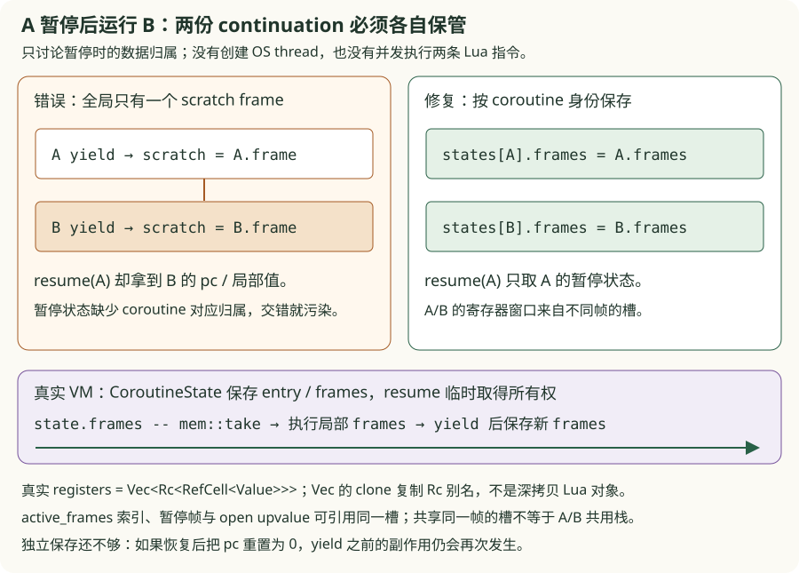
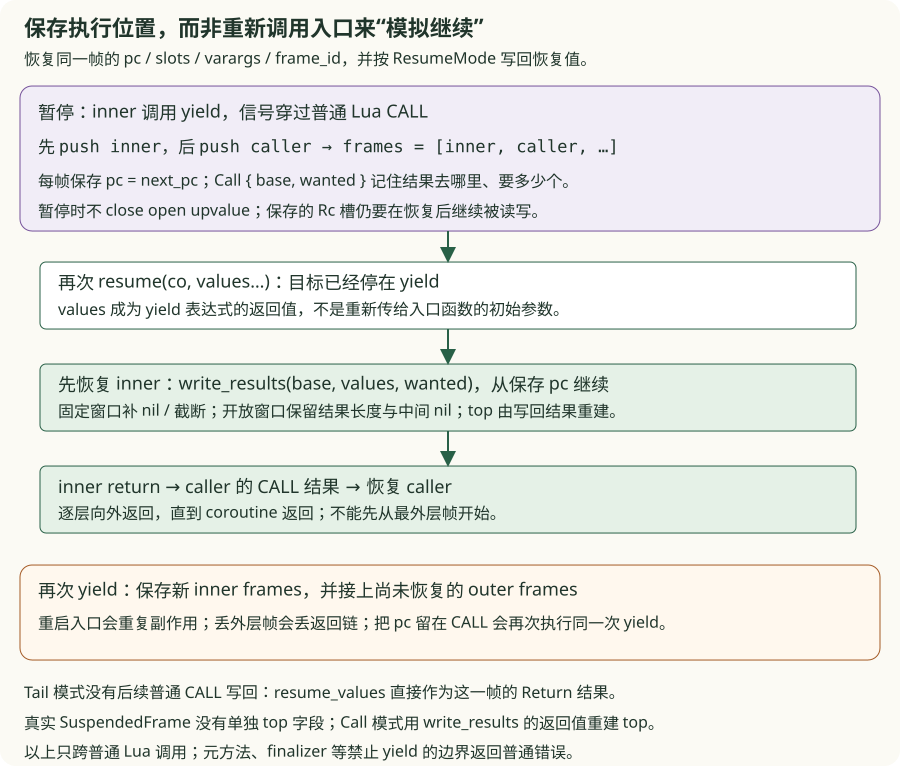
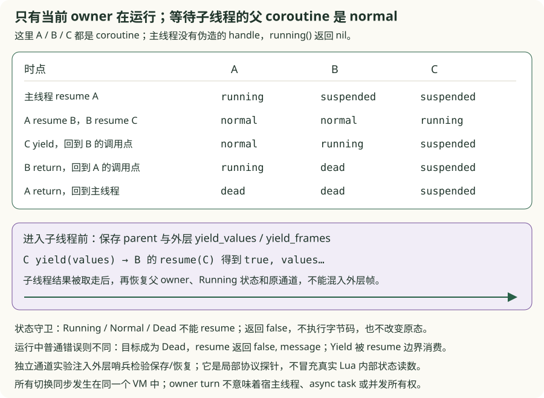
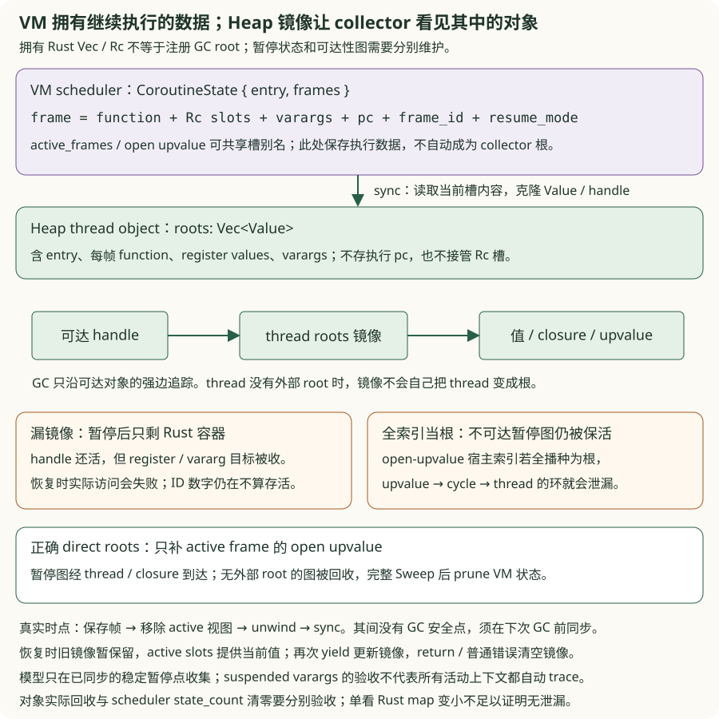

# v0.15 · Coroutine

<div class="lesson-meta"><span>独立暂停帧 → 继续执行 → owner turn → roots 交接</span><span>workspace</span><span>checkpoint v0.15</span></div>

<a id="learning-task-card"></a>
## 学习任务卡

<div class="task-card">
  <strong>让执行位置与对象存活一起跨过 yield</strong>
  <p>前置：v0.10 的多返回、v0.11 的 Rc 槽/upvalue、v0.14 的增量 GC 与短借用。
  逐一解决：两个 coroutine 为什么不能共用暂停区；resume 为什么不能从入口重跑；
  嵌套 resume 怎样归还 owner 与值；暂停对象怎样进入 GC 图；宿主索引为何不能全部当根。
  产出是五个独立 TODO、状态轨迹与真实 Heap/VM 对照，不涉及 OS thread 或 async。</p>
</div>

v0.14 的一次 Lua 调用要么返回，要么报错。现在让它暂停、先运行另一条执行链，再回到
原位置，就必须同时保存“怎样继续执行”和“哪些对象仍需存活”。本版保存真实 VM 帧，
不靠重跑源码模拟继续；普通 Lua 调用里的 yield 仍受指令数、调用深度和禁止边界约束。

`exercises/continuation/` 是小型执行/owner 协议模型；`exercises/roots/` 是稳定暂停
边界的 GC 图模型。它们不是历史中间 VM，也不互相拼接成完整解释器。真实快照在
`crates/`，各包另用真实 Heap/VM 对照证明对应可观察行为。

<a id="learning-predict"></a>
## 先预测再运行

先预测两次 resume 的结果，以及入口的 `runs` 最终是多少：

```lua
{{#include ../../code/v15-coroutine/examples/resume_once.lua}}
```

```powershell
$coManifest = 'book/code/v15-coroutine/Cargo.toml'
cargo run --quiet --manifest-path $coManifest -- book/code/v15-coroutine/examples/resume_once.lua
cargo run --quiet --manifest-path $coManifest --example continuation_problem_chain
cargo run --quiet --manifest-path $coManifest --example coroutine_roots_problem_chain
```

第一条应返回 `type=boolean value=true`：先 yield 11，再返回 42，入口副作用只执行一次。
两个 CLI 固定并列重放错误与修复，退出 0 只表示重放完成；它们不读取 starter。学习者
完成状态由章末显式 `--ignored` 验收决定，五个 TODO 初始都应失败。命令均从仓库根目录运行。

<a id="learning-code-map"></a>
## 代码阅读地图

1. [执行实验](https://github.com/YanqingXu/lua_rust/blob/main/book/code/v15-coroutine/exercises/continuation/README.md)：先交错两个小程序，比较 scratch、保存 pc 与 owner 通道；
2. VM 的 `execute_frame → run_frame_state → CALL`：分配独立槽，遇 Yield 保存帧；
3. `CoroutineState / SuspendedFrame / ResumeMode`：谁保管跨调用数据，哪些是槽别名；
4. `resume_coroutine → resume_frame`：从内层继续，把结果逐层交回；
5. [roots 实验](https://github.com/YanqingXu/lua_rust/blob/main/book/code/v15-coroutine/exercises/roots/README.md)：分清执行数据、Heap 镜像、直接根与宿主索引；
6. `sync_coroutine_roots → Heap::coroutine_set_roots → mark_one`：发布并追踪镜像边；
7. `gc_roots → prune_collected_coroutines`：只补活动 upvalue 根，完整周期后清理状态。

[真实 VM](https://github.com/YanqingXu/lua_rust/blob/main/book/code/v15-coroutine/crates/lua_vm/src/lib.rs)
与 [真实 Heap](https://github.com/YanqingXu/lua_rust/blob/main/book/code/v15-coroutine/crates/lua_core/src/lib.rs)
是源码对应入口。先看下列局部反例，再沿调用链阅读。

## 问题一：A 暂停后运行 B，为什么 A 恢复时拿到了 B 的局部值？

### 只有一个全局保存区，第二次暂停就覆盖第一次

让 A 用 seed 10 运行到 yield，再让 B 用 seed 100 运行到 yield，随后交错恢复。
本节不涉及 GC，先只看暂停状态由谁保存：

```powershell
cargo run --quiet --manifest-path $coManifest --example continuation_problem_chain -- storage
```

错误入口把两者的帧写进同一个 scratch：

```rust
{{#include ../../code/v15-coroutine/exercises/continuation/starter.rs:co_save_starter}}
```

这里的 `Frame` 只模拟一个小程序的 pc/局部值；错误版仍可编译，却会取错帧、提前结束
或丢帧。给函数改名为 coroutine 并不会产生独立存储。

```diff
- *scratch = Some(frame);
+ coroutine.frame = Some(frame);
```

```rust
{{#include ../../code/v15-coroutine/exercises/continuation/solution.rs:co_save_solution}}
```

修复后 A/B 轨迹分别是 **10 → 11 → 14**、**100 → 102 → 106**；交错不会改变
任何一条轨迹。合同保留另两个健康 hook，这题只需修 `save_frame`。



### 对照真实“独立栈”：独立容器，允许同一槽被共享引用

真实 `CoroutineState` 长期保存 `entry: Option<Value>` 与 `frames: Vec<SuspendedFrame>`。
resume 临时 `take` 出它们，结束或再次 yield 后再写回状态，避免借着调度 map 调用整个 VM。
`run_frame_state` 为每次新调用分配独立的 `Vec<StackSlot>`；`StackSlot` 是
`Rc<RefCell<Value>>`，不是一个全局寄存器数组。

`active_frames.insert(frame_id, registers.clone())` 只克隆 Vec 与 Rc 别名；open upvalue
也可指向同一槽，使闭包在 yield 前后继续读写原变量。不能把这种共享说成深拷贝，
也不能把“暂停帧容器有 owner”写成“每个槽只有一个 Rust owner”。

```powershell
cargo test --manifest-path $coManifest --test co_continuation_reference suspended_frames_belong_to_each_coroutine -- --exact
```

**完成条件：** A/B 交错仍保留各自局部状态，不能靠顺序跑完 A 再跑 B 隐藏污染。
接着会遇到第二问：帧保存对了，下一次究竟从哪条指令开始？

## 问题二：resume 为什么重复执行 yield 之前的副作用？

### 保存了寄存器，恢复入口却仍返回 0

```powershell
cargo run --quiet --manifest-path $coManifest --example continuation_problem_chain -- pc
```

错误版每次从入口重跑，小程序的入口副作用从应有的一次变为三次。不要通过删除副作用
或减少 resume 次数隐藏问题；需要保留下一条执行位置：

```rust
{{#include ../../code/v15-coroutine/exercises/continuation/starter.rs:co_resume_pc_starter}}
```

```diff
- 0
+ frame.pc
```

```rust
{{#include ../../code/v15-coroutine/exercises/continuation/solution.rs:co_resume_pc_solution}}
```

模型把 pc 更新步骤预先实现，TODO 只决定取保存值还是重启。真实 VM 在普通 CALL 收到
`VmErrorKind::Yield` 时保存 **next_pc**；若保存当前 CALL 的 pc，恢复后仍会再次执行
同一次 yield。内部 Yield 借用结构化错误的传播路径，不是发给宿主的普通错误。

### 一个真实暂停帧必须保存什么？

| 字段 | 用途 | 不能用什么替代 |
|---|---|---|
| `function` | 定位 Proto、常量与 closure upvalue | 只保存源码字符串 |
| `registers` | 原 Rc 槽与当前局部值 | 新建全 nil 的窗口 |
| `varargs` | 未必已经读入寄存器的额外参数 | 只保存固定参数 |
| `pc` | yield 调用之后的下一条指令 | 入口 0 或当前 CALL |
| `frame_id` | 与 open-upvalue 索引关联 | 每次 resume 随意换 ID |
| `resume_mode` | 普通 CALL 的 base/wanted，或 Tail | 忘记结果写回位置 |

真实 `SuspendedFrame` **没有 top 字段**。普通 Call 模式先 `write_results`，用返回的
窗口末端重建 top；固定 wanted 会截断或补 nil，开放 wanted 保留实际长度和中间 nil。
Tail 模式直接把 resume 参数作为该帧的 Return 结果。本题只替换模型的 pc 决策，完整
结果窗口、varargs、深层调用与 tail-yield 由真实 VM 对照及既有测试承担。



内层 CALL 先保存帧，外层后保存，得到 `[inner, caller, …]`。resume 参数先成为 inner
的 yield 表达式结果；inner 正常 return 后，结果才写入 caller 的 CALL 结果窗口。
若再次 yield，把新内层帧接上尚未恢复的旧外层帧；不能丢掉剩余 caller。Lua tail-call
已经消除的 caller 不会凭空出现在保存列表中。

Yield 路径只移除 `active_frames` 和 active-function 视图，不 CLOSE open upvalue；
正常 return 或普通错误才 close。暂停后闭包还要访问原槽，提前 close 会破坏这一合同。

```powershell
cargo test --manifest-path $coManifest --test co_continuation_reference resume_does_not_restart_entry_side_effects -- --exact
cargo test --manifest-path $coManifest --test pipeline deep_yield_chain_restores_every_caller_frame -- --exact
cargo test --manifest-path $coManifest --test pipeline tail_yield_returns_resume_values_to_the_coroutine_caller -- --exact
```

**完成条件：** 恢复值正确、副作用只发生一次，多次 yield 仍能完成；真实 VM 的嵌套
调用、多值含 nil 与 tail-yield 均单独验证。接着让 coroutine resume 另一条链。

## 问题三：子 coroutine yield 后，谁继续运行，值交给谁？

### 切换 current 还不够，还要隔离并归还 yield 通道

A/B/C 都是 coroutine。A resume B，B resume C 时，C 为 Running，**A/B 都是 Normal**。
C yield 后值交给 B 的 `resume(C)` 调用点，不直接交给 A；此时 B 恢复 Running，A 仍
Normal。主线程不参与这组 enum 状态，它没有伪造的 handle，`running()` 返回 nil。

```powershell
cargo run --quiet --manifest-path $coManifest --example continuation_problem_chain -- turn
```

错误 hook 只改 current，子线程会看见错误父状态，输出通道也会混进外层帧：

```rust
{{#include ../../code/v15-coroutine/exercises/continuation/starter.rs:co_turn_starter}}
```

修复把进入和离开看成一次完整 owner turn：

```rust
{{#include ../../code/v15-coroutine/exercises/continuation/solution.rs:co_turn_solution}}
```

相对旧写法，新增三处一起观察：父 Running→Normal；`take` 外层 yield values/frames，
给子线程独立通道；取得子结果后恢复 parent、Running 与原通道。模型在外层注入非空
哨兵，专门检查保存/恢复是否完整；它是局部协议探针，不宣称真实 Lua 每次嵌套 resume
都出现这组哨兵。真实 VM 另以 Lua 输入核对 status、owner 与含 nil 的值方向。



### 把四种状态和两种失败分开

| 触发 | 状态变化 | 对调用者的结果 |
|---|---|---|
| create | 新建 Suspended，保存入口 | thread handle |
| resume Suspended | Running，取得 entry 或 frames | 执行目标 |
| Yield | 目标回到 Suspended，保存新帧 | `true, yielded…` |
| 正常 return | 目标 Dead，清暂停 roots | `true, returned…` |
| 实际执行中的普通错误 | 目标 Dead，清理暂停状态 | `false, message` |
| resume Running/Normal/Dead | **保持原态，不执行字节码** | `false, message` |

`resume` 在进入前验证状态，所以“所有失败都会让目标 Dead”不成立。取走子线程的
Yield 信号后先恢复父 owner 与外层通道，再根据目标结果完成状态迁移。本模型没有
panic/abort 清理或并发调度合同。

```powershell
cargo test --manifest-path $coManifest --test co_continuation_reference nested_owner_turn_restores_parent_and_channels -- --exact
cargo test --manifest-path $coManifest --test pipeline nested_resume_exposes_running_and_normal_statuses -- --exact
```

**完成条件：** 子线程观察父 Normal，返回后父 Running；子结果没有外层哨兵，外层
通道没有子帧残留。现在 pc/owner 都正确了，但暂停寄存器已不在 active roots 中。

## 问题四：Rust 还拥有暂停帧，为什么恢复时对象已变成 stale？

### 执行数据的 owner，不等于 collector 的根

暂停时 `CoroutineState` 仍拥有帧和 Rc 槽，collector 却不遍历任意 Rust HashMap。
只保留入口或 thread handle，不发布暂停帧中的值，就会让恢复需要的对象消失：

```powershell
cargo run --quiet --manifest-path $coManifest --example coroutine_roots_problem_chain -- mirror
```

错误入口保留 entry，却忽略暂停 frames：

```rust
{{#include ../../code/v15-coroutine/exercises/roots/starter.rs:coroutine_mirror_starter}}
```

修复添加每帧 function、varargs 与**当前槽内容**，而非把 Rc 槽搬到 Heap：

```rust
{{#include ../../code/v15-coroutine/exercises/roots/solution.rs:coroutine_mirror_solution}}
```

```diff
  let mut roots = state.entry.iter().copied().collect::<Vec<_>>();
+ for frame in &state.frames {
+     roots.push(frame.function);
+     roots.extend(frame.varargs.iter().copied());
+     for slot in &frame.registers { roots.push(*slot.borrow()); }
+ }
  roots
```

模型 ID 是可复制 handle；真实实现克隆 `Value`，用 `try_borrow` 将槽冲突转成错误。
`sync_coroutine_roots` 收集拥有型 Vec 后，`Heap::coroutine_set_roots` 校验并执行
barrier，再更新 thread 对象。`mark_one` 遇 thread 时沿该 Vec 继续追踪。

| 保存在哪里 | 内容与作用 |
|---|---|
| VM 活动帧的局部 Vec | 执行 pc、寄存器槽、varargs |
| `active_frames` 索引 | 共享原 Rc 槽，供活动 slots 的根枚举 |
| `CoroutineState.frames` | 暂停 continuation；resume 时临时 take 出 |
| Heap thread 的 `roots: Vec<Value>` | entry/function/register values/varargs 的 tracing 镜像 |



### 镜像是快照，不会跟着槽自动变化

克隆 Value 不复制目标对象，也不建立自动同步 Rc 的关系。参考测试发布镜像后改一个
原槽，要求旧镜像不变，下一次同步才更新。真实 resume 期间暂时保留旧 thread 镜像，
活动 slots 又提供当前值，可能保守保留旧对象；再次 yield 更新镜像，return/普通错误
清空 thread roots。不能拿这种保守保活当作无需同步的证明。

真实时点也不能倒过来讲：CALL 保存帧 → 移除 active 视图 → unwind 到 resume 边界 →
安装 frames 并 sync。这个交接窗口没有 GC checkpoint，合同是**下一次可能回收前完成
镜像**，不是声称先 sync 再 detach。模型只在已同步的稳定暂停点收集。

真实 Heap 对照用公开 API 分别构造空镜像和正确镜像；Rust Rc 槽始终还在，再检查
`function_proto`、`upvalue_get` 和 table 访问。它不是对真实 VM 的故障注入。真实 VM
另验证入口尚未首次执行也能跨 host GC、暂停后 register/capture/varargs 可恢复，计算值为 46。

```powershell
cargo test --manifest-path $coManifest --test gc_coroutine_roots_reference suspended_values_are_mirrored_before_collection -- --exact
cargo test --manifest-path $coManifest --test gc_coroutine_roots_reference real_vm_entry_register_capture_and_suspended_varargs_survive_gc -- --exact
```

**完成条件：** 不只看到 thread handle 存活，还要每类目标实际可访问；修改槽后
重同步生效。若为修 stale 而把所有宿主状态永久设成 root，又会引入下一种错误。

## 问题五：把 scheduler 与全部 open-upvalue 都当根，为什么线程永远收不掉？

### 索引知道对象在哪里，不代表 Lua 仍能到达它

固定 `thread → 暂停 getter → open upvalue → cycle → thread` 的环，再移除外部
thread root。若把 scheduler map 的所有 handle 或全部 open-upvalue 索引直接播种，
它们会凭宿主索引把整环保活。多余 roots 隐藏了漏边，却产生永久泄漏：

```powershell
cargo run --quiet --manifest-path $coManifest --example coroutine_roots_problem_chain -- release
```

```rust
{{#include ../../code/v15-coroutine/exercises/roots/starter.rs:coroutine_direct_starter}}
```

修复只直接补 owner frame 仍 active 的 open upvalue，scheduler 只作索引：

```rust
{{#include ../../code/v15-coroutine/exercises/roots/solution.rs:coroutine_direct_solution}}
```

```diff
- let mut roots = context.scheduler_handles.clone();
- roots.extend(context.open_upvalues.iter().map(|(_, upvalue)| *upvalue));
+ let roots = context.open_upvalues.iter()
+     .filter(|(owner, _)| context.active_frames.contains(owner))
+     .map(|(_, upvalue)| *upvalue).collect();
```

暂停 upvalue 经可达 thread 的镜像和 closure 图到达；外部可达 closure 本身也可合法
保活它。这里要移除的是只因宿主索引存在的伪根，不能删掉仍活动 frame 的根。合同
单独检查“只把全部 upvalue 当根、不 root scheduler”也会泄漏上述环。

### 对象回收与调度状态清理分别验收

整轮 Sweep 完成后，`prune_collected_coroutines` 检查 Heap thread 的真实存活，移除
VM state 及那些 frame_id 的 open-upvalue 索引。它是清理索引，不是自动调用 coroutine
close；不能仅靠 `coroutine_state_count()==0` 证明 child 已回收。

真实 Heap 对照撤 thread root 后要求 thread 和八个目标对象的访问全部失败，前缀 root
仍可用。真实 VM 分开 execute 隔离观察帧，解除外部引用再 host GC；除了 scheduler
count 为 0，还要求弱表的 cycle/getter/thread 三槽精确为 nil、prefix 仍可读。
`current_coroutine` 只是身份元数据，本身并非 `gc_roots` 的直接根；常规 resume 中的
handle 由调用方参数与 invoke 的 temporary roots 保持。

```powershell
cargo test --manifest-path $coManifest --test gc_coroutine_roots_reference unreachable_continuations_are_not_permanent_roots -- --exact
cargo test --manifest-path $coManifest --test gc_coroutine_roots_reference real_vm_unreachable_cycle_disappears_from_weak_slots_and_scheduler -- --exact
```

**完成条件：** 可达暂停线程仍能恢复；撤根后对象图与 VM state 都释放。不能以
清空所有 roots 通过回收题，也不能以永远保留所有状态通过存活题。

## API 与暂停边界

| 入口 | 结果 | 边界 |
|---|---|---|
| `create(f)` | Suspended thread | 接受 Lua function、已有 builtin 和 wrapper；类型需校验 |
| `resume(co, …)` | `true, yield/return values…` | 守卫拒绝与实际执行错误按问题三区分 |
| `yield(…)` | 下次 resume 的参数 | 主线程和禁止边界报普通错误 |
| `status(co)` | running/normal/suspended/dead | 主线程没有伪造的 thread 值 |
| `running()` | 当前 thread；主线程 nil | 同步 owner turn，无宿主并发 |
| `wrap(f)` | 去掉成功布尔值的可调用值 | resume 失败重新抛出错误 |

`yield_forbidden_depth` 保护元方法与 finalizer 等不能保存为普通 Lua continuation 的
回调。接受 builtin 入口不等于可以从该 builtin 入口任意 yield。本章不添加 pcall/xpcall、
完整 traceback、debug hook 或显式 coroutine close API。

```powershell
cargo test --manifest-path $coManifest --test pipeline yield_cannot_cross_metamethod_boundaries -- --exact
cargo test --manifest-path $coManifest --test pipeline yield_cannot_cross_a_finalizer_boundary -- --exact
```

## 已知边界：暂停 varargs 验收不等于所有活动参数都已安全

本次源码核对还复现了一个现有快照边界。Lua tail-call 分派可能绕过 `invoke` 的临时
参数 roots，而 `gc_roots` 没有独立枚举活动 frame 的 varargs。下面在读入寄存器之前
收集，就会丢掉只存在于活动 varargs 的对象：

```lua
{{#include ../../code/v15-coroutine/examples/active_varargs_gap.lua}}
```

```powershell
cargo run --quiet --manifest-path $coManifest -- book/code/v15-coroutine/examples/active_varargs_gap.lua
```

**当前预期：非零退出，含 `stale GC handle`。** 这是独立的已知失败入口，不是五个
学习者 TODO，也没有被本章修复。暂停 roots 模型及正向 VM 验收只覆盖前述稳定边界，
不能外推为全部活动 varargs、tail-call 参数转交或所有 GC phase 的 owner 协议已完备。
后续整改应为活动 varargs 或参数交接补明确 root 生命周期，再验证正常/暂停/尾调用
组合，不能单靠增加永久 roots 掩盖它。

## Rust 知识映射与设计选择

- 状态持有暂停帧容器，`mem::take` 使借用结束后再执行整个 VM；
- Rc 槽别名维持 closure/upvalue 共享，RefCell 借用只临时用于读写值；
- `Option<entry>` 区分首次进入与恢复，`ResumeMode` 描述 Call 窗口或 Tail；
- Yield 沿 Result 传播、在 resume 边界消费，清理路径区别于 return/普通错误；
- Heap 的 Value 镜像表达 GC edges，VM HashMap 表达调度索引，两者不能互代。

保存帧方案没有使用 OS thread 或 async executor；所有切换由 resume 显式触发。
当前 Vec 从头取帧适合教学，不等于成熟实现的性能化栈布局。

## 从 v0.14 迁移了什么

- 新增 typed thread/wrapper 身份与 Heap thread 的 tracing roots；
- 重构调用清理，yield 保留槽，return/error close；
- 新增 entry/frames、next pc、结果窗口及嵌套 owner/通道保存；
- 直接补 active upvalue 根，暂停图改走镜像；完整周期后清理已回收状态；
- 保留 v0.14 增量阶段、barrier、weak table 与 finalizer；
- 六个 coroutine 教学入口已存在，标准库 crate、模块/REPL 和完整 debug 协议留到后版。

## 运行与验收

```powershell
cargo run --manifest-path $coManifest -- book/code/v15-coroutine/examples/demo.lua
cargo test --manifest-path $coManifest --workspace
```

原 demo 仍返回 `type=number value=1515`。原快照 99 项测试保留：74 个端到端、7 个
编译器、15 个 core、3 个 VM；新执行参考 9 项、roots 参考 9 项，默认合计 **117 项
通过、5 项学习者 TODO ignored**。默认通过不表示 TODO 已完成，也不表示活动 varargs
已知失败已修复。

<a id="learning-exercises"></a>
## 章末练习

<div class="exercise understanding">
  <strong>理解题</strong>
  <p>交错 A/B 各三次 resume，预测 scratch 污染了谁，再只修 continuation/starter.rs
  的 save_frame。对照 Rc 槽别名解释独立容器与深拷贝的差别。</p>
</div>

<div class="exercise implementation">
  <strong>实现题</strong>
  <p>分别修 resume_pc 与 run_child：入口副作用只发生一次；子线程观察父 Normal，
  子结果含 nil 且不混入哨兵，返回后父 owner、Running 与外层通道全部恢复。</p>
</div>

<div class="exercise debugging">
  <strong>调试题</strong>
  <p>分别修 roots/starter.rs 的 mirror_roots 与 extra_direct_roots：可达暂停图可恢复，
  无外部 root 的环可回收。区分 stale 漏边与索引伪根，不能永久 root 全部状态。</p>
</div>

### 修改范围、命令与完成条件

只改两个 starter 的五个 TODO；合同、固定 faults、真实 Heap/VM 与 ignored 标记保持
原样。每题注入一个待修 hook，其他 hook 使用健康实现，前题错误不会掩盖后题。

```powershell
# 初始分别 3 项失败、2 项失败；实现后必须全部通过。
cargo test --manifest-path $coManifest --test co_continuation_exercises -- --ignored
cargo test --manifest-path $coManifest --test gc_coroutine_roots_exercises -- --ignored

# 固定反例、参考解与真实 Heap/VM 对照：9 + 9 项默认通过。
cargo test --manifest-path $coManifest --test co_continuation_reference --test gc_coroutine_roots_reference
```

| 验收主题 | 修改入口 | 必须观察到 |
|---|---|---|
| 独立暂停状态 | `save_frame` | A/B 交错结果各自正确，不能取错/丢失帧 |
| 继续而非重跑 | `resume_pc` | 多次恢复正确，入口副作用仍为 1 |
| 嵌套 owner turn | `run_child` | 父 Normal→Running，子值方向和外层通道正确 |
| 暂停 tracing 镜像 | `mirror_roots` | entry/function/register/vararg/capture 实际存活，重同步读当前槽 |
| 去掉宿主伪根 | `extra_direct_roots` | 活动根保留；撤 thread root 后对象释放、scheduler 清理 |

[执行包说明](https://github.com/YanqingXu/lua_rust/blob/main/book/code/v15-coroutine/exercises/continuation/README.md)
与 [roots 包说明](https://github.com/YanqingXu/lua_rust/blob/main/book/code/v15-coroutine/exercises/roots/README.md)
包含逐题精确命令、预期轨迹及可选参考解。两个 CLI 固定重放，练习完成以显式
`--ignored` 为准，不能把“0 failed、5 ignored”写成已完成。

<a id="learning-checkpoint"></a>
## 完成检查点

- 能解释独立 frame 容器、共享 Rc 槽、Heap Value 镜像的不同角色；
- 能从重复副作用推导 next_pc，从内向外手推窗口、含 nil 多值与 tail-yield；
- 能画 A/B/C owner turn，区分守卫拒绝与实际错误的状态变化；
- 能说明 Yield 不 CLOSE、detach 到 sync 的无 GC 窗口与下次收集前的交接要求；
- 能同时验收暂停图存活、撤根后对象回收和 VM 状态清理；
- 五个 TODO 显式通过，且能复现/解释活动 varargs 的未修复边界。

## 与成熟实现和专题章节的对应

- 成熟实现的独立 stack/call-info 与 owner turn 是保存帧方案的性能化目标；
- [Closure 与 Upvalue](v11-closure-upvalue.md) 可回看暂停为何保留原槽；
- [增量 GC](v14-incremental-gc.md) 可对照镜像写入 barrier 与可达性图；
- [寄存器虚拟机](../ch04-vm/register-vm.md) 可定位结果窗口与 tail-call 合同；
- 下一 checkpoint v0.16 将宿主适配器独立成 lua_stdlib；活动 varargs 整改须另以真实失败入口启动。
