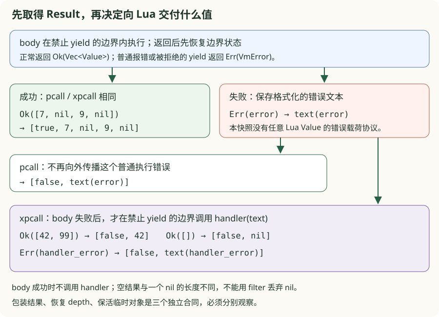
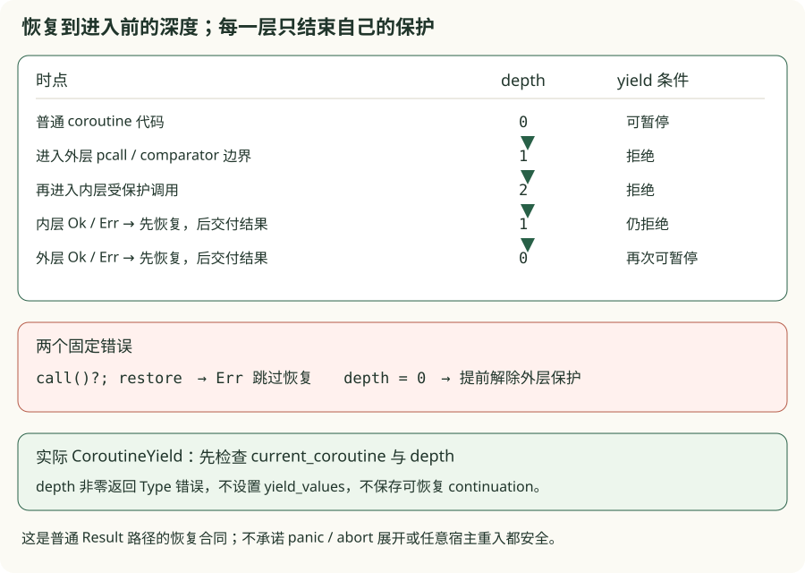
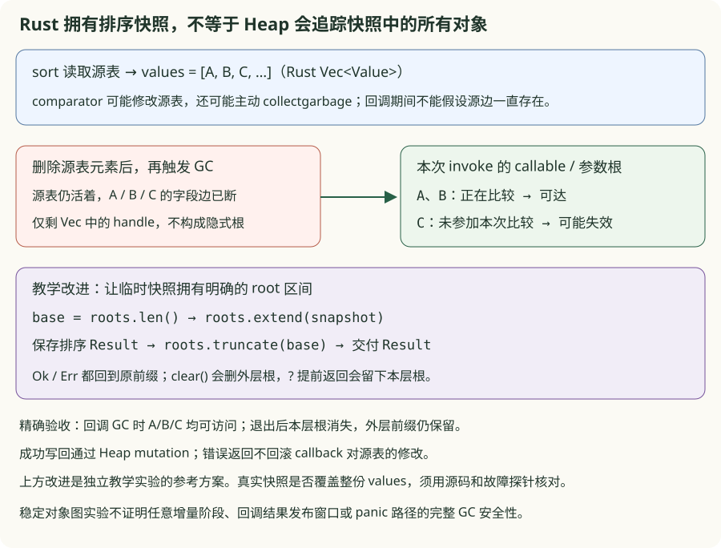

# v0.16 · 核心标准库

<div class="lesson-meta"><span>统一宿主合同 → 回调结果 → 边界恢复 → 临时 roots</span><span>5-crate workspace</span><span>checkpoint v0.16</span></div>

<a id="learning-task-card"></a>
## 学习任务卡

<div class="task-card">
  <strong>从三个可见故障推导 Rust builtin 的边界</strong>
  <p>前置：v0.01 字节字符串、v0.08 Table、v0.14 Heap roots、v0.15 VM 调用。
  本次依次解决：同类参数被不同函数解释；函数写好了却找不到；裸 global 与 _G 各改
  一份数据；接着解决保护调用如何交付结果、禁止 yield 状态如何恢复、排序快照如何保活。
  产出是分组独立 TODO、错误/修复对照、状态图和真实 Heap/VM 验收。
  新知识是借用参数切片、拥有的返回值、结构化错误、crate 依赖方向和共享对象身份。</p>
</div>

v0.15 已能调用少量 Rust builtin。v0.16 加入数十个入口后，复制取参和安装代码会把
同一规则散落到不同位置。本章先观察这种写法的失败，再引入 `Args`、catalog 与唯一
global environment。`lua_stdlib` 管声明和参数规则，VM 保管 Heap 与执行状态。

各练习包使用**人为构造的局部错误设计**，不是声称历史版本曾经出现这些 bug，也不会
修改真实 VM 来制造故障。`faults.rs` 固定错误行为，`solution.rs` 给出参考，`real.rs`
另接真实快照。CLI 不读取 `starter.rs`，重放成功不表示学习者已经完成练习。
排序部分另保留一个当前真实快照的故障输入，单独标为已知功能缺口。

<a id="learning-predict"></a>
## 先预测再运行

先写下四组预期：`math.abs('-9')` 与 `math.sqrt('9')`；`math.sqrt()` 与
`math.sqrt(nil)`；`string.char(65,0,255)` 的字节；`answer=42` 后的 `_G.answer`。
最后问：函数体存在，是否足以让 `math.sqrt` 不为 nil？

把预测写完，再读这个真实 Lua 探针。它还检查错误原因不同、双向读写、删除及 `_G` 重绑：

```lua
{{#include ../../code/v16-core-stdlib/examples/builtin_contracts.lua}}
```

以下命令均从仓库根目录运行。省略 CLI 参数或用 `all` 会执行该包全部固定对照：

```powershell
$stdManifest = 'book/code/v16-core-stdlib/Cargo.toml'
cargo run --quiet --manifest-path $stdManifest -- book/code/v16-core-stdlib/examples/builtin_contracts.lua
cargo run --quiet --manifest-path $stdManifest --example args_problem_chain
cargo run --quiet --manifest-path $stdManifest --example catalog_problem_chain
cargo run --quiet --manifest-path $stdManifest --example globals_problem_chain
```

真实快照接受上述数字字符串，字节值仍为 `[65,0,255]`；初始 `_G` 指回环境表，所以
裸写入立即能从 `_G` 读到。缺参和显式 nil 都失败，但失败原因不同。下面逐步对照。
第一条 Lua 探针应返回 `type=boolean value=true`；三个 CLI 则逐项显示故障与参考结果。

继续预测：在同一 coroutine 里，pcall 拒绝一次 yield、sort comparator 再拒绝一次，
后面的普通 yield 是否还能暂停并恢复？handler 返回 table 时，它会不会被转成字符串？

```lua
{{#include ../../code/v16-core-stdlib/examples/callback_contracts.lua}}
```

```powershell
cargo run --quiet --manifest-path $stdManifest -- book/code/v16-core-stdlib/examples/callback_contracts.lua
cargo run --quiet --manifest-path $stdManifest --example protected_problem_chain
cargo run --quiet --manifest-path $stdManifest --example boundary_problem_chain
cargo run --quiet --manifest-path $stdManifest --example sort_roots_problem_chain
```

Lua 探针应先合法 yield `41,nil`，resume 输入 42 后返回 43，主 chunk 最终返回 true。
它验证被拒绝的暂停没有阻断后续合法暂停；精确的 depth/roots 前缀另由局部合同检查。

<a id="learning-code-map"></a>
## 代码阅读地图

1. [参数包](https://github.com/YanqingXu/lua_rust/blob/main/book/code/v16-core-stdlib/exercises/args/README.md)：固定取参错误 → `Args<'a>` → `HostError` → VM 附加函数名；
2. [注册包](https://github.com/YanqingXu/lua_rust/blob/main/book/code/v16-core-stdlib/exercises/catalog/README.md)：漏安装/错 ID → `FunctionSpec/LibrarySpec` → `Vm::new` → `invoke_native`；
3. [全局环境包](https://github.com/YanqingXu/lua_rust/blob/main/book/code/v16-core-stdlib/exercises/globals/README.md)：两份状态 → 一个 Heap table → `GETGLOBAL/SETGLOBAL` → `gc_roots`；
4. [真实 stdlib](https://github.com/YanqingXu/lua_rust/blob/main/book/code/v16-core-stdlib/crates/lua_stdlib/src/lib.rs)：目录、decoder 与错误数据；
5. [真实 VM](https://github.com/YanqingXu/lua_rust/blob/main/book/code/v16-core-stdlib/crates/lua_vm/src/lib.rs)：初始化、Heap mutation、builtin 分派与错误转换；
6. [既有标准库合同](https://github.com/YanqingXu/lua_rust/blob/main/book/code/v16-core-stdlib/tests/stdlib.rs)：公开库成功值、coercion、错误分类和可选 oracle 对照。
7. [保护结果包](https://github.com/YanqingXu/lua_rust/blob/main/book/code/v16-core-stdlib/exercises/protected/README.md)：`Result<Vec<Value>, VmError>` → pcall/xpcall 返回窗口；
8. [边界包](https://github.com/YanqingXu/lua_rust/blob/main/book/code/v16-core-stdlib/exercises/boundary/README.md)：`invoke_yield_forbidden → invoke_callable → invoke` 的进入、嵌套与恢复；
9. [排序 roots 包](https://github.com/YanqingXu/lua_rust/blob/main/book/code/v16-core-stdlib/exercises/sort_roots/README.md)：`invoke_table::Sort` 的局部快照、comparator 重入 GC 与临时根区间。

## 问题一：同一类参数，为什么一个函数接受、另一个拒绝？

### 每个 builtin 自己取参，就可能各写一套规则

假设 `sqrt` 已接受数字字符串，而新增 `abs` 只匹配 `Value::Number`。`abs('-9')`
便在运算前失败，尽管 `sqrt('9')` 能返回 3。先运行固定反例，观察拒绝发生在哪一步：

```powershell
cargo run --quiet --manifest-path $stdManifest --example args_problem_chain -- number
```

CLI 把差异隔离在通用取参函数：输入同一字符串 `' 42.5 '`，strict-number 故障版拒绝，
共享 `Args::number` 返回 42.5。上面的 abs/sqrt 是引入情景，真实 Lua 探针验证两者均已修好。

只认 Number 的起点可编译，也能处理数值，但它丢失了数字字符串转换和参数位置：

```rust
{{#include ../../code/v16-core-stdlib/exercises/args/starter.rs:args_number_starter}}
```

第一步不改数学运算，只把取参交给共享 decoder，并从 `lua_stdlib` 导入 `Args`：

```diff
- match values.get(index) {
-     Some(Value::Number(number)) => Ok(*number),
-     _ => Err(HostError::message("number required")),
- }
+ Args::new(values).number(index)
```

```rust
{{#include ../../code/v16-core-stdlib/exercises/args/solution.rs:args_number_solution}}
```

`Args<'a>` 只借用调用者已有的 `&'a [Value]`。`get/required` 返回同一切片内的
`&'a Value`，没有复制 VM 或长期保存参数；`number` 则在局部借用期间解出拥有的
`f64`。生命周期 `'a` 把返回引用的有效期约束在参数数据之内，不负责 GC 保活。

```rust
{{#include ../../code/v16-core-stdlib/exercises/args/real.rs:args_borrowed_view}}
```

| 输入情况 | 真实 decoder 的步骤 | 可见结果 |
| --- | --- | --- |
| number | 直接取值 | 对应 `f64` |
| 数字字符串 | UTF-8 检查、trim、Rust `f64` parse | 如 `' 9 '` 得到 9 |
| 缺参 | `required` 发现 `None` | `value expected` |
| 显式 nil | 参数存在，但类型不符 | `number expected, got nil` |
| 非数字字符串或非法 UTF-8 | 数值解析失败 | `number expected` |

`HostError::argument(index, ...)` 把内部零基下标转为一基参数编号；错误仍是数据，
尚无函数名。VM 的 `host_error(function, error, proto, pc)` 再添加函数名与源位置，
将这一类错误标为 `VmErrorKind::Type`。不能把任意 Heap 或 Lua callback 错误都
重新包装成 HostError；那些错误应保留自己的来源。回调边界留待后续微课。


### string 参数为什么不能直接变成 Rust String？

把字节经过 lossy UTF-8 文本转换，再转回 bytes，会把 `0xff` 改写为替换字符的编码。
这次“转换成功”实际上已经改变数据。固定错误版同时漏掉了 number → 字节文本的规则：

```powershell
cargo run --quiet --manifest-path $stdManifest --example args_problem_chain -- bytes
```

```rust
{{#include ../../code/v16-core-stdlib/exercises/args/starter.rs:args_bytes_starter}}
```

```diff
- match values.get(index) {
-     Some(Value::String(bytes)) => Ok(String::from_utf8_lossy(bytes.as_bytes())
-         .into_owned().into_bytes()),
-     _ => Err(HostError::message("string required")),
- }
+ Args::new(values).bytes(index)
```

```rust
{{#include ../../code/v16-core-stdlib/exercises/args/solution.rs:args_bytes_solution}}
```

这里返回 `Vec<u8>`，即拥有的副本；源参数销毁后，这个 Vec 仍可使用。这样 builtin
后续处理不用继续借着参数容器。复制字节有成本，但保留 NUL/0xff 是语义要求，
不能用“文本看起来一样”代替逐字节验收。

```rust
{{#include ../../code/v16-core-stdlib/exercises/args/real.rs:args_owned_bytes}}
```

```powershell
cargo test --manifest-path $stdManifest --test args_reference real_args_borrow_values_while_owned_bytes_can_escape_input_lifetime -- --exact
```

该单题用指针相等帮助观察 `required` 返回原 Value 的别名，再验证源参数离开作用域后
拥有的 bytes 仍可读取。引用有效期本身由 Rust 类型系统保证，不靠指针比较补救。

**完成条件：** 两个 hook 分别通过数字字符串/缺参/类型/编号合同和 bytes/number
转换合同；真实 VM 还要验证错误分类、函数名以及第 2 个参数的编号。两个 TODO 独立，
只修一个即可运行对应验收，完整命令见参数包 README。

本版边界：数值解析使用 UTF-8 + Rust `f64`，没有证明全部 Lua 5.1 数值词法相同；
`optional_integer` 把缺参与 nil 都视为默认值，不能推广成所有 decoder 都这样做。
`Args::table` 只检查 Value 变体并取 typed handle，句柄有效性由后续 Heap API 验证。

接下来，参数规则统一了，却仍可能根本调用不到写好的函数。

## 问题二：函数体已经实现，为什么 Lua 查到的还是 nil？

### 分派分支与安装目录是两件事

在固定错误设计里，VM adapter 已能处理 `MathFunction::Sqrt`，安装器却在完整目录中
跳过了 `sqrt`，其余 67 个绑定仍存在。Lua 的 `math.sqrt` 查表得到 nil，尚未进入运算：

```powershell
cargo run --quiet --manifest-path $stdManifest --example catalog_problem_chain -- missing
```

```rust
{{#include ../../code/v16-core-stdlib/exercises/catalog/starter.rs:catalog_install_starter}}
```

把公开名字与稳定身份放进 `FunctionSpec`，按库分组为 `LibrarySpec`，让初始化遍历
这些声明。展开 `starter` 委托的固定 `omit_sqrt`，最小修正就是删掉对目录的例外过滤：

```diff
  for &spec in library.functions {
-     if library.name == b"math" && spec.name == b"sqrt" {
-         continue;
-     }
      installed.bind(table, spec)?;
  }
```

```rust
{{#include ../../code/v16-core-stdlib/exercises/catalog/solution.rs:catalog_install_solution}}
```

目录中的名字是静态字节切片，spec 的身份是可复制的 `NativeFunction` enum。
复制 ID 不会复制函数执行状态，也不是捕获 VM 的 Rust closure。它可以放进 Value、
比较或用作 table key；VM 收到 ID 后再穷尽分派。目录自身不拥有函数体。


### “有一个 function”为什么仍不足以验收？

把 `sqrt` 错装成 `abs` 时，类型仍然是 function，调用也能返回 number；输入 81
却得到 81，而非 9。因此需要独立的“名字 → ID”期望，再验证实际调用结果：

```powershell
cargo run --quiet --manifest-path $stdManifest --example catalog_problem_chain -- identity
cargo run --quiet --manifest-path $stdManifest --example catalog_problem_chain -- duplicates
cargo test --manifest-path $stdManifest --test catalog_reference catalog_installs_the_independent_public_contract -- --exact
```

合同中的期望不能临时从待测 catalog 生成，否则 catalog 自己漏掉 sqrt 时，两边会一起
缺项。练习用独立公开清单核对目录和安装结果，再用遗漏、错 ID 的固定变体证明合同能
发现问题。同库重复名字应被教学 preflight 拒绝；不同库的同名函数可以共存。

安装实验使用独立 Heap。`installed_call` 先从这张表读出稳定 ID，将固定探针编译结果
中唯一的数值 0 常量替换为该 NativeFunction，再交给新建真实 VM 执行。这证明“装进去
的身份确实调用了预期函数”；它不表示实验 Heap 已被装入真实 VM。另一个直接 Lua
探针检查真实 `Vm::new` 的公开入口。下面每个调用使用独立固定期望：

```rust
{{#include ../../code/v16-core-stdlib/exercises/catalog/real.rs:catalog_real_calls}}
```

**源码对应与边界：** 真实 `Vm::new` 已遍历 `BASE_FUNCTIONS/LIBRARIES` 安装公开库，
另装 math 常量和 string primitive 的 `__index`；`gc_*` 等教学诊断仍单独安装。
练习的重复名 preflight 是局部保护，真实初始化没有相同的动态检查。穷尽 enum 分派
能帮助发现遗漏分支，却不会自动证明 catalog 没有漏声明或连错 ID。

### 为什么拆 crate，到这里才有直接收益？

三个职责现已能够从失败位置区分：stdlib 声明公开目录和纯参数规则，core 定义可跨层
传递的 Value/ID，VM 拥有 Heap、调用栈和实际执行。因此依赖是 `stdlib → core`，
`VM → stdlib + core`；app 再把 compiler 与 VM 组合起来。stdlib 不需要反向依赖 VM。

新增一个 builtin 时仍要修改 ID、catalog、VM dispatch；集中目录解决重复安装清单，
并不消灭所有改动点。收益通过“漏安装被发现、错 ID 被发现、调用结果正确”来观察。

**完成条件：** 修复 installer 后，独立公开合同通过，固定故障仍被识别；真实 VM 的
对应函数可调用。只把 `sqrt` 塞回一个特例、只检查 function 类型，都不是目录驱动安装。

函数可以找到了，但库表到底安装进了哪一个全局环境？

## 问题三：为什么 answer 与 _G.answer 会各自保留一个值？

### 给 Rust globals 复制一个 _G 快照，会产生两个写入口

v0.15 使用 Rust `HashMap<ByteString, Value>` 保存 global。若沿用它，再为了暴露 `_G`
而复制一个 Heap table，裸 `answer` 与 `_G.answer` 就落在不同位置。固定反例先复制
快照，再从两边写入；第二次写入不会自动通知另一边：

```powershell
cargo run --quiet --manifest-path $stdManifest --example globals_problem_chain
```

```rust
{{#include ../../code/v16-core-stdlib/exercises/globals/starter.rs:globals_install_starter}}
```

展开错误构造器，就能看到快照复制后出现两份长期存储：

```rust
{{#include ../../code/v16-core-stdlib/exercises/globals/model.rs:globals_snapshot_storage}}
```

这题只替换环境初始化 hook。驱动器已提供两种设计的读写路径，健康路径始终从同一
环境句柄读取和修改。真实 v0.15 只有 globals map，尚未安装 `_G`；双存储是本节
人为设计的失败迁移。真实 v0.15 → v0.16 的变化概括如下：

```diff
- globals: HashMap<ByteString, Value>
+ global_env: TableRef
+ GETGLOBAL / SETGLOBAL → heap.table_get / table_set(global_env, ...)
+ global_env["_G"] = Value::Table(global_env)
+ gc_roots 显式加入 Value::Table(global_env)
```

```rust
{{#include ../../code/v16-core-stdlib/exercises/globals/solution.rs:globals_install_solution}}
```

这里“唯一”指表的身份相同。Rust 保存/复制的 `TableRef` 是句柄，不是表内容副本。
table 的存储由 Heap 管，VM 保管环境句柄；把句柄放进 `gc_roots` 后，collector 才从
这个环境继续追踪字段。单有 Rust owner 或 `_G` 自环都不能代替根枚举。

```rust
{{#include ../../code/v16-core-stdlib/exercises/globals/model.rs:globals_environment_roots}}
```


真实 VM 的两条指令都使用 `self.global_env`，不需要维护同步副本。注意 `SETGLOBAL`
通过 Heap API 写入，以保留 nil 删除与 write barrier；不能直接绕过 Heap 修改内部 map。

```rust
{{#include ../../code/v16-core-stdlib/crates/lua_vm/src/lib.rs:globals}}
```

### 沿一条验收规格理解“同一份状态”

```powershell
cargo test --manifest-path $stdManifest --test globals_reference single_environment_is_shared_by_globals_and_g -- --exact
```

这条共享合同让同一个初始化 hook 接受以下观察，而非只比较两个句柄的显示文本：

1. 裸 global 写入后，从 `_G` 路径读到新值；从 `_G` 写入后，裸读也改变。
2. 通过任一路径写 nil 后，另一边精确读到 `Value::Nil`，没有残留快照值。
3. 初始 `_G` 与环境是同一张表，`_G._G` 也回到它；图的自环可被遍历终止。

参考包再验证跨 GC 的图：真实 VM 分多次 `execute` 建立全局对象、在宿主调用收集、
重新执行读取。这样第一次调用的局部寄存器不会替根枚举遮掩问题。独立 Heap 另撤掉
所有环境根，验证自环可以被回收；Rust 中仍留着句柄不妨碍它变 stale。

### _G 可以改写，环境身份由谁保持？

先保存 `local env = _G`，再执行 `_G = { answer = 99 }`。这是在原环境 E 的 `_G`
字段上写入新表 R；`Vm.global_env` 仍指 E。所以裸 `answer` 仍访问 E，`_G.answer`
此时访问 R。`_G` 是普通可变字段，不能将“初始化时指回自身”教成永久不可变条件。

**完成条件：** 同步读写和删除成立，宿主 GC 后对象可访问，替换 `_G` 后裸 global
仍来自原环境。真实 VM 与独立 Heap 分别验证对应观察，不从一次成功运行外推所有 GC
路径安全。v0.15 已记录的活动 varargs/tail-call 漏根属于另一个工程问题，本包未修复。

## 问题四：pcall 返回 true，为什么成功结果仍然不完整？

### 执行成功，不等于结果窗口只有一个值

先预测 `pcall(function() return 7,nil,9,nil end)` 的返回数量。它应交付五个值：
`true,7,nil,9,nil`；中间和尾部 nil 都是位置。返回零值时应只有 true。把返回值 `.first()`
取出再包装，会把正确执行变成错误接口；过滤 nil 也会改变后续位置。

```powershell
cargo run --quiet --manifest-path $stdManifest --example protected_problem_chain -- pcall
```

本包先取得 body 的 Result，只实现“怎样交付结果”；它不模拟栈展开、GC 或 callback
执行。错误起点可编译，但没有保留整个窗口：

```rust
{{#include ../../code/v16-core-stdlib/exercises/protected/starter.rs:protected_pcall_starter}}
```

设计差异是把整份成功 Vec 接到 true 后面，同时把普通 Err 转成 false 与错误文本：

```diff
- 只取 body 成功结果的第一个位置
+ let mut results = vec![Value::Boolean(true)];
+ results.extend(values);
```

```rust
{{#include ../../code/v16-core-stdlib/exercises/protected/solution.rs:protected_pcall_solution}}
```

`Result` 用 enum 区分控制流，`Vec<Value>` 拥有返回窗口。这里的 move/extend 转交
窗口所有权，不会自动注册 Heap root。真实 VM 先恢复执行边界，再进行这个结果包装；
两者不能因为都发生在 pcall 内就混为一项验收。

**完成条件：** 成功的零值、多值、中间/末尾 nil 原样保留；普通错误成为 `false,text`，
没有继续以 Err 穿过这个 pcall 结果协议。参数缺失等进入 body 之前的错误另有校验，
不能由本包已经取得 Result 的合同证明。

```powershell
# learner 初始运行 1 项且失败；完成 pcall hook 后通过。
cargo test --manifest-path $stdManifest --test protected_exercises pcall_keeps_the_complete_result_window -- --ignored --exact
cargo test --manifest-path $stdManifest --test protected_reference pcall_keeps_the_complete_result_window -- --exact
```

### xpcall 的 handler 何时运行，返回哪几个值？

固定错误版即使 body 成功也可能调用 handler，或把 handler 的所有结果都接在 false
后面。让 handler 增加计数并返回 `42,99`，就能分别观察“多执行一次”和“窗口多一个值”。

```powershell
cargo run --quiet --manifest-path $stdManifest --example protected_problem_chain -- xpcall
```

```rust
{{#include ../../code/v16-core-stdlib/exercises/protected/starter.rs:protected_xpcall_starter}}
```

```diff
- 无论 body 结果都运行 handler，或保留 handler 全部输出
+ body Ok → true 后接完整 body 窗口，不调用 handler
+ body Err → handler(text(error))，只取首值，无首值则 nil
+ handler Err → false 后接格式化 handler 错误
```

```rust
{{#include ../../code/v16-core-stdlib/exercises/protected/solution.rs:protected_xpcall_solution}}
```



这个 checkpoint 的 `VmError` 保存文本与位置，不携带任意 Lua Value 作为原始错误
对象。`error(value)` 会先 stringify，handler 收到的也是格式化字符串；不能把本节
描述成完整 Lua 错误对象语义。真实 xpcall 的 handler 可以返回 table、number、false
或 nil；首值不必是字符串，只有 handler 本身失败时再转错误文本。

真实 VM 探针在同一次 execute 中捕获错误、继续调用和访问对象，另核对 handler 的
调用次数及返回窗口。这样能证明可见控制流继续，不能单凭结果正确就断言私有 roots
已精确截断；精准恢复需要下面独立的状态与 roots 合同。

```rust
{{#include ../../code/v16-core-stdlib/exercises/protected/real.rs:protected_real_same_execute}}
```

```powershell
# 第二题独立，不要求先完成第一题。
cargo test --manifest-path $stdManifest --test protected_exercises xpcall_only_handles_failures_and_selects_one_result -- --ignored --exact
cargo test --manifest-path $stdManifest --test protected_reference xpcall_only_handles_failures_and_selects_one_result -- --exact
```

第二题完成时，成功路径的 handler 调用计数为 0；失败路径恰好 1，handler 的第二个
结果不会向外泄漏，空窗口补一个 nil。失败不能统一当成字符串成功结果来拼接。

## 问题五：错误已经变成 false，为什么下一次合法 yield 还会失败？

### `?` 放在恢复之前，普通错误会跳过清理

考虑 `depth += 1; let values = call()?; depth -= 1;`。成功路径看似正确，错误却会
直接返回，留下未结束的禁止状态。pcall 即使把错误变成 false，后面的普通 coroutine
代码仍可能被这份残留 depth 阻止。

```powershell
cargo run --quiet --manifest-path $stdManifest --example boundary_problem_chain -- error
```

```rust
{{#include ../../code/v16-core-stdlib/exercises/boundary/starter.rs:boundary_invoke_starter}}
```

先保存完整 Result，恢复后再交付它；不要在取得 Result 时就用 `?` 穿过恢复点：

```diff
- let values = call(vm)?;
- restore(vm);
- Ok(values)
+ let result = call(vm);
+ restore(vm);
+ result
```

```rust
{{#include ../../code/v16-core-stdlib/exercises/boundary/solution.rs:boundary_invoke_solution}}
```

模型保存进入前的 depth 并恢复该数值；真实 `invoke_yield_forbidden` 采用成对 `+=1`
和 `-=1`，中间同样先保存 `self.invoke_callable(...)` 的 Result，没有先 `?`。
`invoke_callable` 解析到 `__call` 时还会增加一层禁止状态，因此边界可以嵌套。

### 内层结束时为什么不能直接清零？

假设外层 depth=1，内层进入后为 2。内层恢复到 0 会提前解除外层保护，而不是只结束
本次调用。固定布尔式错误版演示内层错误已捕获，外层却错误地允许 yield 并留下暂停值：

```powershell
cargo run --quiet --manifest-path $stdManifest --example boundary_problem_chain -- nested
```



真实 `CoroutineYield` 先检查当前是否 coroutine，再检查 depth；禁止时返回 Type
错误，文案仍沿用 `attempt to yield across a metamethod or finalizer boundary`。
它在写 `yield_values` 之前拒绝，不会产生成功的 Yield continuation。这里不能仅凭
报错文本含 metamethod，就误以为 pcall/comparator 不属于这个边界。

验收把初始 depth 设成非零前缀，检查 Ok、普通 Err、被拒绝的 yield 都回到原状态；
嵌套时内层结束后外层仍禁止，最外层结束后才允许新 yield。真实 VM 则在**同一次
execute、同一个 coroutine 内**先触发保护调用错误，再执行合法 yield，随后 resume
完成。若换一个 VM 或新 execute 才测试，会削弱对泄漏状态的观察。

**完成条件：** 不只看到 false，还要看到外层保护保持、旧 pending 值为空、后续合法
暂停/恢复成功。这个实现覆盖普通 Result 路径，不承诺 panic/abort 的清理行为。
它也没有证明整个 `invoke` 任意分支的 roots 清理：例如 CoroutineWrapper 分支中
`resume_coroutine(...)?` 仍可能提前离开尾部 truncate；本包不把局部模型扩写为全 VM 保证。

```powershell
cargo test --manifest-path $stdManifest --test boundary_reference protected_boundary_restores_depth_on_every_result -- --exact
```

## 问题六：禁止 yield 已经恢复，排序回调触发 GC 为什么仍会丢对象？

### 当前比较的两个参数活着，不等于整个排序快照活着

真实 `Sort` 先从表中读取所有元素到 Rust `Vec<Value>`，再用 insertion sort 比较，
最后写回源表。正常情况下，源表的字段也能保活这些对象；但 comparator 是 Lua
代码，可以删除源表字段，再调用 `gc_collect()`。

真实 `invoke` 临时登记当前 callable 与 arguments。因此本次比较 A/B 时，它们有
参数根；快照中没参与本次比较的 C/D 可能只剩 Rust handle。拥有 Vec 不会让 collector
自动沿这个 Vec 追踪。先运行真实故障输入，再看局部改进：

```powershell
# 当前已知失败：退出 2，错误包含 stale GC handle；不是练习未完成。
cargo run --quiet --manifest-path $stdManifest -- book/code/v16-core-stdlib/examples/sort_snapshot_roots_gap.lua
cargo run --quiet --manifest-path $stdManifest --example sort_roots_problem_chain
```

```lua
{{#include ../../code/v16-core-stdlib/examples/sort_snapshot_roots_gap.lua}}
```

该输入先由已结束的构造函数返回四个表，避免构造帧的独立寄存器继续保活它们；第一次
比较清空源表再收集，后续比较访问失效对象。**真实 v0.16 快照尚未修复这条路径**。
它单独记录为 `known-functional-failure / functionality_pass=false`，不藏进 ignored，
也不计作默认参考成功。以下参考是独立 Heap 教学实验中的改进方案。
保活要求来自本 VM 已选择的 Rust 快照算法；本节不承诺官方 Lua 在 comparator 修改
源表时的最终排序结果，也不以这个输入证明两者的排序语义等价。

### 给整个快照登记一段临时 roots，而不是只保活比较对

```rust
{{#include ../../code/v16-core-stdlib/exercises/sort_roots/starter.rs:sort_snapshot_scope_starter}}
```

问题需要的是一个明确的区间：进入时记录前缀长度，把全部 snapshot values 加入根；
operation 完成后先清理本层区间，再交付 Ok/Err。`clear()` 会删掉外层根，`?` 放在
清理前则在错误时留下本层根，两种问题都要验收。

```diff
- operation(vm, values)
+ let base = vm.temporary_roots.len();
+ vm.temporary_roots.extend_from_slice(values);
+ let result = operation(vm, values);
+ vm.temporary_roots.truncate(base);
+ result
```

```rust
{{#include ../../code/v16-core-stdlib/exercises/sort_roots/solution.rs:sort_snapshot_scope_solution}}
```

`&mut [Value]` 允许 operation 调整排序顺序；roots 只需覆盖同一整组身份，不必跟着每次
交换重排。`extend_from_slice` 复制 Value/handle 到会被枚举的根列表，没有复制 Heap 对象。



真实 Heap 实验保留一个外层 prefix，再构造四个不同 rank 的表。故障版在删除源边和
GC 后访问 victim 失败；改进版全部对象都可访问，排序结果正确。结束后检查 roots
精确回到 prefix，再撤去源边收集，要求本层对象实际失效、prefix 仍可访问。
错误场景在 comparator 把 `source[1]` 改成 99 后返回 Err，同样检查截断；下一次 GC
只要求已失去源边的旧第 1 项被回收，其余三项仍通过源表存活，不应误验为全部释放。

```powershell
cargo test --manifest-path $stdManifest --test sort_roots_reference snapshot_roots_survive_callbacks_and_restore_on_error -- --exact
```

**状态恢复不等于数据回滚。** 快照排序未完成时可以不写回，但 callback 对源表或其他
对象的修改已经发生，不会因 pcall 返回 false 自动撤销。真实 VM 探针分别验证成功排序、
comparator 首结果的 truthiness、普通报错与可见副作用。nil/false 表示“不更小”，0
在 Lua 中为 truthy；不能把返回类型擅自缩成 Rust bool，也不能要求非空数字为 false。

### 临时根的责任还包括哪些窗口？

真实 `invoke` 在调用前保存 root_base、登记 callable 和参数，在通常结果路径尾部
truncate；Lua frame 则通过 active 函数/寄存器提供根。保护调用返回的 Vec 和 handler
首结果，在交回调用者并写寄存器之间的现有同步路径没有 GC checkpoint。必须把根合同
与实际收集点一起看，不能说任何 Rust 局部 Value 都自动保活。

本包只对固定普通 Result 和同步收集窗口给出证据。它不修复真实 sort 漏根，也不证明
任意增量阶段、panic 或宿主重入下的全部返回值发布路径。v0.15 活动 varargs/tail-call
缺口亦保持各自版本归属。需要工程整改时，应从真实故障输入起步增加回归，再改 runtime。

## 其余标准库能力：保留 checkpoint 的范围

本快照还实现以下能力；上面的六问只逐项验证各自列出的路径：

| 库 | 本版能力与边界 |
| --- | --- |
| Base | 19 个入口，包括 assert、pcall/xpcall、print、raw 操作、select/unpack、类型/转换和 collectgarbage |
| Math | 28 个函数与 pi/huge；固定 LCG 让 seed 测试可重复，不承诺与平台 C rand 数列相同 |
| String | 10 个 byte-string 入口；find 暂为 plain search；format 只验证 `%s/%d/%i/%f/%q/%%` |
| Table | concat/insert/maxn/remove/sort；移动通过 Heap mutation；sort 为教学 insertion sort |
| Coroutine | 六入口纳入 catalog，保留 v0.15 scheduler 与禁止 yield 边界 |

`pcall/xpcall` 成功返回 `true, results…`；pcall 失败返回 `false, message`，xpcall 先把
错误交给 handler，再返回 `false, handler 的首个结果`（无结果时为 nil）；handler 失败
则返回错误文本。其 callback 与 table comparator 跨不可 continuation 的边界时禁止 yield。
参数包的 HostError 测试、保护结果协议、depth 恢复与 snapshot roots 各有独立验收，不能互相替代。

原 `examples/stdlib_diff.lua` 及差分测试仍保留：有 `lua` 可执行程序时启动外部对照，
找不到则跳过该外部进程。因此“workspace 全通过”不等于本机执行过官方 oracle；应记录
实际可用版本和是否执行。本轮新合同不依赖外部 oracle 即可检查固定期望。

## 运行与验收

```powershell
cargo run --quiet --manifest-path $stdManifest -- book/code/v16-core-stdlib/examples/demo.lua
cargo test --manifest-path $stdManifest --test args_reference
cargo test --manifest-path $stdManifest --test catalog_reference
cargo test --manifest-path $stdManifest --test globals_reference
cargo test --manifest-path $stdManifest --test protected_reference
cargo test --manifest-path $stdManifest --test boundary_reference
cargo test --manifest-path $stdManifest --test sort_roots_reference
cargo fmt --manifest-path $stdManifest --all -- --check
cargo clippy --manifest-path $stdManifest --workspace --all-targets -- -D warnings
cargo test --manifest-path $stdManifest --workspace
cargo test --manifest-path $stdManifest --workspace --release
```

demo 应返回 `type=number value=1616`。前一批参数/注册/环境的基线为 133 通过、4 ignored；
本轮增加 22 项参考（protected 9、boundary 8、sort_roots 5）及 4 个 TODO，合计
**155 项通过、8 项 learner ignored**。这个计数不包含独立已知失败输入。默认参考
检查修复方案、固定故障及真实快照对照；不能把默认通过当作练习完成。显式运行：

```powershell
cargo test --manifest-path $stdManifest --test args_exercises -- --ignored
cargo test --manifest-path $stdManifest --test catalog_exercises -- --ignored
cargo test --manifest-path $stdManifest --test globals_exercises -- --ignored
cargo test --manifest-path $stdManifest --test protected_exercises -- --ignored
cargo test --manifest-path $stdManifest --test boundary_exercises -- --ignored
cargo test --manifest-path $stdManifest --test sort_roots_exercises -- --ignored
```

六个命令初始分别有 2、1、1、2、1、1 个失败。只改各包 `starter.rs` 指定 hook，完成后相应
命令全部通过；不要改断言、固定 faults 或参考入口。逐题精确命令与预期见各包 README。
维护者验证还要完成“初始失败 → 临时套参考解通过 → 恢复原字节后再次失败”，确认练习
确实调用 starter，也确认仓库交付的是待完成版本。

站点验收继续使用：

```powershell
powershell -NoProfile -ExecutionPolicy Bypass -File tools/check_book_teaching.ps1
mdbook build book
node tools/check_book_links.mjs target/mdbook .
```

## 本版本暂不支持

- 完整 Lua 数值词法、string pattern、完整 string.format；string.dump 留到 binary chunk。
- `dofile/load/loadfile/loadstring` 与 io/os/package/debug 留到 v0.17；function environment 留待兼容收口。
- `collectgarbage('count')` 暂按对象数；setpause/setstepmul 尚不改变阈值。
- 非 ASCII 大小写的 locale 行为、与 C rand 相同的随机序列、生产排序性能。

<a id="learning-exercises"></a>
## 章末练习

<div class="exercise understanding">
  <strong>理解题：找出每一份数据的拥有者</strong>
  <p>沿参数图说明 Args 借用了什么、bytes 返回谁的 Vec、HostError 何时获得函数名；
  沿注册图说明名字、ID、函数体和 Heap 分别由哪层管理。以参数包 real 对照命令验收，
  成功条件是能解释输入销毁后为何返回 bytes 仍可使用，且不把它当作 GC root。</p>
</div>

<div class="exercise implementation">
  <strong>实现题：完成八个独立 hook</strong>
  <p>修改 args 的 number/bytes、catalog 的 installer、globals 的 initializer，范围只限
  三个 starter.rs；再完成 protected 的两题、boundary 与 sort_roots 各一题。
  运行上面的六个 --ignored 命令；八项均通过才完成。对照代码 diff
  说明每一步解决哪条失败观察，不以删除反例或修改合同取得通过。</p>
</div>

<div class="exercise understanding">
  <strong>理解题：三个恢复点分别恢复什么？</strong>
  <p>沿保护调用图说明 body/handler 结果如何交付，沿 depth 图说明内层结束为什么仍禁止
  yield，沿 roots 图说明 Rust Vec 为何不能保活未参与当前比较的对象。运行三个新 CLI
  的 real 模式；成功条件是能把控制流、执行状态和 Heap 可达性分别对应到观察。</p>
</div>

<div class="exercise debugging">
  <strong>调试题：抓到错误后仍应检查哪两件事？</strong>
  <p>运行 boundary_problem_chain -- error 与 sort_roots_problem_chain，分别定位泄漏
  depth 和漏 snapshot roots。只修改各包 starter 后运行显式 learner 命令验收；真实
  sort_snapshot_roots_gap.lua 仍应单独报告功能失败，不能改成 ignored 或参考成功。</p>
</div>

<div class="exercise debugging">
  <strong>调试题：存在性和同一性是两种检查</strong>
  <p>运行 catalog_problem_chain -- identity，定位为什么 function 类型正确仍算失败；
  再运行 globals_problem_chain，对照替换 _G 前后的裸读取。成功条件是分别指出错 ID
  与换字段的差别，解释为何后者没有替换 VM 的环境句柄。无需修改核心源码。</p>
</div>

<a id="learning-checkpoint"></a>
## 完成检查点

- 用同一组输入说明独立解析为什么分叉，统一 decoder 后哪些成功/错误观察改变了。
- 能解释借用切片与拥有的 bytes 输出，并保留缺参、nil、错误类型之间的区别。
- 能让遗漏/错 ID/重复名变体被验收发现；说明目录、分派和诊断入口各自的范围。
- 能证明双向 global 读写、nil 删除、跨 GC 存活与 `_G` 可替换，并画出实际根路径。
- 能保留 pcall 全窗口与 xpcall handler 首值，区分 nil、空窗口和普通错误文本。
- 能证明嵌套 depth 恢复、禁止期间无 pending yield、同一次执行后续合法暂停仍可用。
- 能解释 snapshot 全根区间和错误时前缀恢复，并区分状态恢复与 callback 数据回滚。
- 八个独立 TODO 通过；能区分固定模型、真实快照验证与单独记录的功能缺口。

## 从 v0.15 迁移到哪里，下一步又会遇到什么？

保留 Value、Heap、调用与 coroutine 协议；新增 `lua_stdlib` 的 catalog/Args/HostError，
让 VM 遍历声明安装公开库。global 从 Rust map 改成 Heap table，指令读写与 roots 同时
迁移；仅安装 `_G` 快照不能完成这次迁移。标准库函数体继续位于 VM adapter。

若转向工程整改，可以从 sort_snapshot_roots_gap 的精确输入修复 snapshot roots，
再补成功、错误、删除源边、nested callback 的真实回归；本轮参考模型不能代替修复。
下一教学 checkpoint 为 v0.17，可从“同一模块 require 两次为什么不能再执行两次”
推进到 loader、缓存、循环 require 与失败后缓存状态的恢复，再扩展 io/os/debug。

可回看 [Value 与字节字符串](v01-value.md)、[Table](v08-table.md)、
[增量 GC](v14-incremental-gc.md) 与 [Coroutine](v15-coroutine.md)，追溯这些规则的来源。
