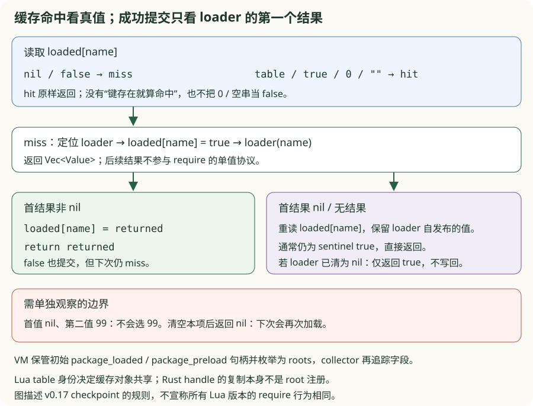
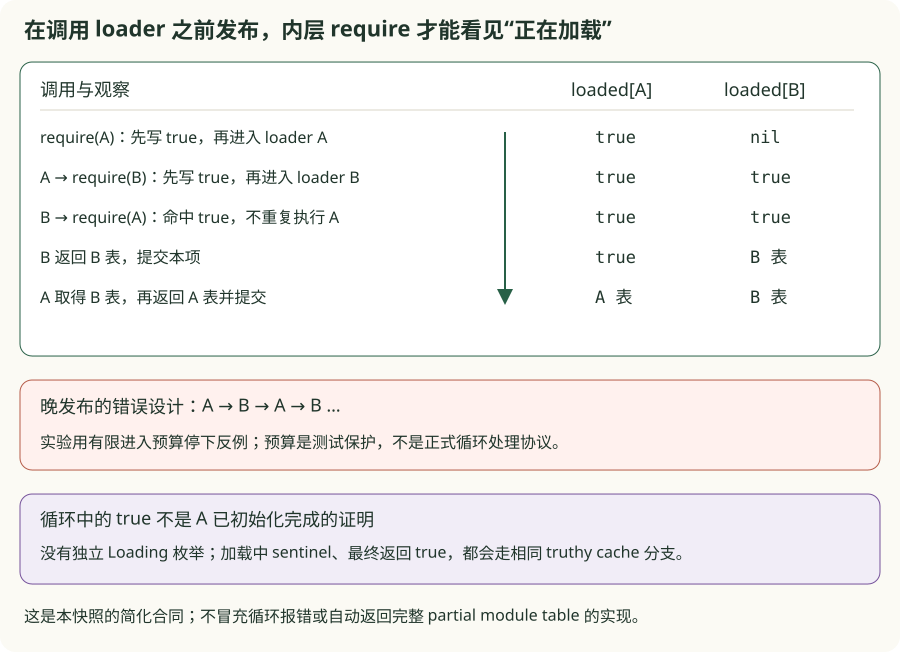
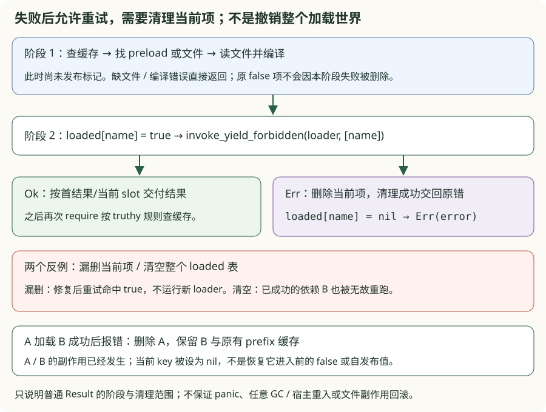

# v0.17 · 宿主标准库与 Lua 模块

<div class="lesson-meta"><span>重复执行 → 真值缓存 → 循环可见性 → 失败重试</span><span>5-crate workspace</span><span>checkpoint v0.17</span></div>

<a id="learning-task-card"></a>
## 学习任务卡

<div class="task-card">
  <strong>让 require 的副作用、缓存和失败状态都有可观察的边界</strong>
  <p>前置：v0.16 的 callback Result/禁止 yield、v0.13 的 Heap owner。依次解决：
  重复 require 为什么又执行；缓存为什么要看真值；A→B→A 怎样停下；首次报错为何
  让修复后的重试假成功。产出是四个独立 TODO、固定反例、状态图和真实 VM/文件对照。
  文件、os、debug 仍属于本 checkpoint 的背景能力，本轮不扩展这些宿主 API。</p>
</div>

v0.16 的 math/string/table 函数主要处理内存中的 `Value`。文件、环境、时钟和模块加载不同：它们会接触平台状态，可能部分成功，且离开 Lua 作用域后仍需要关闭资源。本版增加一个核心能力：**让 Runtime 对宿主资源、加载缓存和调试视图拥有明确的生命周期与失败协议**。

本轮把 require 拆成缓存、循环、重试三个局部实验。`faults.rs` 是人为写坏的设计，
不是历史中间 VM；CLI 固定并列错误版与参考，不读取学习者 `starter.rs`。每包另用
真实 v0.17 验证对应行为。练习模型互相独立，不拼接成另一个完整解释器。

<a id="learning-predict"></a>
## 先预测再运行

先预测下面三件事：两次 require 是否得到同一个表、B 在循环里能看到 A 的什么值、
第一次失败后修复重试会不会再运行副作用。

```lua
{{#include ../../code/v17-host-stdlib-modules/examples/require_contracts.lua}}
```

从仓库根目录运行；后面的命令继续使用同一 manifest 变量：

```powershell
$moduleManifest = 'book/code/v17-host-stdlib-modules/Cargo.toml'
cargo run --quiet --manifest-path $moduleManifest -- book/code/v17-host-stdlib-modules/examples/require_contracts.lua
cargo run --quiet --manifest-path $moduleManifest --example require_cache_problem_chain
cargo run --quiet --manifest-path $moduleManifest --example require_cycle_problem_chain
cargo run --quiet --manifest-path $moduleManifest --example require_retry_problem_chain
```

Lua 探针应返回 `type=boolean value=true`：lesson 只执行一次；循环内层看到的是 true；
retry 两次实际执行，effects 最终也是 2。CLI 退出 0 只说明固定对照重放完成，不能
代替显式 `--ignored` 的 learner 验收。接着再预测：loader 返回 false 是否只加载一次？

<a id="learning-code-map"></a>
## 代码阅读地图

1. [缓存实验](https://github.com/YanqingXu/lua_rust/blob/main/book/code/v17-host-stdlib-modules/exercises/cache/README.md)：重复执行 → `Value::is_truthy` → loader 首结果与自发布；
2. [循环实验](https://github.com/YanqingXu/lua_rust/blob/main/book/code/v17-host-stdlib-modules/exercises/cycles/README.md)：发布标记的时点 → A/B trace → 临时 true 与最终结果；
3. [重试实验](https://github.com/YanqingXu/lua_rust/blob/main/book/code/v17-host-stdlib-modules/exercises/retry/README.md)：保存 Result → 清当前 key → 保留依赖与副作用；
4. `invoke_package::Require`：缓存读取、preload/path 定位、标记、`invoke_yield_forbidden`、提交/失败清理；
5. `compile_source → compile → Heap::allocate_function`：复用 compiler，随后在当前 VM 执行；
6. `Vm::new / gc_roots`：保存初始 loaded/preload 句柄并作为根；
7. UserdataRef 与 VM file map：Lua 身份和 `Option<File>` 宿主 owner；
8. close/prune/drop：显式关闭、GC 后清理、VM shutdown 的资源 drain；
9. byte-oriented IO 与 debug views：内容保留 bytes，只暴露真实存在的调试数据。

这里有两套不同的生命周期：Heap 决定 Lua userdata identity 是否可达；VM map 决定宿主 File
何时关闭。它们通过 typed handle 关联，但不能互相替代。只删除 Heap record 而不 prune map
会泄漏 OS handle，只关闭 File 而不保留 tombstone又无法实现 `io.type`。

## 文件不是普通 userdata 标签

文件值使用 `UserdataRef` 参加 Lua identity、metatable 和 GC；真正的 `std::fs::File` 保存在唯一 VM owner 的 `HashMap<UserdataRef, Option<File>>`：

```text
Lua userdata ──identity──> Runtime file entry ──owns──> OS handle
      │                           │
      └── per-object metatable    ├── Some(File): open
                                  └── None: closed tombstone
```

Heap userdata 新增独立 metatable edge，collector 会追踪它。共享 file metatable 的 `__index` 指回自身，安装 read/write/close/flush/seek；因此 `file:read()` 使用 v0.12 已实现的方法调用语义，不需要在 Parser 中添加特殊语法。

资源状态机可以先写成：

```text
open:   map[id] = Some(File)
close:  take Some(File); map[id] = None
prune:  if Heap handle is stale, remove map entry
drop:   clear map before Heap shutdown
```

[查看完整宿主文件资源实现](https://github.com/YanqingXu/lua_rust/blob/main/book/code/v17-host-stdlib-modules/crates/lua_vm/src/lib.rs)

文件有三条关闭路径：

1. `file:close()` / `io.close(file)` 将 `Some(File)` 取走并保留 closed tombstone；
2. 完整或增量 Sweep 完成后，VM 移除已经 stale 的 userdata entry；
3. `Vm::drop` 先 clear 所有文件，再执行 Heap shutdown。

测试在 Windows 上实际删除对应文件，证明 handle 已释放，而不只检查 Rust flag。closed tombstone 让 `io.type(file)` 返回 `"closed file"`，并使再次 read/write/close 产生结构化错误。

## Byte-oriented io

`io.open` 支持 r/w/a 及其 `+` 和 `b` 组合，失败返回 `nil, message`。File methods 支持：

- `read("*a")`：读剩余全部 bytes，EOF 仍返回空 string；
- `read("*l")`：读行并移除 LF 和可选 CR；
- `read("*n")`：读取 ASCII number 并把 cursor 留在 token 后；
- `read(count)`：读取指定字节数，EOF 返回 nil；
- `write(...)`：string/number coercion 后原样写 bytes，并返回 file；
- `seek("set"|"cur"|"end", offset)`、`flush`、`close`。

测试文件包含 NUL 和 0xff，证明路径转成宿主字符串不代表文件内容也转 UTF-8。当前 Windows 教学边界要求 path 本身是 UTF-8；错误会显式返回，不做 lossy 路径匹配。

`io.read/write/flush` 连接进程 stdin/stdout。默认输入输出文件切换与 lines iterator 留在兼容收口，不用隐藏 iterator 状态假装已经完成。

## OS 边界

本版实现 clock、date、difftime、execute、getenv、remove、rename、time 和 tmpname。文件系统 API 遵循 Lua 风格：成功返回 true，平台失败返回 `nil, message`；不会把权限、文件不存在或锁冲突变成 panic。

为了不依赖宿主 locale，`os.date` 当前把 timestamp 映射为 UTC civil date，支持 `*t/!*t` 和 `%Y/%m/%d/%H/%M/%S/%c/%%`。从 Unix day 到年月日使用显式整数算法，epoch 测试固定为：

```text
1970-01-01 00:00:00, weekday=5
```

`os.execute(command)` 明确是宿主副作用边界：Windows 使用 `cmd /C`，Unix 使用 `sh -c`，返回进程状态。验收只调用无参数的 shell-presence 查询，不在测试中启动任意外部命令。

## Loader 复用同一编译器

VM 在 v0.17 依赖 `lua_compiler`，但编译器仍只依赖 core，不形成环。`loadstring`、`loadfile` 和 `dofile` 都调用同一 `compile → Proto → Heap Function` 路径：

- load 成功返回可多次调用的 Lua function；
- 语法/文件错误时 loadstring/loadfile 返回 `nil, message`；
- dofile 将加载错误作为 Lua error，并原样传播 chunk 的多返回。

这也确保动态 chunk 与主脚本共享 `_G`、registry、GC 和 coroutine scheduler，而不是启动第二个 VM。

## 问题一：同一模块 require 两次，为什么初始化又运行了一次？

### 找到 loader 只解决“怎样执行”，没有决定“是否还应执行”

让 loader 增加计数并返回一张表。忽略缓存的错误版每次都会进入 loader，计数变成 2，
两次得到的表身份也不同；文件路径正确、编译成功，都不能修复这个错误。
CLI 先重放完全不查缓存的故障，再重放“只要存在就命中”的中间设计；starter 保留
第二种故障，让读者继续发现 false 也应重新加载。
CLI 的局部模型固定返回 42，通过 calls 的 2→1 隔离重复执行问题；上面的表身份是
动机场景，另由真实 VM 的 normal/self-publication probe 检查，不能从这个数值模型推出。

```powershell
cargo run --quiet --manifest-path $moduleManifest --example require_cache_problem_chain -- lookup
```

```rust
{{#include ../../code/v17-host-stdlib-modules/exercises/cache/starter.rs:require_cache_lookup_starter}}
```

先检查已加载项，再决定要不要定位 loader。`Cache::get` 已把缺项转换为 Nil，检查必须
复用 Lua 的 truthiness：

```diff
  let loaded = cache.get(name);
- (loaded != Value::Nil).then_some(loaded)
+ loaded.is_truthy().then_some(loaded)
```

```rust
{{#include ../../code/v17-host-stdlib-modules/exercises/cache/solution.rs:require_cache_lookup_solution}}
```

`lookup` 共享借用缓存，只复制返回的 Value，不复制模块表。真实 VM 通过 Heap table
保存 loaded，命中后同样复制句柄返回，所以两次访问同一 table 身份与字段内容。
nil 和 false 是 miss；0、空串、true、table 都是 hit。用 Rust 的“键存在”或数值/文本
是否为空替代 `is_truthy`，会改变重新加载的条件。

```powershell
cargo test --manifest-path $moduleManifest --test cache_reference cache_hit_requires_a_truthy_value -- --exact
```

### loader 成功了，究竟把什么写进缓存？

require 只交付 loader 的第一个结果。第二个结果不是备用值：`return nil,99` 不会
取 99。loader 也可能自己写入 loaded 再不返回值；无条件用 true 覆盖它，会丢掉它
已经发布的模块表。
starter 无条件用首值覆盖本项，空窗口则写 true：首值 nil 会删除自发布值，空窗口
又会覆盖它。这两种成功返回都需要保留 loader 的显式发布。

```powershell
cargo run --quiet --manifest-path $moduleManifest --example require_cache_problem_chain -- finish
```

```rust
{{#include ../../code/v17-host-stdlib-modules/exercises/cache/starter.rs:require_cache_finish_starter}}
```

协议差异是先消费首结果，再决定是否写入；不是寻找第一个非 nil：

```diff
- loader 成功就返回 true，忽略已发布值；或扫描第一个非 nil 结果
+ 首结果非 nil：写 loaded[name] 并返回它（包括 false）
+ 首结果 nil / 无结果：重读 loaded[name]，有值就返回该值
```

```rust
{{#include ../../code/v17-host-stdlib-modules/exercises/cache/solution.rs:require_cache_finish_solution}}
```



| loader 行为 | 本次结果 / cache | 下次 require |
| --- | --- | --- |
| 返回 table,99 | 只提交并返回该 table | 命中同一对象 |
| 返回 false | 提交 false，返回 false | miss，再执行 |
| 返回 0 或空串 | 提交对应值 | 命中 |
| 不返回 / 首值 nil，未改 slot | 调用前 true 标记仍在 | 命中 true |
| 自写模块表，首值 nil | 保留并返回自发布表 | 命中同一对象 |
| 清空本项，再返回 nil | **仅返回 true，slot 仍是 nil** | miss，再执行 |

最后一行是这个 checkpoint 的精确边界：真实源码没有在 nil fallback 时把 true
写回。模型与真实探针都保留这一行为，不能悄悄修成“任何 nil 返回都缓存 true”，再
声称讲解的是现有源码；本章也不宣称与所有 Lua 版本的 require 规则相同。

**完成条件：** 两个 hook 分别通过命中与提交合同；真实 VM 检查 loader 次数、表身份、
原始值、首 nil/后值和自发布行为。跨 execute 的 GC 检查要求实际读取缓存对象字段，
不能只比较句柄显示文本或 map 长度。精确命令见缓存包 README。

```powershell
cargo test --manifest-path $moduleManifest --test cache_reference require_success_commits_only_the_first_result -- --exact
```

这个真实探针特意替换公开的 `package.loaded` 字段并结束执行帧，再从宿主触发 GC。
随后 require 仍命中 VM 保存的初始 owner，实际读取 answer=42；新公开表里没有这项。
它证明字段重绑与内部 owner 不同，不把 Rust handle 的保存本身说成保活。

```rust
{{#include ../../code/v17-host-stdlib-modules/exercises/cache/real.rs:require_cache_real_owner}}
```

缓存现在能挡住重复执行。但第一次执行还没返回时，另一模块已经回来 require 它了。

## 问题二：A 要 B，B 又要 A，第一次加载应该何时变得可见？

### 在 loader 返回后才发布，阻挡不了重入

错误版把“完成后提交”当成唯一发布时点。A 的 loader 进入 B，B 又进入 A，因为双方
都还没返回，cache 一直未命中，产生 A→B→A→B 的重复进入。实验用固定有限预算让
错误版停下，避免用真实 stack overflow 教学；这个预算不是生产循环协议。

```powershell
cargo run --quiet --manifest-path $moduleManifest --example require_cycle_problem_chain
```

```rust
{{#include ../../code/v17-host-stdlib-modules/exercises/cycles/starter.rs:cycle_publish_starter}}
```

最小改变是把加载标记的写入移到调用前。此时要发布的是 true，还不是最终模块表：

```diff
+ vm.publish(name, Value::Boolean(true))?;
  let returned = loader(vm, name)?;
- vm.publish(name, Value::Boolean(true))?;
  vm.publish(name, returned.clone())?;
  Ok(returned)
```

```rust
{{#include ../../code/v17-host-stdlib-modules/exercises/cycles/solution.rs:cycle_publish_solution}}
```



真实顺序是：缓存 miss → 定位 loader → 写 true → `loader(name)`。A→B→A 的内层
require(A) 得到 Boolean(true)，不会重新运行 A；B 返回表后提交 B，A 随后再提交 A。
这能终止固定循环，却不能让 B 在此时访问尚未完成的 `A.answer`。

### true 代表“完成”还是“进行中”？

本快照没有独立 `Loading` enum，也没有不能伪造的内部 sentinel。加载标记和模块
最终返回的 true 走同一个 truthy 分支，因此单看值不能判断初始化阶段。若 loader
自行提前发布 table，内层可以读到它，但那是 loader 明确建立的边，不是 require
自动创建完整模块对象。

**完成条件：** 模型自循环/A-B 循环的 trace 与次数正确；真实 preload 和 Lua 文件
分别验证内层看到 true、最终缓存是实际表。固定预算耗尽只证明晚发布的反例会重复
进入，不应被当作真实 VM 的循环错误类型。本包循环成功路径的模型不承担失败恢复，
只处理固定单结果 loader；nil/false 提交矩阵由缓存包负责，下一问再单独检查失败恢复。

```powershell
cargo test --manifest-path $moduleManifest --test cycles_reference loading_sentinel_is_visible_before_recursive_loader_call -- --exact
```

## 问题三：第一次 loader 报错，为什么修好之后却得到 true？

### `?` 把普通错误交回了，却把加载标记留下了

先让 loader 增加副作用计数，再返回 Err；修复 loader 后用同一个 VM 再 require。
错误版若直接 `loader(...)?`，会跳过删除，第二次命中残留 true，不再运行修复后的
loader。看起来“没有再报错”，实际上连修复代码也没执行。

```powershell
cargo run --quiet --manifest-path $moduleManifest --example require_retry_problem_chain
```

```rust
{{#include ../../code/v17-host-stdlib-modules/exercises/retry/starter.rs:retry_attempt_starter}}
```

把 Result 留在局部变量中，明确匹配 Err，再决定删除与返回的顺序：

```diff
- let results = loader(vm, name)?;
- Ok(vm.finish(name, results))
+ let result = loader(vm, name);
+ match result {
+     Ok(results) => Ok(vm.finish(name, results)),
+     Err(error) => { vm.loaded.remove(name); Err(error) }
+ }
```

```rust
{{#include ../../code/v17-host-stdlib-modules/exercises/retry/solution.rs:retry_attempt_solution}}
```

模型保留原 VmError 验证种类、位置和消息，清理只删除当前 key。真实 VM 使用
`Heap::table_set(name, Nil)` 删除本项；若这个 Heap 清理本身失败，源码会用 cleanup
错误替换原错误，所以“总能返回原错误”只适用于删除成功的普通路径。



### 为什么不能直接清空整个 package.loaded？

A 加载 B 成功后，A 自己报错。清空整个 loaded 会连 B 和原有 prefix 模块都删掉，
导致重试 A 时 B 被无故再执行。正确清理只令 A=nil，B 继续命中；A 的副作用则已经
发生，第二次运行会再次发生。这是当前缓存项的失败清理，**不是回滚整个依赖图或
Lua 全局副作用**。

它也不是“恢复进入前的旧值”：原项为 false 时，运行阶段失败后变 nil；loader 先
自发布 table 又报错，当前项同样删掉。这个固定合同要与文件定位失败区分。

### 所有失败都发生在标记写入之后吗？

| 阶段 | 发生的错误 | 当前 loaded 项 |
| --- | --- | --- |
| 查缓存后、定位 loader 时 | 缺文件、package.path 无效 | 尚未写新标记，原值不因本阶段失败被删 |
| 读到首个文件后编译 | 语法错误 | 同样发生在标记之前；不会继续试后一个模板 |
| 写 true 后执行 loader | 普通运行错误、不可调用 preload、禁止 yield | 删除当前 key，再返回错误 |
| 正常提交/清理时 | Heap API 本身失败 | 遵循实际错误分支，模型不注入分配/清理失败 |

文件 probe 使用同一 VM 和独立临时目录，先分别复现 missing/compile/runtime，再
修复文件后重试；preload probe 则在同一次 execute 内替换 loader 并重试。另一个
coroutine 在 require 拒绝 loader yield 后继续运行，修好 loader 后加载成功，再在
同一 coroutine 合法 yield/resume，避免用新 VM 的初始化掩盖禁止状态泄漏。

**完成条件：** 不只要求第二次不报错，还要检查新 loader 的次数/结果、旧错误的保留、
当前项精确 nil、依赖 B 与 prefix 保留，以及副作用没有被伪造回滚。这个 Result
模型不承诺 panic/abort、任意 callback 资源或全部 GC 阶段都能恢复。

```powershell
cargo test --manifest-path $moduleManifest --test retry_reference failure_removes_only_the_current_loading_entry -- --exact
```

## 从真实 require 源码读出边界

[完整 module loader](https://github.com/YanqingXu/lua_rust/blob/main/book/code/v17-host-stdlib-modules/crates/lua_vm/src/lib.rs)
从 `invoke_package::Require` 开始。不要一次 include 全函数；依次沿三个练习中的局部
合同回到源码的 lookup、publication、invoke 和 cleanup/commit 分支。

- 先查初始 loaded 表；preload 非 nil 就按 callable 路径尝试，false 也不是“没有 preload”。
- 文件搜索把模块名的 `.` 换成 `/`，把每个分号模板中的 `?` 替换为该路径；空模板忽略。
  读取失败累积候选诊断，首个可读文件编译失败则立即返回，不继续搜索。
- 当前 compiler 产生 Proto 并分配 Heap Function，loader 在同一 VM/global/registry
  执行，参数是模块名字；不是再启动一个隔离 VM。
- VM 保存初始 `package_loaded/package_preload` 句柄并直接枚举为 roots；只替换
  `package.loaded` 或 `package.preload` 字段不会换掉这两个内部 owner。文件 path
  则从当前 global `package` 表读取。模型的缓存容器不证明这些 Heap/GC 行为，须看 real 对照。
- 从 loader 结果返回到缓存提交的现有同步路径没有新增 GC checkpoint。不能因为局部
  Vec 拥有 Value 就说任意时点都安全；v0.15/v0.16 已记录的 GC 缺口不由本章覆盖。

`package.loadlib`、原生动态模块及完整 package searcher 协议不在本 checkpoint 内。

## Debug 视图

debug 库公开本阶段能由真实 Runtime 数据支撑的入口：getinfo、getmetatable、setmetatable、getregistry、getupvalue、setupvalue 和 traceback。

- getinfo 接受 Lua/native function 或活动 stack level，读取 Proto debug name、upvalue 数和 line；
- getupvalue/setupvalue 直接访问 Closure 的 typed upvalue handles，并返回编译器记录的名字；
- debug metatable API 绕过 `__metatable` 保护，覆盖 table、userdata 和 primitive type；
- registry 返回 v0.13 已作为 GC root 的真实 registry table；
- traceback 基于当前 call-info 生成 byte string。

当前还没有 lexical local name/location 表、hook event 或 function environment，所以相应 debug API 不注册，而不是返回猜测值。

## Rust 知识映射与设计选择

- `Option<File>` 同时表达 open resource 与可观察的 closed userdata；
- file metatable 是 Heap graph edge，宿主资源 map 是 Runtime ownership edge，两者职责不混淆；
- `OpenOptions` 把 Lua mode string 翻译为显式权限组合；
- `Result<Vec<Value>, VmError>` 表达 Lua error，`Vec<Value>{nil,message}` 表达普通平台失败；
- `loaded[name] = true` 在 loader 调用前发布；调用后的普通错误只删当前 key，定位失败时还没有新标记；
- loader callback 在禁止 yield 的宿主边界执行，避免暂停一半的 require transaction；
- VM Drop 先 drain 宿主资源，保证确定性 shutdown。

替代方案是把 `File` 直接塞进 Heap object，但会迫使 core 依赖 `std::fs`，破坏 runtime value 与宿主能力的边界。另一个方案是全局 integer fd；typed userdata identity 更自然地复用 metatable、GC 和错误分类。

## 从 v0.16 迁移了什么

- 新增：io/file、os、package、debug builtin catalog；
- 新增：Userdata 独立 metatable 与 GC tracing edge；
- 新增：open file owner map、三条资源 drain 路径和二进制 IO；
- 新增：UTC time、环境、文件系统、shell status 与平台错误协议；
- 新增：loadstring/loadfile/dofile 共用编译器；
- 新增：package.path/preload/loaded、Lua file require、循环 sentinel、缓存与 rollback；
- 新增：Proto/upvalue/registry/metatable/traceback debug 视图；
- 保留：v0.16 核心库矩阵与 v0.15 coroutine/GC 合同；
- 排除：动态 native module、C API 和 binary chunk。

## 运行与验收

```powershell
cargo run --manifest-path book/code/v17-host-stdlib-modules/Cargo.toml -- `
  book/code/v17-host-stdlib-modules/examples/demo.lua
cargo test --manifest-path $moduleManifest --test cache_reference
cargo test --manifest-path $moduleManifest --test cycles_reference
cargo test --manifest-path $moduleManifest --test retry_reference
cargo fmt --manifest-path $moduleManifest --all -- --check
cargo clippy --manifest-path $moduleManifest --workspace --all-targets -- -D warnings
cargo test --manifest-path $moduleManifest --workspace
cargo test --manifest-path $moduleManifest --workspace --release
```

示例 require 一个只加载一次的 Lua module，写入并重读临时文件，再用 debug.getinfo 检查 module function：

```text
type=number value=1717
```

原快照基线有 119 项：74 个主线端到端、7 个核心标准库/差分、10 个宿主标准库与模块、
7 个编译器、15 个 core、3 个 stdlib 合同与 3 个 VM。本轮增加 24 项参考（cache 9、
cycles 6、retry 9），合计 **143 通过、4 个 learner ignored**。不把 ignored 当作
完成；文件探针使用进程唯一临时目录，不改变工作目录。

```powershell
cargo test --manifest-path $moduleManifest --test cache_exercises -- --ignored
cargo test --manifest-path $moduleManifest --test cycles_exercises -- --ignored
cargo test --manifest-path $moduleManifest --test retry_exercises -- --ignored
```

初始三组分别有 2/1/1 项失败。只修改各包 `starter.rs` 指定 hook，完成后同一合同通过。
各题可独立完成；固定 CLI 和默认参考不读取 starter，不需要先完成上一包。
维护者需验证“初始失败 → 临时套解通过 → 原字节恢复后再失败”，防止假绿或交付已填答案。
逐题命令、成功观察和模型范围见各包 README。

```powershell
powershell -NoProfile -ExecutionPolicy Bypass -File tools/check_book_teaching.ps1
mdbook build book
node tools/check_book_links.mjs target/mdbook .
```

## 本版本暂不支持

- io.input/output 默认流切换、io.lines/file:lines、io.tmpfile 和 setvbuf；stdin 的 `*n` 尚未实现；
- os.exit、setlocale，以及 os.time(table)；os.date 不是宿主 localtime/locale 的完整 formatter；
- package.loaders/cpath/loadlib、`module(...)`/package.seeall 和动态 native module；
- debug.getlocal/setlocal、gethook/sethook、debug.debug、getfenv/setfenv；
- loader 的 chunk name 仍是教学 Proto name，traceback 尚未携带规范化 `@path`；
- Windows host path 当前要求 UTF-8，未覆盖任意宽字符路径；
- v0.16 尚未实现的 Lua pattern 与完整 string.format 仍未补齐。

<a id="learning-exercises"></a>
## 章末练习

<div class="exercise understanding">
  <strong>理解题：同一个 true 为什么可能处在不同阶段？</strong>
  <p>沿循环图说明发布标记、重入命中、最终提交的先后；再沿缓存表说明 nil、false、0
  和空串分别何时再次执行。运行 cache/cycles CLI 对照；成功条件是能解释循环中拿到
  true 为什么不能读取完整模块字段，以及它为何不等于已完成初始化。</p>
</div>

<div class="exercise implementation">
  <strong>实现题：完成四个独立 hook</strong>
  <p>只修改 cache 的 lookup/finish、cycles 的 publication、retry 的 attempt。
  运行上面三个 --ignored 命令；2/1/1 项全部通过才完成。不要改固定故障、合同、
  真实核心或默认 ignored 标记来取得通过。</p>
</div>

<div class="exercise debugging">
  <strong>调试题：重试不报错，是否真的执行了修复代码？</strong>
  <p>运行 retry CLI，对照漏删当前项与清空全部缓存两种故障。检查第二次 loader 的次数
  和结果、B 的执行次数、当前 key 与 prefix；成功条件是能解释“假命中 true”和
  “无故重跑成功依赖”的不同原因，并说明副作用为何仍存在。</p>
</div>

<a id="learning-checkpoint"></a>
## 完成检查点

- 能画出 userdata、VM resource map 和 OS handle 的 owner 图；
- 能解释三条资源 drain 路径；
- 能用真实值与执行次数解释缓存命中和首结果提交，而不是只看 key 是否存在；
- 能手推 A→B→A 的缓存轨迹，区分循环中的 true 与最终模块表；
- 能区分标记发布前后的错误，并验证当前项清理、依赖保留与同 VM 重试；
- 四个独立 TODO 显式通过，能分清模型、真实快照、GC/禁止 yield 的验证范围；
- 能区分 Lua error 与 `nil,message` 平台失败。

## 与成熟实现和专题章节的对应

- 当前成熟实现的 scoped runtime access、HostIo、package searcher 与 debug hooks 是本版显式 owner map 的扩展目标；
- [Runtime 所有权与 GC](v13-runtime-gc.md) 可回看为什么 registry/package/file metatable 必须进入 root inventory；
- [Coroutine](v15-coroutine.md) 可对照 require/file callback 为什么属于禁止 yield 的宿主边界；
- [核心标准库](v16-core-stdlib.md) 可回看 catalog 和 HostError 如何扩展到平台失败；
- 若继续本版教学，可从 file userdata 已失去 Lua 可达性但 OS handle 仍被 map 拥有的问题，继续展开显式 close、GC prune 与 Drop 的状态迁移；本轮没有完成这组练习。
- 下一 checkpoint 是 v0.18：完成 CLI/REPL 合同，并新增 `lua_bytecode` crate 提供 text/JSON、CFG、trace、fixture manifest 与超时 runner。
