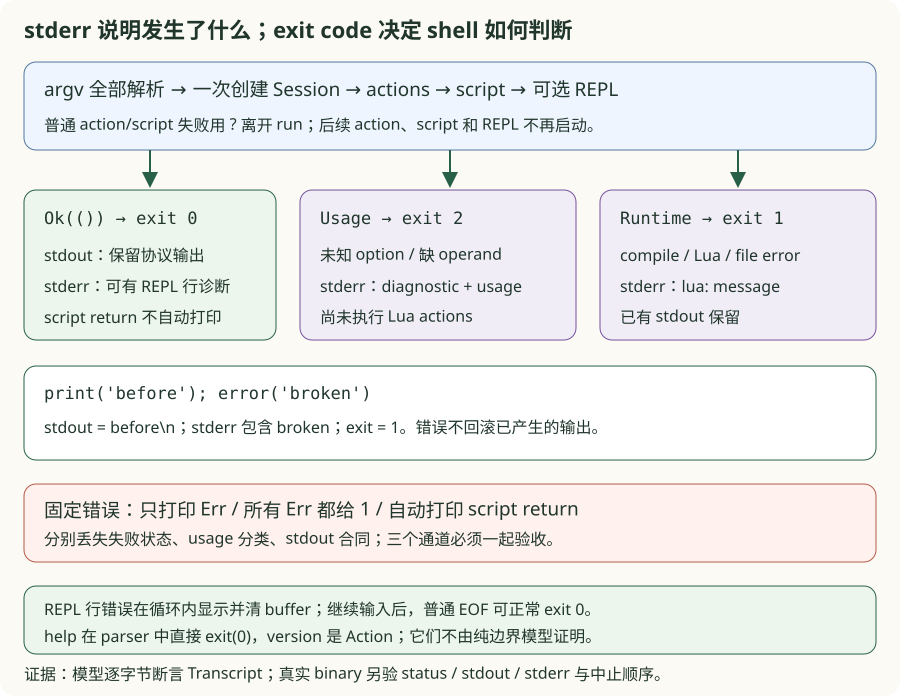
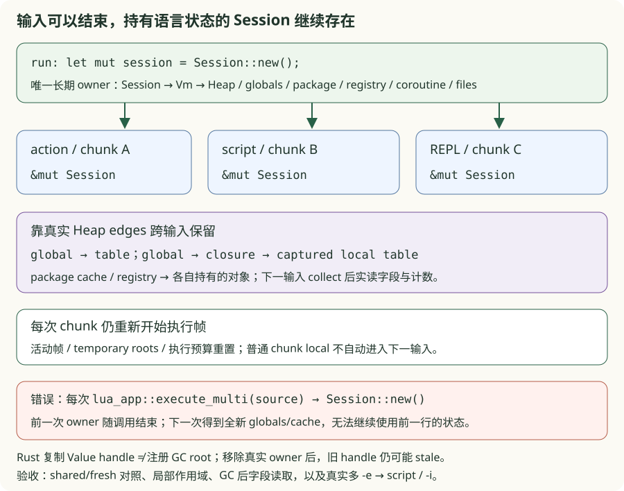
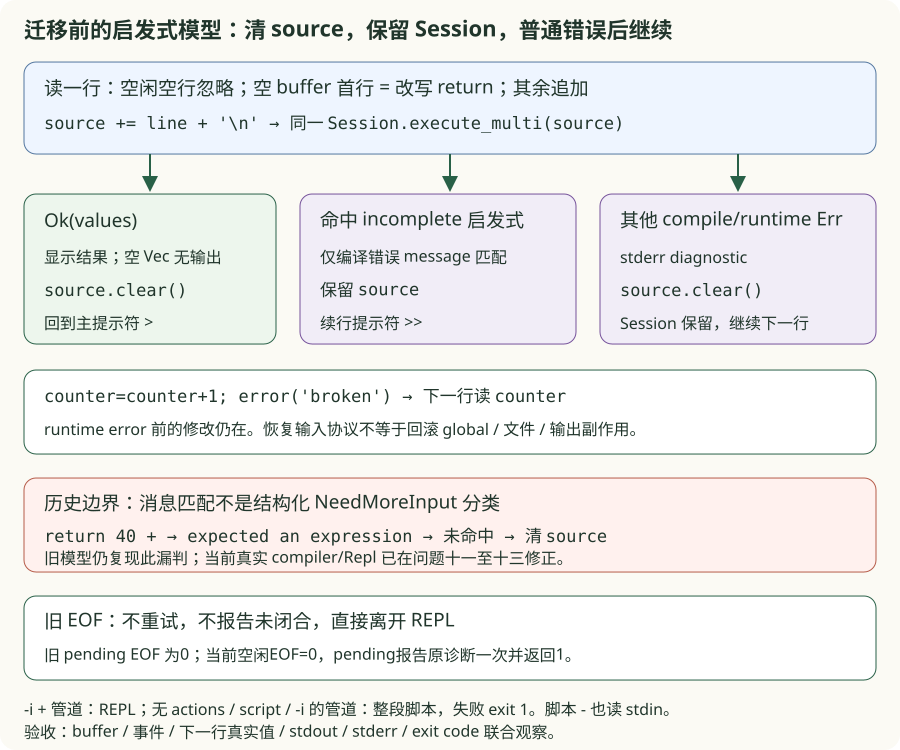

# v0.18 · CLI、REPL 与字节码工具

<div class="lesson-meta"><span>错误退出 → Session owner → 输入 buffer 与恢复</span><span>6-crate workspace</span><span>checkpoint v0.18</span></div>

<a id="learning-task-card"></a>
## 学习任务卡

<div class="task-card">
  <strong>让 shell 看见失败，让下一次输入看见该保留的状态</strong>
  <p>前置：v0.17 的 VM owner、loader 与宿主 I/O。依次解决：打印错误为什么仍是退出
  0；每行重新 execute 为什么丢失 global；报错后该清源码还是重建 VM。新增 Rust 概念
  是 ExitCode/Result 的边界、Session 的长期可变 owner、短命 source buffer 与子进程
  stdio 协议。产出为三个独立 TODO、固定反例、前后差异、状态图和真实进程验收。
  bytecode 工具保留本 checkpoint 的阅读入口，本轮不扩展其 JSON/CFG/trace 协议。</p>
</div>

到 v0.17 为止，binary 只执行单份文件/stdin 源码并总是打印 Rust 风格的最终 Value。本版增加一个核心能力：**把脚本、交互和诊断都变成有明确 stdout/stderr/exit-code 合同的工具，并用真实子进程测试守住它们**。

<a id="learning-predict"></a>
## 先预测再运行

先写出以下三个实验的预测：错误已经写到 stderr，进程是否一定失败；第二行是否能
看到第一行的 table/closure；一行 runtime error 后，global 和当前 source 应各自怎样处理。

```lua
-- 脚本模式：print 的副作用已经发生，后面的 error 不能抹掉它。
print("before")
error("broken")
```

从仓库根目录执行。先构建真实 binaries；三个示例只定位同 profile 的 lua_app，
不会在运行中再启动 cargo。切换 Release 时也先构建 Release binaries。

```powershell
$toolManifest = 'book/code/v18-cli-tools/Cargo.toml'
cargo build --manifest-path $toolManifest --bins
cargo run --quiet --manifest-path $toolManifest --example cli_exit_problem_chain
cargo run --quiet --manifest-path $toolManifest --example repl_owner_problem_chain
cargo run --quiet --manifest-path $toolManifest --example repl_recovery_problem_chain
```

每个 CLI 固定并列 faults 与 solution，并另跑真实 v0.18 子进程；退出 0 表示固定
对照重放完成，不等于 learner 已完成。错误版是人为设计的局部反例，不是历史中间 VM。
精确的 stdin bytes、stdout/stderr 和 exit code 由各包 real/contracts 留作永久复现入口。

<a id="learning-code-map"></a>
## 代码阅读地图

1. [退出实验](https://github.com/YanqingXu/lua_rust/blob/main/book/code/v18-cli-tools/exercises/cli_exit/README.md)：`main → run → CliError`，先读 stream/code 合同，再看固定边界反例；
2. `parse_options → Vec<Action> → arg_entries`：先完成解析，再按顺序执行 actions；
3. [owner 实验](https://github.com/YanqingXu/lua_rust/blob/main/book/code/v18-cli-tools/exercises/repl_owner/README.md)：`Session::new → execute_multi → Vm::execute_multi`，找到跨 chunk 保留与每次重置的字段；
4. [恢复实验](https://github.com/YanqingXu/lua_rust/blob/main/book/code/v18-cli-tools/exercises/repl_recovery/README.md)：`repl → source → execute_multi → is_incomplete`，区别 Session 与 buffer 生命周期；
5. 共享进程探针：spawn、写完关闭 stdin、并行 drain 两个输出、deadline、kill/wait exact child；
6. bytecode JSON/CFG/trace：保留 bytes、控制流与 instruction-before 观察协议。

一次进程执行也是资源协议：stdin 必须及时关闭，stdout/stderr 必须都被 drain，
timeout 后必须 kill 并 wait。本轮三个局部模型各隔离一个决策，再由真实 Session 或
真实 binary 兑现对应合同；边界模型不假装捕获 Lua print，也不实现第二套 parser/VM。

## CLI 是动作序列，不是一个脚本参数

命令行 parser 先把 options 转成按原顺序执行的 actions：

```text
-e chunk ─┐
-l module ├──> shared Session/VM ──> script or stdin ──> optional REPL
-v        ┘
```

支持的入口包括：

- `lua_app script.lua args...`：运行文件；
- `lua_app -` 或无参数且 stdin 非终端：从 stdin 读取 bytes；
- `-e stat` / `-estat`：可重复执行 chunk；
- `-l name` / `-lname`：按出现顺序调用 require；
- `-i`：actions/script 完成后进入同一个 VM 的 REPL；
- `--`：终止 option parsing，使以 `-` 开头的脚本名合法；
- `-v/--version`、`-h/--help`；
- 保留教学兼容开关 `--dump-bytecode`，正式观察推荐独立工具。

Session 只创建一次 VM，因此多个 `-e`、preload module、脚本和 REPL 能看到彼此的 globals、package cache、registry 和 GC 状态。

## `arg` table 的相对索引

CLI 保存包括 executable 在内的原始 argv，并以 script 位置为原点：

```text
lua_app -e setup script.lua first second
   -3    -2   -1       0        1     2
```

具体 option operand 的位置会随 argv 改变，但规则固定为 `arg[index - script_position]`。脚本路径放在 0，脚本参数从 1 开始，解释器/options 位于负索引。VM 的 `set_arg_table` 创建真正 Heap table，再写入 `_G.arg`；测试同时读取正索引和 `arg[-1]`。

Windows `OsString` 在当前教学 checkpoint 以 lossy UTF-8 注入 Lua，任意宽字符 argv 留给跨平台 SDK 收口；脚本文件本身仍按 bytes 读取。

## stdout、stderr 与退出码

CLI 不再自动打印脚本 return value。Lua `print/io.write` 决定 stdout，REPL 才显示求值结果：

| 情况 | stdout | stderr | exit code |
|---|---|---|---:|
| 正常脚本 | Lua 自己的输出 | 空 | 0 |
| compile/runtime/file error | 已产生的 Lua 输出，可能非空 | `lua: message` | 1 |
| 未知 option/缺 option operand | 空 | error + usage | 2 |
| help/version | 合同文本 | 空 | 0 |

区分 1 和 2 让 shell/CI 能判断用户程序失败和调用方式错误。REPL 内一条输入的普通
错误由循环处理，通常不会使最终 EOF 返回 1；stdin 读取或 stdout 写入失败等宿主错误
仍可能离开循环。不能把“stderr 非空”直接等同于非零退出。

## 持久 REPL 与续行

REPL 复用 Session，支持：

- `= expression` 自动改写成 `return expression`；
- 非空 return values 以 tab 分隔，byte string 直接写 stdout；
- compile error 的 message 命中 `expected 'end'`、`unexpected end` 或 `unterminated`，则保留 buffer 并显示 `>> `；
- 普通 compile/runtime error 写 stderr、清空当前 buffer，REPL 继续；
- EOF 干净退出。

这是当前快照的字符串启发式，不是独立的结构化 Incomplete 错误类别。问题三会实测
它的漏判与 pending buffer 的 EOF 边界，不把这段代码描述成完整 Lua 续行 parser。

## 问题一：终端已经显示错误，shell 为什么仍判断成功？

### 错误信息和进程状态走两条通道

在 `fn main() { if let Err(e) = run() { eprintln!(...) } }` 中，打印后正常返回 unit，
进程仍成功。把所有 Err 都返回 1 又会丢掉 usage=2 的分类；把脚本 return value
顺手打印，则让 `return 42` 污染 stdout。三个固定错误分别暴露 status、分类和输出
边界问题；不能只数 stderr 行数来验收。

```powershell
cargo run --quiet --manifest-path $toolManifest --example cli_exit_problem_chain
```



实现题只补 `finish`。输入已包含此前产生的输出与运行结果；这个纯边界模型不解析
argv、不执行 Lua，也不实现捕获全局 stdout。真实进程对照负责检验这些外部行为。

```rust
{{#include ../../code/v18-cli-tools/exercises/cli_exit/starter.rs:cli_exit_starter}}
```

```diff
- Err(error) => { eprintln!("{error}"); /* main 正常返回，code=0 */ }
+ Ok(()) => ExitCode::SUCCESS
+ Err(Usage(message)) => { stderr(error + usage); ExitCode::from(2) }
+ Err(Runtime(message)) => { stderr(error); ExitCode::from(1) }
```

这段 diff 表示真实 `main` 的协议迁移；练习的 Transcript 让 stream/code 可直接断言：

```rust
{{#include ../../code/v18-cli-tools/exercises/cli_exit/solution.rs:cli_exit_solution}}
```

边界追加 diagnostic，不覆盖此前 stdout；真实 `print('before'); error('broken')`
保留 `before\n`，stderr 有 broken，code=1。失败的 action 用 `?` 离开 run，后续
`-e`、脚本和 `-i` 都不再启动。options 整体解析在 actions 执行之前，不能把未知
option 当作已经执行某些 action 后的运行错误。

真实 help 在 parse_options 中直接打印并 exit(0)；version 是有序 Action。纯模型的
success 分支不证明这两个解析路径，也不承诺所有 `process::exit` 路径都运行析构。
**完成条件：** 同时核对 status、完整 stdout 与 diagnostic/usage；不要以“看到了错误”
替代非零退出，也不要把脚本 return value 当成 Lua 自己的输出。逐项命令见退出包 README。

```powershell
cargo test --manifest-path $toolManifest --test cli_exit_reference result_boundary_preserves_streams_and_maps_exit_codes -- --exact
```

## 问题二：上一行明明创建了 table，下一行为什么得到 nil？

### 一次性 convenience API 不是跨输入 owner

`lua_app::execute_multi(source)` 为一次调用新建 Session；`Session::execute_multi`
则可变借用已有 Session。两个函数名字相近，所有权位置却不同。固定错误在每次
submit 时调用前者，第一行的 table/closure/package 状态随 owner 结束，第二行
自然不能继续使用。

```powershell
cargo run --quiet --manifest-path $toolManifest --example repl_owner_problem_chain
```

```rust
{{#include ../../code/v18-cli-tools/exercises/repl_owner/starter.rs:repl_owner_starter}}
```

```diff
  fn submit(session: &mut Session, source: &[u8]) -> Result<Vec<Value>, AppError> {
-     lua_app::execute_multi(source)
+     session.execute_multi(source)
  }
```

```rust
{{#include ../../code/v18-cli-tools/exercises/repl_owner/solution.rs:repl_owner_solution}}
```



Session 在 run 中只创建一次，再传给各 action、脚本和 repl；每次提交仅临时独占
借用它。长期保留的是 VM 中的 Heap、global/registry/package owner、coroutine 状态
和资源登记，**不是上一个 chunk 的局部作用域或寄存器**。`Vm::execute_multi` 会重置
call stack、活动帧、活动函数、temporary roots、手动 GC mode 与本次指令预算。

跨输入要保留的 local，必须通过仍可达的闭包 upvalue 等真实边保存。练习先把 table
挂到 global，把另一个 local table 捕获进 global closure；下一输入先 collect，再
实读字段与计数。同时检查 chunk-only local 下一次为 nil、package cache 的字段/次数
与 registry edge。只看两次返回 handle 的显示文本不能证明对象仍活着。

```rust
{{#include ../../code/v18-cli-tools/exercises/repl_owner/chunks.rs:repl_owner_chunks}}
```

Rust 中保存一个 `Value::Table` 也不会自动把它登记为 Heap root。包内另用公开 Vm
探针移除合法 owner、结束旧执行帧后回收，再精确验证旧 handle 已 stale；跨输入
模型自身只保留 number/bool/nil 观察结果，避免拿未注册的宿主 handle 冒充保活。
本包不把此前 v0.15/v0.16 已登记的 GC 缺口说成已修复。

**完成条件：** 同一 Session 下 table/closure/module/registry 可实际访问，fresh 故障
确实丢状态；真实 CLI 的多 `-e → script` 与 `-i` 输入也得到预期结果。learner 只改
submit 的调用目标，不复制一份 VM、搬运 globals 或重建缓存来绕过 owner 合同。

```powershell
cargo test --manifest-path $toolManifest --test repl_owner_reference submissions_preserve_globals_tables_closures_and_owner_edges -- --exact
```

## 问题三：REPL 报错后，下一行应该接着哪一份状态？

### Session 继续存在，当前输入有自己的提交与清空时点

把 source 每行清空，三行 if 就再也拼不成完整 chunk；所有错误都保留 source，后续
输入会被拼到坏语法后面；把 `execute_multi(...)?` 直接传播出 REPL，则一条普通错误
就结束会话。三个错误都用了同一个持久 VM，仍然无法正确恢复输入协议。

```powershell
cargo run --quiet --manifest-path $toolManifest --example repl_recovery_problem_chain
```

```rust
{{#include ../../code/v18-cli-tools/exercises/repl_recovery/starter.rs:repl_recovery_starter}}
```

最小迁移是保存本次执行结果，在 REPL 层决定 buffer 的去留：

```diff
- session.execute_multi(source.as_bytes())?; // 首错结束会话
- source.clear();                          // 或每行无条件清空
+ match session.execute_multi(source.as_bytes()) {
+     Ok(values) => { display(values); source.clear(); }
+     Err(Compile(e)) if is_incomplete(&e) => { /* 保留 source，等待续行 */ }
+     Err(e) => { diagnostic(e); source.clear(); /* 接受下一行 */ }
+ }
```

```rust
{{#include ../../code/v18-cli-tools/exercises/repl_recovery/solution.rs:repl_recovery_solution}}
```



这个 hook 返回当前事件，外围固定循环负责显示和继续；错误不需要借一个新 Session
来“恢复”。编译失败还没执行 chunk；runtime error 之前已经改过的 global、文件或
输出副作用却不会被回滚。合同让 `counter=counter+1; error(...)` 失败，下一输入
仍读到增长后的 counter，避免只验证“下一行没报错”。

`=expr` 只在 source 为空时改写成 return；续行里的 `=` 不是新表达式入口。无返回值
得到空 Vec，不输出结果行；显式 return nil 得到一个 Nil，仍显示 nil。空闲空行不执行
chunk；存在 pending source 时空行按原样进入 buffer。

### “还没写完”是目前启发式的判断，不是完整语法结论

```rust
{{#include ../../code/v18-cli-tools/exercises/repl_recovery/model.rs:repl_recovery_classifier}}
```

当前 `is_incomplete` 只匹配 message 中的三个片段。像 `return 40 +` 本来可以追加
`2` 完成表达式，却报 expected an expression，未命中规则，source 会被当普通错误
清掉。这是快照的可运行漏判；本题保留该边界，后续若改 parser，应单独引入结构化
NeedMoreInput 合同并重验。不能用扩展模型的理想行为冒充当前 binary 的事实。

EOF 也需按当前实现观察：pending buffer 不再重试，不额外报告“未闭合”，离开函数
时销毁 buffer 并返回正常退出。`-i` 即使接到管道仍使用 REPL/banner/prompts；没有
script、没有 actions 且未指定 `-i` 时，非终端 stdin 才默认一次 read_to_end，作为
脚本执行，错误按 CLI code=1 处理。显式脚本 `-` 也读 stdin；已有 `-e` 不会再自动
读取管道。这不是同一种
跨行协议。read/flush 等宿主 I/O 错误可离开循环，普通 Lua 输入错误才在循环内恢复。

**完成条件：** 对照精确事件、buffer 内容、下一输入的真实值和进程 stream/code。
共享合同检查成功/普通编译错/runtime 错清空、未完成保留；真实 `-i` 检查错误后继续，
并单独记录 EOF pending 与续行漏判，不能只检查 stderr 含某个词。

```powershell
cargo test --manifest-path $toolManifest --test repl_recovery_reference source_lifecycle_recovers_after_errors -- --exact
```

## `lua_bytecode` crate

v0.18 新增第六个 crate。它不修改 Proto，只提供四种观察视图：

```powershell
cargo run --manifest-path book/code/v18-cli-tools/crates/lua_bytecode/Cargo.toml -- `
  --format text script.lua
cargo run --manifest-path book/code/v18-cli-tools/crates/lua_bytecode/Cargo.toml -- `
  --format json script.lua
cargo run --manifest-path book/code/v18-cli-tools/crates/lua_bytecode/Cargo.toml -- `
  --format cfg script.lua
cargo run --manifest-path book/code/v18-cli-tools/crates/lua_bytecode/Cargo.toml -- `
  --format trace script.lua
```

### Text 与稳定 JSON

text 复用 core disassembler。JSON 递归输出 Proto name、stack/params/vararg、constants、每条指令的 raw/pc/line/op/a/b/c/bx/sbx 和 nested protos。

```rust
{{#include ../../code/v18-cli-tools/crates/lua_bytecode/src/lib.rs:bytecode_json}}
```

Lua string constant 可能包含 NUL 或无效 UTF-8，所以 JSON 不把它伪装成 Unicode text，而是输出 `{"type":"string","hex":"..."}`。NaN/Infinity 也编码为 string，避免生成非法 JSON number。

### CFG

CFG builder 先找 basic-block leaders：入口、jump target、jump/return 后的下一条指令；再为每个 block 输出 DOT node 和 jump/next edge。

CFG 构建分两遍：第一遍收集入口、jump target、终止指令后继作为 leaders；第二遍切分 block
并按 opcode 添加 jump/fallthrough edge。
[查看完整 CFG builder](https://github.com/YanqingXu/lua_rust/blob/main/book/code/v18-cli-tools/crates/lua_bytecode/src/lib.rs)

Jump target 必须落在 code 范围并恰好对应 leader，否则返回 bytecode error。ForPrep/ForLoop 和条件跳转分别建模，不根据源码缩进猜控制流。

### Trace

VM 默认不记录 trace。调用 `enable_trace` 后，dispatch 在每条指令执行前保存：step 顺序、Lua call depth、Proto name、pc、line、opcode 和 register snapshot；`take_trace` 关闭记录并转移 events。

trace tool 先编译并执行 Proto，runtime error 仍以 exit 1 报告；成功时输出 JSON array。这样可以区分“字节码是什么”和“这次输入实际走了哪些状态”，为 v1.0 的 oracle VM trace gate 准备稳定数据形状。

## Fixture manifest 与超时 runner

`tests/fixtures/manifest.tsv` 为每个 CLI case 声明 script、args、expected exit、完整 stdout 和 stderr substring。Runner 启动真实 `lua_app` binary，连接三个 stdio stream，并轮询 `try_wait`：

```text
spawn ──> write/close stdin ──> poll until deadline
                              ├── exited: drain stdout/stderr
                              └── timeout: kill exact child, wait, fail test
```

旧 `tests/cli_contract.rs` 的 runner 在 child 退出后才读 stdout/stderr，现有小 fixture
使用五秒 deadline；它不证明大输出管道安全。本轮练习另用共享
[process helper](https://github.com/YanqingXu/lua_rust/blob/main/book/code/v18-cli-tools/exercises/support/process.rs)：
reader 线程并发 drain 两个输出，writer 写完关闭 stdin，主线程检查 deadline；超时
只 kill/wait 当前 child。没有按进程名批量终止，也不在示例中嵌套执行 cargo。

本轮真实子进程输入有界，helper 不扩展为通用进程树管理器。除 manifest 外，原测试
继续覆盖 `-e/-l/--`、stdin、REPL、错误分类、文件副作用和四种 bytecode format。

## Rust 知识映射与设计选择

- `Action` enum 保留 option 出现顺序；
- `Session` 封装可复用 VM，library convenience API 仍能一次性执行；
- `IsTerminal` 区分无参数 REPL 与管道脚本；
- `BufRead::lines` 与 source buffer 实现 continuation prompt；
- `BTreeSet` 让 CFG leaders 和 DOT 输出稳定排序；
- 手写 JSON escape/hex 避免为教学 viewer 引入序列化依赖，同时测试其 bytes 合同；
- `Command + try_wait + deadline` 在本轮无后代的有界 fixture 中把 hangs 变成确定性失败。

替代方案是把 REPL 每行写到临时文件并重新启动 binary，但那会丢失 globals/coroutine/package 状态。另一个方案是让 bytecode crate侵入 Compiler/VM；只读 Proto/trace event 保持工具与执行语义解耦。

## 从 v0.17 迁移了什么

- 新增：可复用 `Session`、宿主 arg table 注入和 action-ordered CLI；
- 重构：脚本 return value 不再污染 stdout；
- 新增：stdin、`-e/-l/-i/--`、help/version 和退出码合同；
- 新增：持久 REPL、表达式缩写、block 续行与错误恢复；
- 新增：`lua_bytecode` crate 和 text/JSON/CFG/trace binary；
- 新增：可开关 VM register trace events；
- 新增：fixture manifest、进程 timeout runner 和副作用验收；
- 保留：v0.17 host resources/modules 与此前全部语义测试；
- 未加入：binary chunk serializer/deserializer 或 C/native module loader。

## 运行与验收

```powershell
cargo run --manifest-path book/code/v18-cli-tools/Cargo.toml -- `
  book/code/v18-cli-tools/examples/demo.lua
cargo test --manifest-path $toolManifest --test cli_exit_reference
cargo test --manifest-path $toolManifest --test repl_owner_reference
cargo test --manifest-path $toolManifest --test repl_recovery_reference
cargo fmt --manifest-path $toolManifest --all -- --check
cargo clippy --manifest-path $toolManifest --workspace --all-targets -- -D warnings
cargo test --manifest-path $toolManifest --workspace
cargo build --release --manifest-path $toolManifest --bins
cargo test --manifest-path $toolManifest --workspace --release
```

示例在 Lua 内显式 print，因此 CLI stdout 是：

```text
1818
```

本快照原有 129 个测试：119 个原语义测试、5 个 CLI/REPL process tests、3 个 bytecode
library tests 和 2 个 bytecode binary process tests。本轮增加 20 项参考（退出 8、
owner 5、恢复 7），合计 **149 通过、3 个 learner ignored**。v0.17 教学练习的计数
仍归各自版本，不把它们重复算进这个独立快照。

```powershell
cargo test --manifest-path $toolManifest --test cli_exit_exercises -- --ignored
cargo test --manifest-path $toolManifest --test repl_owner_exercises -- --ignored
cargo test --manifest-path $toolManifest --test repl_recovery_exercises -- --ignored
```

初始每组恰好一项失败。只修改各包 starter 的指定 hook，显式 learner 全通过才完成；
默认参考、ignored 和固定 CLI 退出 0 不能代替这一验收。维护者须验证失败→临时套解
通过→原字节恢复并刷新 mtime 后再失败，防止缓存或已填答案造成假绿。精确命令、
观察值与修改范围见三个 README。

```powershell
powershell -NoProfile -ExecutionPolicy Bypass -File tools/check_book_teaching.ps1
mdbook build book
node tools/check_book_links.mjs target/mdbook .
```

## 本版本暂不支持

- REPL 没有 readline 历史、补全、TTY 编辑和 signal-aware Ctrl-C 恢复；
- multiline 判断依赖 CompileError.message 子串，`return 40 +` 等可续行前缀仍会漏判，pending EOF 静默退出；
- argv/path 在 Windows 仍采用 lossy UTF-8 adapter；
- JSON schema 还没有跨版本兼容承诺，v1.0 会冻结并登记版本；
- trace 是 instruction-before snapshot，没有 allocator bytes、GC phase transition 或 host callback event；
- process runner 服务现有 tests 与本轮练习，不提供通用进程树/任意大输出 fixture CLI；
- Lua 5.1 binary chunk、C API 与 dynamic native module 仍分别属于 v1.1、v1.2、v1.3；
- v0.16/v0.17 已登记的 pattern、标准库和 debug 差异仍需 v1.0 收口。

<a id="learning-exercises"></a>
## 章末练习

<div class="exercise understanding">
  <strong>理解题：一个 owner，为什么仍有两套状态？</strong>
  <p>沿 owner 与 recovery 两图列出 Session、Heap、chunk locals、captured locals、source
  的生命周期。运行三个 CLI 对照；成功条件是能解释错误后 counter 仍变了但 source
  已清，以及 stderr 有错误时 REPL EOF 为什么仍可 exit 0。</p>
</div>

<div class="exercise implementation">
  <strong>实现题：完成三个独立 hook</strong>
  <p>只改 cli_exit::finish、repl_owner::submit、repl_recovery::submit。运行上面三个
  --ignored 命令，每组恰好一项通过才完成。不修改 faults、合同、真实 src/crates 或
  ignored 标记；共享 helper 与真实 binary 对照不是 TODO。</p>
</div>

<div class="exercise debugging">
  <strong>调试题：补一行 2，为什么没有得到 42？</strong>
  <p>运行恢复 CLI 的固定反例，比较 return 40 + 的 CompileError.message、is_incomplete
  判定、buffer 和下一行事件；再比较一次 read_to_end 的 stdin 脚本。成功条件是能
  复现当前漏判、区分分行编译与整段编译，并指出未来结构化续行协议要改变哪一层。</p>
</div>

<a id="learning-checkpoint"></a>
## 完成检查点

- 能从 argv 手推 Action 顺序与 arg table；
- 能区分 usage、compile/runtime 和正常退出合同；
- 能用完整 stdout/stderr 与真实 exit code 验证错误前的输出和后续 actions 中止；
- 能用 GC 后字段读取说明 Session owner 的保留边，区分 chunk local 与 captured local；
- 能手推 success/incomplete/普通错误的 buffer 变化，并说明 runtime 副作用不回滚；
- 三个 TODO 显式通过，能说明模型、真实 Session、真实进程和启发式的验证边界；
- 能解释 JSON、CFG 与 trace 各自回答的问题；
- 能列出可靠子进程 runner 的完整生命周期。

## 与成熟实现和专题章节的对应

- 当前成熟实现的 CLI contract tests、bytecode evidence、VM trace 和 fixture runner 是本版工具协议的扩展目标；
- [Bytecode](../ch03-compiler/bytecode.md) 可对照 raw instruction fields 与 JSON；
- [寄存器虚拟机](../ch04-vm/register-vm.md) 可解释 trace snapshot 中 base/top/register window；
- [用测试守住兼容性](../ch05-engineering/testing.md) 可对照进程级合同为何不能只用函数单测替代；
- 若继续本版教学，可按“字节串为何不能直接做 JSON 文本 → CFG 为何要按指令找 leader → trace 为何记录执行前状态”推进观察工具问题链；本轮只保留这些工具的入口与既有验收；
- 下一 checkpoint 是 v1.0：补齐登记差异，冻结能力矩阵，并以官方 Lua 5.1.5 与固定 C++ oracle 双差分收口。
