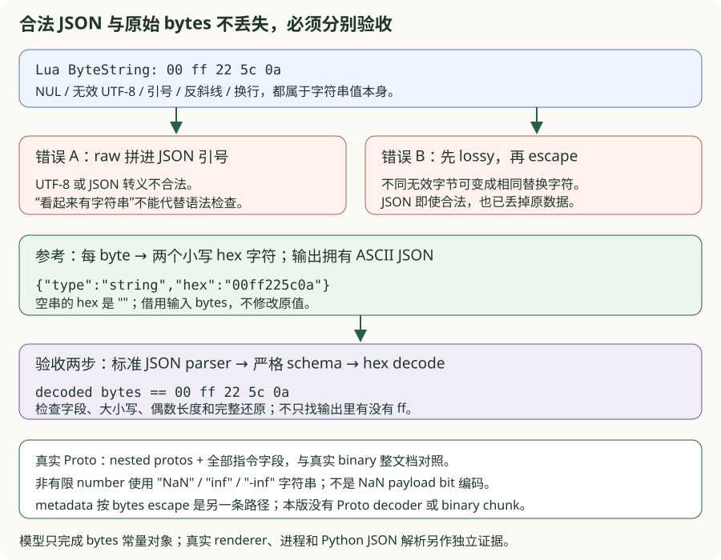
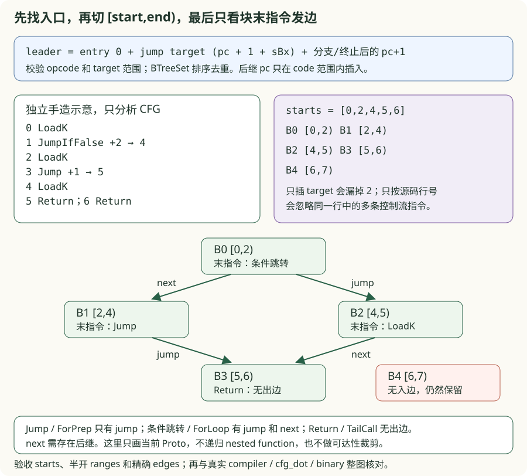
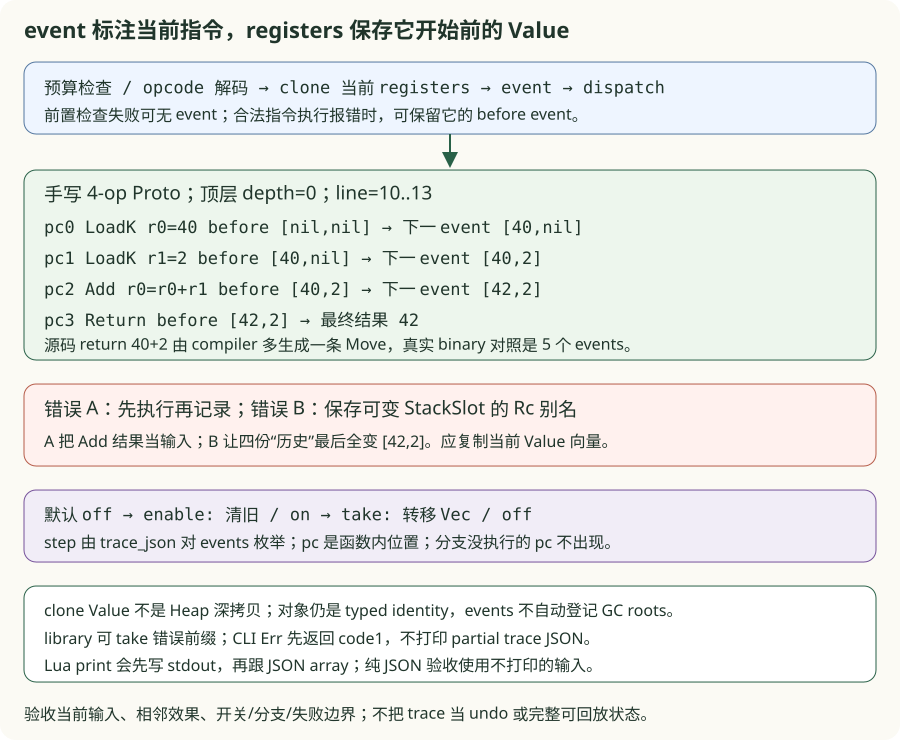
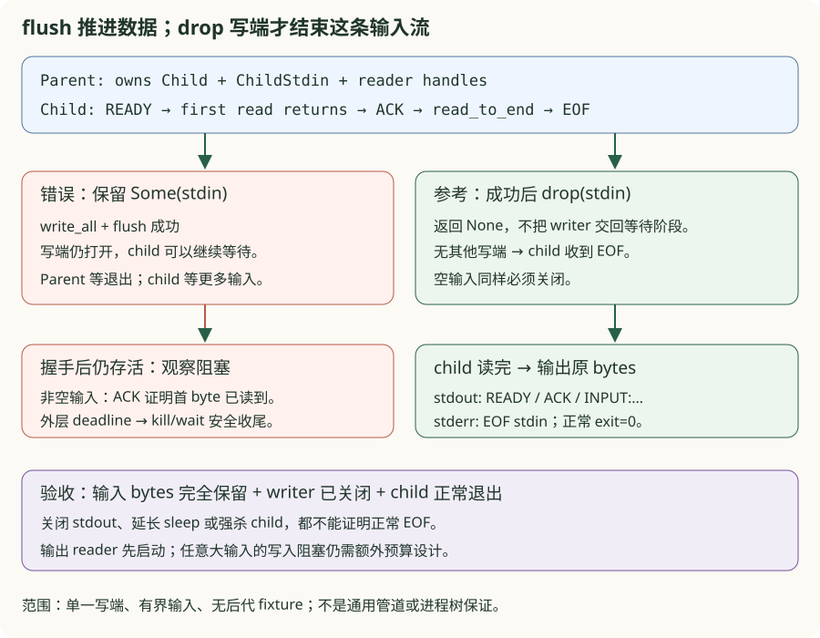
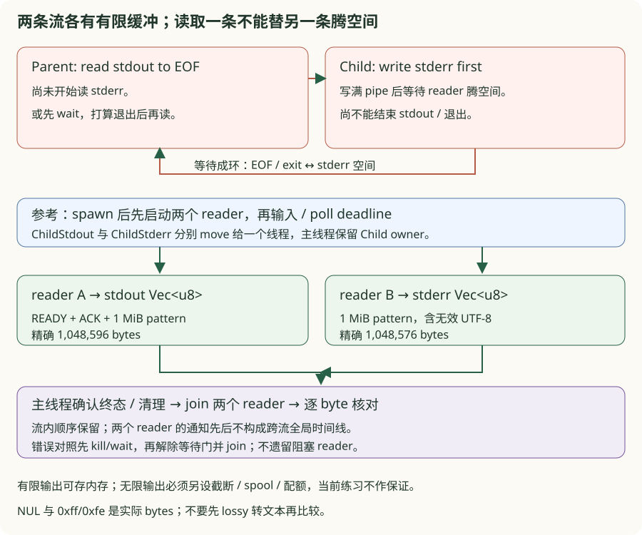
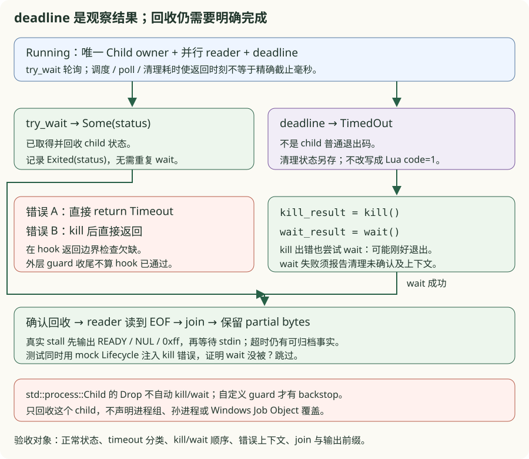
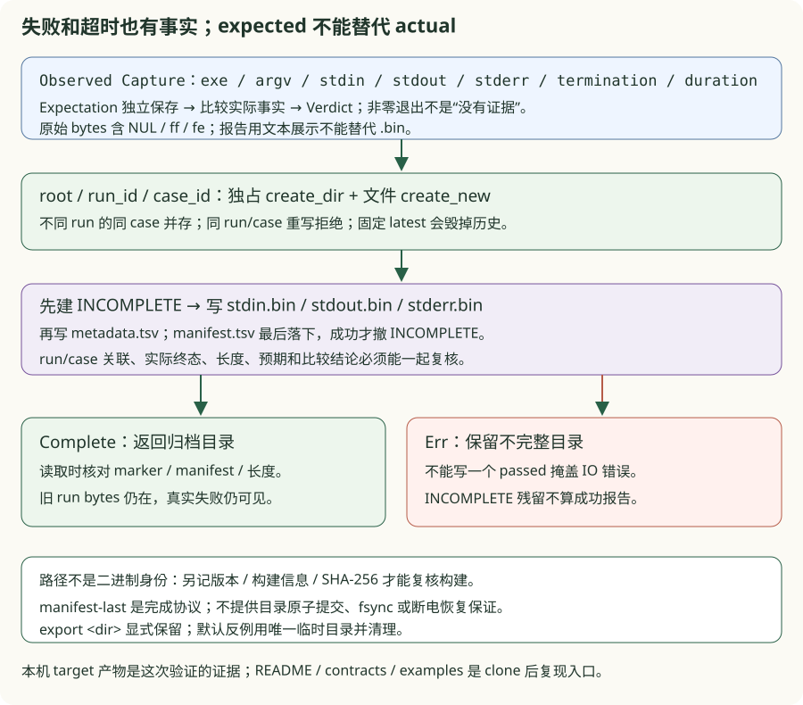

# v0.18 · CLI、REPL 与字节码工具

<div class="lesson-meta"><span>CLI/REPL → 观察工具 → 子进程生命周期与证据</span><span>6-crate workspace</span><span>checkpoint v0.18</span></div>

<a id="learning-task-card"></a>
## 学习任务卡

<div class="task-card">
  <strong>让 shell 看见失败，让下一次输入看见该保留的状态</strong>
  <p>前置：v0.17 的 VM owner、loader 与宿主 I/O。依次解决：打印错误为什么仍是退出
  0；每行重新 execute 为什么丢失 global；报错后该清源码还是重建 VM。新增 Rust 概念
  是 ExitCode/Result 的边界、Session 的长期可变 owner、短命 source buffer 与子进程
  stdio 协议。再解决 bytes 转文本丢信息、基本块切错、trace 时点错位三个观察问题。
  最后沿 EOF、双流读取、超时回收、证据归档解决 runner 自身的失败问题。
  全章产出为九个练习包、十个独立 TODO、固定反例、前后差异、状态图和真实进程验收；不把观察
  工具的输出当作 binary chunk 序列化、可达性裁剪或可重放的完整 Heap 快照。</p>
</div>

到 v0.17 为止，binary 只执行单份文件/stdin 源码并总是打印 Rust 风格的最终 Value。本版增加一个核心能力：**把脚本、交互和诊断都变成有明确 stdout/stderr/exit-code 合同的工具，并用真实子进程测试守住它们**。

<a id="learning-predict"></a>
## 先预测再运行

先写出以下三个实验的预测：错误已经写到 stderr，进程是否一定失败；第二行是否能
看到第一行的 table/closure；一行 runtime error 后，global 和当前 source 应各自怎样处理。

```lua
-- 脚本模式：print 的副作用已经发生，后面的 error 不能抹掉它。
print("before")
error("broken")
```

从仓库根目录执行。先构建真实 binaries；三个示例只定位同 profile 的 lua_app，
不会在运行中再启动 cargo。切换 Release 时也先构建 Release binaries。

```powershell
$toolManifest = 'book/code/v18-cli-tools/Cargo.toml'
cargo build --manifest-path $toolManifest --bins
cargo run --quiet --manifest-path $toolManifest --example cli_exit_problem_chain
cargo run --quiet --manifest-path $toolManifest --example repl_owner_problem_chain
cargo run --quiet --manifest-path $toolManifest --example repl_recovery_problem_chain
```

每个 CLI 固定并列 faults 与 solution，并另跑真实 v0.18 子进程；退出 0 表示固定
对照重放完成，不等于 learner 已完成。错误版是人为设计的局部反例，不是历史中间 VM。
精确的 stdin bytes、stdout/stderr 和 exit code 由各包 real/contracts 留作永久复现入口。

<a id="learning-code-map"></a>
## 代码阅读地图

1. [退出实验](https://github.com/YanqingXu/lua_rust/blob/main/book/code/v18-cli-tools/exercises/cli_exit/README.md)：`main → run → CliError`，先读 stream/code 合同，再看固定边界反例；
2. `parse_options → Vec<Action> → arg_entries`：先完成解析，再按顺序执行 actions；
3. [owner 实验](https://github.com/YanqingXu/lua_rust/blob/main/book/code/v18-cli-tools/exercises/repl_owner/README.md)：`Session::new → execute_multi → Vm::execute_multi`，找到跨 chunk 保留与每次重置的字段；
4. [恢复实验](https://github.com/YanqingXu/lua_rust/blob/main/book/code/v18-cli-tools/exercises/repl_recovery/README.md)：`repl → source → execute_multi → is_incomplete`，区别 Session 与 buffer 生命周期；
5. 共享进程探针：spawn、写完关闭 stdin、并行 drain 两个输出、deadline、kill/wait exact child；
6. bytecode JSON/CFG/trace：保留 bytes、控制流与 instruction-before 观察协议。

工具部分按 [bytes JSON](https://github.com/YanqingXu/lua_rust/blob/main/book/code/v18-cli-tools/exercises/bytecode_json/README.md)
→ [CFG leaders](https://github.com/YanqingXu/lua_rust/blob/main/book/code/v18-cli-tools/exercises/bytecode_cfg/README.md)
→ [执行前 trace](https://github.com/YanqingXu/lua_rust/blob/main/book/code/v18-cli-tools/exercises/bytecode_trace/README.md)
阅读；分别回到 `value_json`、`basic_blocks/cfg_dot`、`run_frame_state/trace_json`，不要
一次把整个工具文件读完才寻找规则。

runner 部分依次读 [stdio](https://github.com/YanqingXu/lua_rust/blob/main/book/code/v18-cli-tools/exercises/runner_stdio/README.md)
的 `send_input/start_drains` → [timeout](https://github.com/YanqingXu/lua_rust/blob/main/book/code/v18-cli-tools/exercises/runner_timeout/README.md)
的 `Lifecycle/stop` → [evidence](https://github.com/YanqingXu/lua_rust/blob/main/book/code/v18-cli-tools/exercises/runner_evidence/README.md)
的 `archive/CaseWriter`。前两问用真实 pipe/Child，回收问再用可注入 kill/wait 错误的
窄 trait 检查调用顺序，最后把实际 Capture 写到独占目录。共享 `runner_support/fixture.rs`
是无后代、输出有界的受控子程序，既不是另一套 Lua VM，也不是通用进程树测试。

一次进程执行也是资源协议：stdin 的写端必须及时关闭，stdout/stderr 必须都被读取，
timeout 后仍要回收 child。各局部练习隔离决策，再由真实 Session/Proto/VM 或真实
binary 兑现对应合同；边界模型不假装捕获 Lua print，也不实现第二套 parser/VM。

## CLI 是动作序列，不是一个脚本参数

命令行 parser 先把 options 转成按原顺序执行的 actions：

```text
-e chunk ─┐
-l module ├──> shared Session/VM ──> script or stdin ──> optional REPL
-v        ┘
```

支持的入口包括：

- `lua_app script.lua args...`：运行文件；
- `lua_app -` 或无参数且 stdin 非终端：从 stdin 读取 bytes；
- `-e stat` / `-estat`：可重复执行 chunk；
- `-l name` / `-lname`：按出现顺序调用 require；
- `-i`：actions/script 完成后进入同一个 VM 的 REPL；
- `--`：终止 option parsing，使以 `-` 开头的脚本名合法；
- `-v/--version`、`-h/--help`；
- 保留教学兼容开关 `--dump-bytecode`，正式观察推荐独立工具。

Session 只创建一次 VM，因此多个 `-e`、preload module、脚本和 REPL 能看到彼此的 globals、package cache、registry 和 GC 状态。

## `arg` table 的相对索引

CLI 保存包括 executable 在内的原始 argv，并以 script 位置为原点：

```text
lua_app -e setup script.lua first second
   -3    -2   -1       0        1     2
```

具体 option operand 的位置会随 argv 改变，但规则固定为 `arg[index - script_position]`。脚本路径放在 0，脚本参数从 1 开始，解释器/options 位于负索引。VM 的 `set_arg_table` 创建真正 Heap table，再写入 `_G.arg`；测试同时读取正索引和 `arg[-1]`。

Windows `OsString` 在当前教学 checkpoint 以 lossy UTF-8 注入 Lua，任意宽字符 argv 留给跨平台 SDK 收口；脚本文件本身仍按 bytes 读取。

## stdout、stderr 与退出码

CLI 不再自动打印脚本 return value。Lua `print/io.write` 决定 stdout，REPL 才显示求值结果：

| 情况 | stdout | stderr | exit code |
|---|---|---|---:|
| 正常脚本 | Lua 自己的输出 | 空 | 0 |
| compile/runtime/file error | 已产生的 Lua 输出，可能非空 | `lua: message` | 1 |
| 未知 option/缺 option operand | 空 | error + usage | 2 |
| help/version | 合同文本 | 空 | 0 |

区分 1 和 2 让 shell/CI 能判断用户程序失败和调用方式错误。REPL 内一条输入的普通
错误由循环处理，通常不会使最终 EOF 返回 1；stdin 读取或 stdout 写入失败等宿主错误
仍可能离开循环。不能把“stderr 非空”直接等同于非零退出。

## 持久 REPL 与续行

REPL 复用 Session，支持：

- `= expression` 自动改写成 `return expression`；
- 非空 return values 以 tab 分隔，byte string 直接写 stdout；
- compile error 的 message 命中 `expected 'end'`、`unexpected end` 或 `unterminated`，则保留 buffer 并显示 `>> `；
- 普通 compile/runtime error 写 stderr、清空当前 buffer，REPL 继续；
- EOF 干净退出。

这是当前快照的字符串启发式，不是独立的结构化 Incomplete 错误类别。问题三会实测
它的漏判与 pending buffer 的 EOF 边界，不把这段代码描述成完整 Lua 续行 parser。

## 问题一：终端已经显示错误，shell 为什么仍判断成功？

### 错误信息和进程状态走两条通道

在 `fn main() { if let Err(e) = run() { eprintln!(...) } }` 中，打印后正常返回 unit，
进程仍成功。把所有 Err 都返回 1 又会丢掉 usage=2 的分类；把脚本 return value
顺手打印，则让 `return 42` 污染 stdout。三个固定错误分别暴露 status、分类和输出
边界问题；不能只数 stderr 行数来验收。

```powershell
cargo run --quiet --manifest-path $toolManifest --example cli_exit_problem_chain
```


实现题只补 `finish`。输入已包含此前产生的输出与运行结果；这个纯边界模型不解析
argv、不执行 Lua，也不实现捕获全局 stdout。真实进程对照负责检验这些外部行为。

```rust
{{#include ../../code/v18-cli-tools/exercises/cli_exit/starter.rs:cli_exit_starter}}
```

```diff
- Err(error) => { eprintln!("{error}"); /* main 正常返回，code=0 */ }
+ Ok(()) => ExitCode::SUCCESS
+ Err(Usage(message)) => { stderr(error + usage); ExitCode::from(2) }
+ Err(Runtime(message)) => { stderr(error); ExitCode::from(1) }
```

这段 diff 表示真实 `main` 的协议迁移；练习的 Transcript 让 stream/code 可直接断言：

```rust
{{#include ../../code/v18-cli-tools/exercises/cli_exit/solution.rs:cli_exit_solution}}
```

边界追加 diagnostic，不覆盖此前 stdout；真实 `print('before'); error('broken')`
保留 `before\n`，stderr 有 broken，code=1。失败的 action 用 `?` 离开 run，后续
`-e`、脚本和 `-i` 都不再启动。options 整体解析在 actions 执行之前，不能把未知
option 当作已经执行某些 action 后的运行错误。

真实 help 在 parse_options 中直接打印并 exit(0)；version 是有序 Action。纯模型的
success 分支不证明这两个解析路径，也不承诺所有 `process::exit` 路径都运行析构。
**完成条件：** 同时核对 status、完整 stdout 与 diagnostic/usage；不要以“看到了错误”
替代非零退出，也不要把脚本 return value 当成 Lua 自己的输出。逐项命令见退出包 README。

```powershell
cargo test --manifest-path $toolManifest --test cli_exit_reference result_boundary_preserves_streams_and_maps_exit_codes -- --exact
```

## 问题二：上一行明明创建了 table，下一行为什么得到 nil？

### 一次性 convenience API 不是跨输入 owner

`lua_app::execute_multi(source)` 为一次调用新建 Session；`Session::execute_multi`
则可变借用已有 Session。两个函数名字相近，所有权位置却不同。固定错误在每次
submit 时调用前者，第一行的 table/closure/package 状态随 owner 结束，第二行
自然不能继续使用。

```powershell
cargo run --quiet --manifest-path $toolManifest --example repl_owner_problem_chain
```

```rust
{{#include ../../code/v18-cli-tools/exercises/repl_owner/starter.rs:repl_owner_starter}}
```

```diff
  fn submit(session: &mut Session, source: &[u8]) -> Result<Vec<Value>, AppError> {
-     lua_app::execute_multi(source)
+     session.execute_multi(source)
  }
```

```rust
{{#include ../../code/v18-cli-tools/exercises/repl_owner/solution.rs:repl_owner_solution}}
```


Session 在 run 中只创建一次，再传给各 action、脚本和 repl；每次提交仅临时独占
借用它。长期保留的是 VM 中的 Heap、global/registry/package owner、coroutine 状态
和资源登记，**不是上一个 chunk 的局部作用域或寄存器**。`Vm::execute_multi` 会重置
call stack、活动帧、活动函数、temporary roots、手动 GC mode 与本次指令预算。

跨输入要保留的 local，必须通过仍可达的闭包 upvalue 等真实边保存。练习先把 table
挂到 global，把另一个 local table 捕获进 global closure；下一输入先 collect，再
实读字段与计数。同时检查 chunk-only local 下一次为 nil、package cache 的字段/次数
与 registry edge。只看两次返回 handle 的显示文本不能证明对象仍活着。

```rust
{{#include ../../code/v18-cli-tools/exercises/repl_owner/chunks.rs:repl_owner_chunks}}
```

Rust 中保存一个 `Value::Table` 也不会自动把它登记为 Heap root。包内另用公开 Vm
探针移除合法 owner、结束旧执行帧后回收，再精确验证旧 handle 已 stale；跨输入
模型自身只保留 number/bool/nil 观察结果，避免拿未注册的宿主 handle 冒充保活。
本包不把此前 v0.15/v0.16 已登记的 GC 缺口说成已修复。

**完成条件：** 同一 Session 下 table/closure/module/registry 可实际访问，fresh 故障
确实丢状态；真实 CLI 的多 `-e → script` 与 `-i` 输入也得到预期结果。learner 只改
submit 的调用目标，不复制一份 VM、搬运 globals 或重建缓存来绕过 owner 合同。

```powershell
cargo test --manifest-path $toolManifest --test repl_owner_reference submissions_preserve_globals_tables_closures_and_owner_edges -- --exact
```

## 问题三：REPL 报错后，下一行应该接着哪一份状态？

### Session 继续存在，当前输入有自己的提交与清空时点

把 source 每行清空，三行 if 就再也拼不成完整 chunk；所有错误都保留 source，后续
输入会被拼到坏语法后面；把 `execute_multi(...)?` 直接传播出 REPL，则一条普通错误
就结束会话。三个错误都用了同一个持久 VM，仍然无法正确恢复输入协议。

```powershell
cargo run --quiet --manifest-path $toolManifest --example repl_recovery_problem_chain
```

```rust
{{#include ../../code/v18-cli-tools/exercises/repl_recovery/starter.rs:repl_recovery_starter}}
```

最小迁移是保存本次执行结果，在 REPL 层决定 buffer 的去留：

```diff
- session.execute_multi(source.as_bytes())?; // 首错结束会话
- source.clear();                          // 或每行无条件清空
+ match session.execute_multi(source.as_bytes()) {
+     Ok(values) => { display(values); source.clear(); }
+     Err(Compile(e)) if is_incomplete(&e) => { /* 保留 source，等待续行 */ }
+     Err(e) => { diagnostic(e); source.clear(); /* 接受下一行 */ }
+ }
```

```rust
{{#include ../../code/v18-cli-tools/exercises/repl_recovery/solution.rs:repl_recovery_solution}}
```


这个 hook 返回当前事件，外围固定循环负责显示和继续；错误不需要借一个新 Session
来“恢复”。编译失败还没执行 chunk；runtime error 之前已经改过的 global、文件或
输出副作用却不会被回滚。合同让 `counter=counter+1; error(...)` 失败，下一输入
仍读到增长后的 counter，避免只验证“下一行没报错”。

`=expr` 只在 source 为空时改写成 return；续行里的 `=` 不是新表达式入口。无返回值
得到空 Vec，不输出结果行；显式 return nil 得到一个 Nil，仍显示 nil。空闲空行不执行
chunk；存在 pending source 时空行按原样进入 buffer。

### “还没写完”是目前启发式的判断，不是完整语法结论

```rust
{{#include ../../code/v18-cli-tools/exercises/repl_recovery/model.rs:repl_recovery_classifier}}
```

当前 `is_incomplete` 只匹配 message 中的三个片段。像 `return 40 +` 本来可以追加
`2` 完成表达式，却报 expected an expression，未命中规则，source 会被当普通错误
清掉。这是快照的可运行漏判；本题保留该边界，后续若改 parser，应单独引入结构化
NeedMoreInput 合同并重验。不能用扩展模型的理想行为冒充当前 binary 的事实。

EOF 也需按当前实现观察：pending buffer 不再重试，不额外报告“未闭合”，离开函数
时销毁 buffer 并返回正常退出。`-i` 即使接到管道仍使用 REPL/banner/prompts；没有
script、没有 actions 且未指定 `-i` 时，非终端 stdin 才默认一次 read_to_end，作为
脚本执行，错误按 CLI code=1 处理。显式脚本 `-` 也读 stdin；已有 `-e` 不会再自动
读取管道。这不是同一种
跨行协议。read/flush 等宿主 I/O 错误可离开循环，普通 Lua 输入错误才在循环内恢复。

**完成条件：** 对照精确事件、buffer 内容、下一输入的真实值和进程 stream/code。
共享合同检查成功/普通编译错/runtime 错清空、未完成保留；真实 `-i` 检查错误后继续，
并单独记录 EOF pending 与续行漏判，不能只检查 stderr 含某个词。

```powershell
cargo test --manifest-path $toolManifest --test repl_recovery_reference source_lifecycle_recovers_after_errors -- --exact
```

## `lua_bytecode` 的四种观察入口

text 复用 core disassembler；JSON/CFG 只读取 Proto。trace 另外真实执行 Proto，
因此可能产生 Lua 副作用和运行错误。先从仓库根目录构建两种 binaries，随后三组
问题链用同 profile 的真实工具对照；只 build 根 package 的 --bins 不会构建依赖
crate 的 binary，所以这里要显式加 --workspace：

```powershell
cargo build --manifest-path $toolManifest --workspace --bins
cargo run --quiet --manifest-path $toolManifest --example bytecode_json_problem_chain
cargo run --quiet --manifest-path $toolManifest --example bytecode_cfg_problem_chain
cargo run --quiet --manifest-path $toolManifest --example bytecode_trace_problem_chain
```

以下是直接观察同一输入的四条入口。先预测：payload 编码成什么？if 的两个分支
都会出现在 CFG 吗？同次 trace 会执行两边吗？Add 的 event 中目的寄存器已经是
42 了吗？

```lua
{{#include ../../code/v18-cli-tools/examples/bytecode_views.lua}}
```

```powershell
cargo run --manifest-path book/code/v18-cli-tools/crates/lua_bytecode/Cargo.toml -- `
  --format text book/code/v18-cli-tools/examples/bytecode_views.lua
cargo run --manifest-path book/code/v18-cli-tools/crates/lua_bytecode/Cargo.toml -- `
  --format json book/code/v18-cli-tools/examples/bytecode_views.lua
cargo run --manifest-path book/code/v18-cli-tools/crates/lua_bytecode/Cargo.toml -- `
  --format cfg book/code/v18-cli-tools/examples/bytecode_views.lua
cargo run --manifest-path book/code/v18-cli-tools/crates/lua_bytecode/Cargo.toml -- `
  --format trace book/code/v18-cli-tools/examples/bytecode_views.lua
```

此输入不 print，JSON/trace 才能独立解析；原 demo 会 print，trace stdout 会混入
Lua 输出。固定 CLI 对照不读取 starter，不代表学习者已完成。

## 问题四：JSON 能显示这段字符串，为什么仍然丢了原来的 bytes？

### JSON 字符串承载 Unicode 文本，Lua string 承载任意字节

先预测 `00 ff 22 5c 0a` 的两个错误编码：直接拼到 JSON 引号里，会带入 NUL、
无效 UTF-8、未转义引号/反斜线/换行；先 `from_utf8_lossy` 再 escape 虽可能生成
合法 JSON，却已经把不同的无效字节替换成同一个字符，不能恢复原数据。合法语法
与信息保真是两个验收条件。

```powershell
cargo run --quiet --manifest-path $toolManifest --example bytecode_json_problem_chain
```

```rust
{{#include ../../code/v18-cli-tools/exercises/bytecode_json/starter.rs:bytecode_json_starter}}
```

实现题只补 bytes 常量对象的编码。输入借用 `&[u8]`，不修改源数据；输出拥有一段
ASCII JSON。把每个 byte 变成两个小写 hex 字符，JSON 层就不用猜原始编码：

```diff
- {"type":"string","value":"<raw 或 lossy text>"}
+ {"type":"string","hex":"00ff225c0a"}
```

```rust
{{#include ../../code/v18-cli-tools/exercises/bytecode_json/solution.rs:bytecode_json_solution}}
```



合同精确核对对象字段、偶数长度、小写 hex，再解码回原始 bytes；空串也必须有
`hex:""`。不是只查输出中含有 ff。固定 lossy 对照使不同输入产生相同文本，明确
解释为什么转义不能补救在转码时丢掉的信息。

### bytes 常量正确，不等于整个 Proto 可以反序列化恢复

真实 `proto_json` 递归输出 name、stack/params/vararg、constants、每条指令的
raw/pc/line/op/a/b/c/bx/sbx 与 nested protos。real 对照用真实 ByteString/Proto，
逐项核对整份文档与 binary 输出，再用 Python 标准 JSON parser 独立检查语法与
bytes 还原；不会让局部 encode hook 冒充完整 renderer。

有限 number 保留 JSON number；NaN、正负 infinity 当前编码为字符串 `"NaN"`、
`"inf"`、`"-inf"`，避免非 JSON 的裸 token。它不保留所有 NaN payload bit。metadata
的 name/function 走另一条 escape 路径：按 UTF-8 bytes 输出非 ASCII 的 `\u00xx`，
不能从 bytes 常量的可逆性推断所有元数据都做了 Unicode 保真。本版也没有 Proto
decoder、binary chunk 或跨版本 schema 保证。

**完成条件：** raw 无法满足 JSON/UTF-8 合同，lossy 确实碰撞；参考的每个 bytes
输入都能从严格 schema 解码回原值。真实工具同时覆盖 nested protos、指令字段和
非有限数的实际表示。精确 learner/reference 命令见 JSON 包 README。

```powershell
cargo test --manifest-path $toolManifest --test bytecode_json_reference bytes_constants_preserve_exact_bytes_as_lower_hex -- --exact
```

## 问题五：跳转目标在一段指令中间，为什么原来的块边界不够？

### 一个基本块内不能藏着另一个入口或提前结束的控制流

把所有指令当一块，就无法从块末发出中间 Jump 的边；只把 target 设为 leader，
又会把跳转后或 Return 后的指令混入前块，导致用错块末指令。按源码 line 分块
同样不成立：一行 Lua 可编译出多条跳转，debug line 只是来源信息。

```powershell
cargo run --quiet --manifest-path $toolManifest --example bytecode_cfg_problem_chain
```

实现题只补有序 leader 集合。输入借用真实 Proto/Instruction，框架已经提供半开
切片和 edge 生成，TODO 只负责 leader 发现：

```rust
{{#include ../../code/v18-cli-tools/exercises/bytecode_cfg/starter.rs:cfg_leaders_starter}}
```

```diff
  leaders.insert(0);
- target = pc + sBx;
+ target = pc + 1 + sBx; // VM 的基准是当前指令的下一条
  leaders.insert(target);
+ jump 或没有 fallthrough 的指令后，若还有指令，插入 pc + 1；
+ 校验 opcode/target，再按 BTreeSet 排序、去重；
```

```rust
{{#include ../../code/v18-cli-tools/exercises/bytecode_cfg/solution.rs:cfg_leaders_solution}}
```



入口是 0；所有跳转目标必须满足 `0 <= target < code.len()`。使用带符号计算后再
检查范围，避免负 offset 被提前转 usize。升序 starts 的相邻值形成 `[start,end)`，
最后一个 end 是 code.len；空 code 得到空块列表。之后只看块末指令生成边：

| 块末 opcode | jump 边 | next 边（存在后继块时） |
| --- | --- | --- |
| Jump / ForPrep | 有 | 无 |
| JumpIfFalse / JumpIfTrue / JumpIfNil / ForLoop | 有 | 有 |
| Return / TailCall | 无 | 无 |
| 其他有效指令 | 无 | 有 |

### 后面不可达，为什么仍然划一个块？

leader 划分不是可达性分析。Jump/Return 后即使暂时没有入边，仍要保留独立 block，
这样不会把它们的指令错误地当成前块末尾。本版也只给**当前 Proto** 输出 CFG，
不自动递归生成 nested function 的图。JSON 会递归 Proto，不能据此推断 CFG 也会。

固定错误分别漏掉 `pc+1`、把 offset 基准写成当前 pc、按 line 切块；合同手写
expected starts、半开 ranges 和带 jump/next 标签的 edges，再与 public `cfg_dot`
完整 DOT 比对。forward/back、三种条件跳转、ForPrep/ForLoop、Return/TailCall、
空 code、invalid opcode、负/越界 target 都有独立观察。真实 compiler 的 if/for
再走同一规则，binary 输出也与当前 Proto 的精确图对照。

**完成条件：** 能从指令手推 starts → blocks → edges，解释为什么 conditional 有
两条边而 Jump 没有 next；不能只看到 DOT 里存在 jump/next 两个单词就算完成。

```powershell
cargo test --manifest-path $toolManifest --test bytecode_cfg_reference leaders_split_control_flow_and_validate_instruction_targets -- --exact
```

## 问题六：Add 的 trace 里已经是 42，还能看出它读取了什么吗？

### 先拍当前状态，再执行当前 opcode

最小输入把 r0 设成 40、r1 设成 2，再 `Add r0,r0,r1`。如果在 match dispatch 后
才记录，名为 Add 的 event 里 r0 已是 42；再把它当作 Add 的输入，就会把执行效果
提前一拍。另一个错误保存可变 StackSlot 的 Rc 别名，所有历史行最后都会显示末态。

```powershell
cargo run --quiet --manifest-path $toolManifest --example bytecode_trace_problem_chain
```

局部模型只支持 LoadK/Add/Return，使用真实 Instruction/StackSlot；唯一 TODO 调整
dispatch 的记录时点。完整 VM 的控制流、错误与开关由真实对照负责：

```rust
{{#include ../../code/v18-cli-tools/exercises/bytecode_trace/starter.rs:bytecode_trace_starter}}
```

```diff
- execute(instruction)?;
- record(instruction)?;
+ record(instruction)?; // 复制当前寄存器 Value
+ execute(instruction)?;
```

```rust
{{#include ../../code/v18-cli-tools/exercises/bytecode_trace/solution.rs:bytecode_trace_solution}}
```



同一输入应产生以下当前指令的 before 值；不是给每个 opcode 画一张 after 表：

| pc / 当前指令 | r0 | r1 | 效果在哪观察 |
| --- | --- | --- | --- |
| 0 LoadK r0=40 | nil | nil | 下一 event 的 r0=40 |
| 1 LoadK r1=2 | 40 | nil | 下一 event 的 r1=2 |
| 2 Add r0=r0+r1 | 40 | 2 | 下一 Return event 的 r0=42 |
| 3 Return | 42 | 2 | 最终返回值 42 |

这张表使用练习手写的四指令 Proto；真实编译 `return 40+2` 还生成一条 Move，
binary 对照因此是五个 events。不能把手写寄存器窗口当作 compiler 的固定输出。

真实 VM 的顺序是检查预算、递减、解码 opcode → clone 当前寄存器 Value 向量 →
保存 event → dispatch；所以执行时出错的合法指令也可有 before event，但预算
耗尽、非法 opcode 或记录时借用失败可能发生在 event 之前。分支没有执行的 pc
不会凭空出现。trace_json 的 step 是对传入 events 的枚举索引，VmTraceEvent 本身
没有全局 step 字段；pc 是函数内部位置，line 可重复，depth 是实际调用栈长度。

### 拿走历史不等于持续录制，复制 Value 不等于深拷贝 Heap

默认关闭；enable_trace 清旧 events 再开启；take_trace 关闭并转移 Vec。要再次录制，
必须重新 enable。保存当前 Value 防止后续 slot 写入改掉历史数值；table/function/
userdata 仍只是 typed identity，不包含当时的完整对象内容，trace events 也没有
自动加入 gc_roots。不能把这个快照当作 Heap 保活保证、可回放状态或 undo 日志。

真实 library 可在 execute Err 后 take 已记录的前缀；CLI 则先用 `?` 传播错误，
runtime error 时 code=1、stderr 有诊断，不会打印这个 partial JSON。成功路径若
Lua 自己 print，会先污染 stdout，再写 JSON array；纯 JSON 验收使用不打印的输入。
这是工具当前输出边界，没有偷偷把 Lua 输出重定向到 stderr。

**完成条件：** 模型 before/after/alias 对照清晰；真实 VM 核对寄存器、PC/line/depth、
开关、分支与失败边界；binary 对照纯输出、错误前缀不导出及 print 混合输出。

```powershell
cargo test --manifest-path $toolManifest --test bytecode_trace_reference records_current_registers_before_dispatch -- --exact
```

## 问题七：write_all 和 flush 都成功，子进程为什么还不退出？

### 字节送到了，输入却还没结束

先预测：child 的 `read_to_end` 收到 `abc` 后会返回吗？`flush` 只推进已写数据，
不发送“后面没有输入”的通知。只要父进程仍持有 pipe 写端，child 就能继续等待。
`ChildStdin` 的所有权因此也是协议的一部分：本练习没有克隆写端，写完后 drop
这个 owner 才让 child 读到 EOF；空输入也必须关闭。

```powershell
cargo build --manifest-path $toolManifest --workspace --bins
cargo run --quiet --manifest-path $toolManifest --example runner_stdio_problem_chain
```

固定 fixture 先写 READY，首次 read 返回后写 ACK，再继续 `read_to_end`。错误版本
保留 stdin，框架在握手后确认 child 仍存活；参考版关闭后，完整 stdout 含原输入，
stderr 才出现 `EOF stdin`。非空输入的 ACK 证明首 byte 已被读取；空输入会在 EOF
后完成零字节 read，也输出 ACK。ACK 不宣称整个非空 payload 已经读完。
所有错误对照都有期限和外层 kill/wait，复现阻塞不会把练习永久挂住。

```rust
{{#include ../../code/v18-cli-tools/exercises/runner_stdio/starter.rs:runner_stdin_starter}}
```

```diff
  stdin.write_all(input)?;
  stdin.flush()?;
- Ok(Some(stdin)) // 留住写端，再等 child 结束
+ drop(stdin);   // 结束这次输入流
+ Ok(None)
```

```rust
{{#include ../../code/v18-cli-tools/exercises/runner_stdio/solution.rs:runner_stdin_solution}}
```



函数按值接收 `ChildStdin`，成功时不把 writer 交回等待阶段；返回 None 是可观察的
所有权结果。更一般的输入可能写满 pipe，所以输出 reader 应先启动，输入写入也须
受 runner 的截止与清理协议覆盖。这里的有界 payload 不证明任意大小输入都安全。

**完成条件：** 只补 send_input，精确保留输入 bytes，关闭写端，child 正常结束；
不能用“多等一会儿”、关闭 stdout 或杀掉 child 冒充正常 EOF。

```powershell
cargo test --manifest-path $toolManifest --test runner_stdio_reference stdin_send_then_close_delivers_eof -- --exact
```

## 问题八：先 read stdout 到 EOF，再读 stderr，为什么仍会挂住？

### 两根管道，必须同时有人消费

先画等待关系：parent 正等 stdout EOF；child 先向 stderr 写 1 MiB 有界字节，
pipe 的有限缓冲可能写满，child 卡在 write，尚不能写完 stdout 或退出。关闭 stdin
不能拆掉这个环。“先 wait，退出后再读”也可能卡在同一处。不能依赖某个 OS 的
pipe 容量或用很大的固定 sleep 掩盖问题。

同一 stdio CLI 的 dual 场景先完成 READY/ACK，再先写 stderr、后写 stdout。
固定 faults 分别采用顺序读取、等主线程结束后才读取；参考版在等待之前把
`ChildStdout` 和 `ChildStderr` 各移动给一个 reader thread，最后 join 两个结果。
教学框架在错误路径先 kill/wait child，finish 再解除等待门并 join，避免遗留阻塞线程。
被 kill 打断的大块 write 不保证已经提交多少 bytes：错误路径只能要求实际捕获是
未完整的精确前缀，允许为空；完整双流合同由健康路径验证。

```rust
{{#include ../../code/v18-cli-tools/exercises/runner_stdio/starter.rs:runner_drains_starter}}
```

```diff
- stdout.read_to_end(&mut out)?;
- stderr.read_to_end(&mut err)?;
+ let out = spawn(move || read_all(stdout));
+ let err = spawn(move || read_all(stderr));
  // 主线程输入、检查 deadline 与 child 状态
+ let out_result = out.join();
+ let err_result = err.join(); // 两个 join 都完成，再传播任一错误
```

这段 diff 表示消费顺序的迁移；实际 `join_pair` 先 join 两个 handle，再传播 panic/
读取错误，防止第一个 `?` 提前返回而遗漏另一条 reader。通知 channel 只用于握手
和定位等待点：

```rust
{{#include ../../code/v18-cli-tools/exercises/runner_stdio/solution.rs:runner_drains_solution}}
```



每个 reader 独占一个读端，返回 `Vec<u8>`；主线程拥有 child、deadline 和 join
handles。不要把输出先转成 lossy String 再比较：本 fixture 含 NUL 和无效 UTF-8，
stdout/stderr 要逐 byte 完整核对。每条流内部保持原顺序，两条 reader 的通知先后
不是 stdout/stderr 的全局时间线。捕获进内存也只适用于本章的有界 fixture。

**完成条件：** 同时消费两个 stream，正常退出，stdout 恰为 1,048,596 bytes、
stderr 恰为 1,048,576 bytes，且内容完全匹配。只有长度或某段文字都不足以验收。

```powershell
cargo test --manifest-path $toolManifest --test runner_stdio_reference parallel_readers_capture_both_streams -- --exact
```

## 问题九：deadline 到了，返回 Timeout 就算回收完成了吗？

### kill 是请求，wait 才完成这条回收路径

预测三个实现的返回时状态：直接返回 timeout；只 kill；kill 后 wait。deadline 是
runner 的观察结果，不是 child 主动返回的 exit code。直接返回可能遗留运行中的
child；kill 成功也不能代替 wait。Rust 的 `std::process::Child` drop 本身不会
自动 kill/wait；本章自定义 owner 的 Drop backstop 是另写的保护逻辑。

```powershell
cargo run --quiet --manifest-path $toolManifest --example runner_timeout_problem_chain
```

真实 stall fixture 先输出包含 NUL/0xff 的前缀，再等待仍打开的 stdin。握手后确认
child 存活，deadline 后才执行超时清理；读取线程继续取完已输出的 bytes。固定
faults 的状态在 hook 返回处检查，再由外层安全 guard 收尾。不能因 guard 最终
帮忙回收，就说只 kill 的 hook 已满足合同。

```rust
{{#include ../../code/v18-cli-tools/exercises/runner_timeout/starter.rs:timeout_starter}}
```

```diff
- child.kill()?;
- Ok(())
+ let killed = child.kill();
+ child.wait().map_err(|error| format!("wait after kill ({killed:?}): {error}"))?;
+ Ok(())
```

`&mut dyn Lifecycle` 借用唯一 child owner，窄 trait 让测试能注入 kill 错误，并验证
wait 仍被调用。child 可能刚好自然退出而导致 kill 失败；若随后 wait 成功，owner
已经回收，不能跳过 wait 或把竞态武断解释成泄漏。wait 失败则保留清理错误和 kill
上下文，让调用者看见回收尚未确认。

```rust
{{#include ../../code/v18-cli-tools/exercises/runner_timeout/solution.rs:timeout_solution}}
```



正常路径 `try_wait` 返回 Some 已取得并回收 child 状态，无需为图示再强行 wait
一次。超时路径保存 `TimedOut`，另存清理 status；被终止进程的系统状态不能冒充
Lua 的普通 code=1。计时受调度、poll 粒度和清理耗时影响，deadline 不是函数严格
在同一毫秒返回的保证。所有清理只作用于这个 child；孙进程、进程组/Windows Job
Object 和无限输出限额属于另一个 runner 能力范围。

**完成条件：** 正常退出与 timeout 分开；kill 错误仍尝试 wait；fault 返回边界与
外层 backstop 分开；真实 timeout 回收后 reader join 成功，保留两个 stream 的前缀。

```powershell
cargo test --manifest-path $toolManifest --test runner_timeout_reference timeout_cleanup_always_attempts_wait_and_releases_exact_owner -- --exact
```

## 问题十：报告只写一个 false，下次还能知道这次到底跑了什么吗？

### 先保留事实，再计算预期是否满足

先预测：同一个 case 连跑两次，第二次覆盖 `latest/stdout`，旧失败还能复核吗？
如果写档函数误把 expected 当 stdout 保存，即使报告 false，原始失败也已经丢失。
进程证据要能对应同一次运行：executable/argv、stdin bytes、实际 termination、
耗时与实际 stdout/stderr；expected 和 verdict 是比较层的数据。

```powershell
cargo run --quiet --manifest-path $toolManifest --example runner_evidence_problem_chain
```

固定错误一用 expected 污染 actual，另一用固定 latest 目录覆盖前次结果。参考版
接收已经捕获的 `&Evidence`，只借用数据，把真实 stdin/stdout/stderr 写入独占的
run/case 目录；期望成功但真实 exit=7 的 case 也必须保存 raw bytes 和失败结论。
timeout 同样有证据，不能因为没有普通 exit code 就跳过归档。

```rust
{{#include ../../code/v18-cli-tools/exercises/runner_evidence/starter.rs:runner_evidence_starter}}
```

```diff
  let writer = CaseWriter::begin(root, evidence)?;
- writer.write_new("summary.txt", evidence.verdict().passed.to_string().as_bytes())?;
+ writer.write_new("stdin.bin", &evidence.stdin)?;
+ writer.write_new("stdout.bin", &evidence.capture.stdout)?;
+ writer.write_new("stderr.bin", &evidence.capture.stderr)?;
  writer.complete(evidence)
```

独占目录用 `create_dir` 拒绝重复 owner，文件用 `create_new` 拒绝覆盖。框架先留下
INCOMPLETE 标记，写 bytes、metadata 后最后写 manifest，成功才撤标记；中途错误
通过 Result 返回，残留目录说明未完成，不能把它当作一个绿色报告。
`stdin.bin` 是父进程提交的请求 bytes，不证明 child 已全部消费；消费进度仍要靠
fixture 的 ACK/EOF 协议观察。`binary-version.bin` 保存另一次 version 探针的原输出。
metadata.tsv 使用唯一 key、TAB、value、换行；path/argv/expected/status 文本用 hex
避免换行或 TAB 破坏字段，elapsed.ns 保留实测耗时；manifest 固定列出同 run/case 的文件。

```rust
{{#include ../../code/v18-cli-tools/exercises/runner_evidence/solution.rs:runner_evidence_solution}}
```



读取合同同时核对元数据、实际 bytes、长度和完成标记。同 case 不同 run 的目录
并存；同 run/case 重写必须失败。run_id 是关联键，不因叫 timestamp 就自动唯一。
executable 路径记录“从哪里启动”，不证明其内容未变；复核某个构建还需保留版本、
构建信息或二进制哈希。本轮外部验证另记 SHA-256，没有把路径当作二进制身份。
manifest-last 是本地完成协议，不是整个目录 atomic rename、fsync 或断电恢复保证。

要保留可检查的产物，给 export 指定目录；每次产生新 run，不覆盖历史：

```powershell
cargo run --quiet --manifest-path $toolManifest --example runner_evidence_problem_chain -- export target/runner-evidence-review
```

默认反例 CLI 用独占临时目录并清理。仓库 target 下的本机报告可用于本次复核，
clone 后的永久复现入口是各 README、contracts、真实 capture 和这些 examples。

**完成条件：** 验实际 NUL/0xff/0xfe、真实非零退出与 timeout；保存预期失败事实；
重复运行不覆盖；写档错误不能伪装完成；从同一 run/case 的 manifest 找到全部证据。

```powershell
cargo test --manifest-path $toolManifest --test runner_evidence_reference archives_observed_bytes_and_same_run_metadata -- --exact
```

### 把新协议带回原 fixture tests

原 `tests/fixtures/manifest.tsv` 声明 script、args、expected exit、完整 stdout 和
stderr substring。旧 `tests/cli_contract.rs` 在 child 退出后才读取两条流，小 fixture
通过不证明大输出安全。此前练习的 [process helper](https://github.com/YanqingXu/lua_rust/blob/main/book/code/v18-cli-tools/exercises/support/process.rs)
已采用并发 reader、写完关闭 stdin、deadline、exact child kill/wait；本轮把这些
隐含协议拆成四个可失败的决策，保留旧 helper 与原 CLI 测试作为回归对照。
没有把它们偷偷替换为完整的成熟 runner，也没有扩大语言兼容验收结论。

## Rust 知识映射与设计选择

- `Action` enum 保留 option 出现顺序；
- `Session` 封装可复用 VM，library convenience API 仍能一次性执行；
- `IsTerminal` 区分无参数 REPL 与管道脚本；
- `BufRead::lines` 与 source buffer 实现 continuation prompt；
- `BTreeSet` 让 CFG leaders 和 DOT 输出稳定排序；
- 手写 JSON escape/hex 避免为教学 viewer 引入序列化依赖，同时测试其 bytes 合同；
- 按值移动 stdin/两个 reader 与 thread join，把管道协议变成所有权和终态约束；
- `Command + try_wait + deadline` 让有界 fixture 的阻塞成为可诊断失败，kill 后仍 wait；
- `&mut dyn Lifecycle` 可注入系统调用竞态；`create_new + Result` 拒绝证据覆盖并传播归档错误。

替代方案是把 REPL 每行写到临时文件并重新启动 binary，但那会丢失 globals/coroutine/package 状态。另一个方案是让 bytecode crate侵入 Compiler/VM；只读 Proto/trace event 保持工具与执行语义解耦。

## 从 v0.17 迁移了什么

- 新增：可复用 `Session`、宿主 arg table 注入和 action-ordered CLI；
- 重构：脚本 return value 不再污染 stdout；
- 新增：stdin、`-e/-l/-i/--`、help/version 和退出码合同；
- 新增：持久 REPL、表达式缩写、block 续行与错误恢复；
- 新增：`lua_bytecode` crate 和 text/JSON/CFG/trace binary；
- 新增：可开关 VM register trace events；
- 新增：fixture manifest、进程 timeout runner 和副作用验收；
- 保留：v0.17 host resources/modules 与此前全部语义测试；
- 未加入：binary chunk serializer/deserializer 或 C/native module loader。

## 运行与验收

```powershell
cargo run --manifest-path book/code/v18-cli-tools/Cargo.toml -- `
  book/code/v18-cli-tools/examples/demo.lua
cargo test --manifest-path $toolManifest --test cli_exit_reference
cargo test --manifest-path $toolManifest --test repl_owner_reference
cargo test --manifest-path $toolManifest --test repl_recovery_reference
cargo test --manifest-path $toolManifest --test bytecode_json_reference
cargo test --manifest-path $toolManifest --test bytecode_cfg_reference
cargo test --manifest-path $toolManifest --test bytecode_trace_reference
cargo test --manifest-path $toolManifest --test runner_stdio_reference
cargo test --manifest-path $toolManifest --test runner_timeout_reference
cargo test --manifest-path $toolManifest --test runner_evidence_reference
cargo run --quiet --manifest-path $toolManifest --example runner_stdio_problem_chain
cargo run --quiet --manifest-path $toolManifest --example runner_timeout_problem_chain
cargo run --quiet --manifest-path $toolManifest --example runner_evidence_problem_chain
cargo fmt --manifest-path $toolManifest --all -- --check
cargo clippy --manifest-path $toolManifest --workspace --all-targets -- -D warnings
cargo test --manifest-path $toolManifest --workspace
cargo build --release --manifest-path $toolManifest --workspace --bins
cargo test --manifest-path $toolManifest --workspace --release
```

示例在 Lua 内显式 print，因此 CLI stdout 是：

```text
1818
```

本快照原有 129 个测试：119 个原语义测试、5 个 CLI/REPL process tests、3 个 bytecode
library tests 和 2 个 bytecode binary process tests。CLI/REPL 包增加 20 项参考
（退出8、owner5、恢复7）；工具包再增加22项（JSON6、CFG7、trace9）；runner 包再增加
18 项参考（stdio5、timeout6、evidence7），合计 **189 通过、10 个 learner ignored**，
其中 stdio 包有 EOF、并行读取两个独立题。v0.17 教学练习的计数
仍归各自版本，不把它们重复算进这个独立快照。

```powershell
cargo test --manifest-path $toolManifest --test cli_exit_exercises -- --ignored
cargo test --manifest-path $toolManifest --test repl_owner_exercises -- --ignored
cargo test --manifest-path $toolManifest --test repl_recovery_exercises -- --ignored
cargo test --manifest-path $toolManifest --test bytecode_json_exercises -- --ignored
cargo test --manifest-path $toolManifest --test bytecode_cfg_exercises -- --ignored
cargo test --manifest-path $toolManifest --test bytecode_trace_exercises -- --ignored
cargo test --manifest-path $toolManifest --test runner_stdio_exercises -- --ignored
cargo test --manifest-path $toolManifest --test runner_timeout_exercises -- --ignored
cargo test --manifest-path $toolManifest --test runner_evidence_exercises -- --ignored
```

初始 stdio 组两项失败，其余八组各一项失败。只修改各包 starter 的指定 hook，显式 learner 全通过才完成；
默认参考、ignored 和固定 CLI 退出 0 不能代替这一验收。维护者须验证失败→临时套解
通过→原字节恢复并刷新 mtime 后再失败，防止缓存或已填答案造成假绿。精确命令、
观察值与修改范围见九个 README。Cargo 的 `default-run = "lua_app"` 保持脚本入口；
新 `runner_fixture` 只是测试子程序，命令行示例先构建同 profile 的 workspace binaries。

```powershell
powershell -NoProfile -ExecutionPolicy Bypass -File tools/check_book_teaching.ps1
mdbook build book
node tools/check_book_links.mjs target/mdbook .
```

## 本版本暂不支持

- REPL 没有 readline 历史、补全、TTY 编辑和 signal-aware Ctrl-C 恢复；
- multiline 判断依赖 CompileError.message 子串，`return 40 +` 等可续行前缀仍会漏判，pending EOF 静默退出；
- argv/path 在 Windows 仍采用 lossy UTF-8 adapter；
- JSON schema 还没有跨版本兼容承诺，v1.0 会冻结并登记版本；
- trace 是 instruction-before snapshot，没有 allocator bytes、GC phase transition 或 host callback event；
- process runner 服务现有 tests 与本轮练习，不提供通用进程树/任意大输出 fixture CLI；
- Lua 5.1 binary chunk、C API 与 dynamic native module 仍分别属于 v1.1、v1.2、v1.3；
- v0.16/v0.17 已登记的 pattern、标准库和 debug 差异仍需 v1.0 收口。

<a id="learning-exercises"></a>
## 章末练习

<div class="exercise understanding">
  <strong>理解题：一个 owner，为什么仍有两套状态？</strong>
  <p>沿 owner 与 recovery 两图列出 Session、Heap、chunk locals、captured locals、source
  的生命周期。运行三个 CLI 对照；成功条件是能解释错误后 counter 仍变了但 source
  已清，以及 stderr 有错误时 REPL EOF 为什么仍可 exit 0。</p>
</div>

<div class="exercise implementation">
  <strong>实现题：完成十个独立 hook</strong>
  <p>只改 cli_exit::finish、repl_owner::submit、repl_recovery::submit，再补 JSON encode_bytes、
  CFG leaders、trace dispatch 的记录时点，以及 runner send_input、start_drains、stop、
  archive。运行上面九个 --ignored 命令，stdio 两项、其余每组一项通过才完成。不修改 faults、合同、真实 src/crates 或
  ignored 标记；共享 helper 与真实 binary 对照不是 TODO。</p>
</div>

<div class="exercise debugging">
  <strong>调试题：补一行 2，为什么没有得到 42？</strong>
  <p>运行恢复 CLI 的固定反例，比较 return 40 + 的 CompileError.message、is_incomplete
  判定、buffer 和下一行事件；再比较一次 read_to_end 的 stdin 脚本。成功条件是能
  复现当前漏判、区分分行编译与整段编译，并指出未来结构化续行协议要改变哪一层。</p>
</div>

<div class="exercise understanding">
  <strong>理解题：一份输入，三种输出各保留什么？</strong>
  <p>运行 bytecode_views.lua 的 JSON/CFG/trace，分别还原 payload bytes、手推跳转
  target 与块边、找 Add 前后相邻 event。成功条件是能解释 nested JSON 与当前 Proto
  CFG 的范围差异、不可达 block 与未执行 pc 的区别，以及 register identity 为什么
  不是对象内容的深快照。</p>
</div>

<div class="exercise debugging">
  <strong>调试题：能解析、有 jump、看见42，为什么仍可能是错的？</strong>
  <p>运行三个工具 CLI，检查 lossy 碰撞、漏 pc+1 使 jump 藏进块内、after/alias 历史
  错位。成功条件是从完整 bytes/schema、精确 blocks/edges、当前指令 before 值
  各指出一条失败证据；不能只用 JSON 可解析、DOT 含 jump 或 trace 含42验收。</p>
</div>

<div class="exercise understanding">
  <strong>理解题：这次是谁在等谁？</strong>
  <p>沿四幅 runner 图标出 Child、stdin writer、两条 reader、join handle、run/case
  目录的 owner。成功条件是解释 flush 与 EOF、读到 EOF 与 child 已回收、kill 与
  wait、TimedOut 与清理 status 各自的区别，并说明两条流为什么没有共同顺序。</p>
</div>

<div class="exercise debugging">
  <strong>调试题：有超时、有报告，为什么现场仍可能丢了？</strong>
  <p>运行三个 runner CLI，分别定位等待 EOF、stderr 写满、kill-only 返回、expected
  覆盖 actual 与 latest 覆盖历史。用 export 连跑两次，检查旧目录字节不变，实际
  exit=7 的失败仍留有 NUL/ff/fe。成功条件是从等待图、hook 返回边界、原始文件各
  给一条证据，不能只凭 CLI exit=0 或 manifest 存在判断练习已完成。</p>
</div>

<a id="learning-checkpoint"></a>
## 完成检查点

- 能从 argv 手推 Action 顺序与 arg table；
- 能区分 usage、compile/runtime 和正常退出合同；
- 能用完整 stdout/stderr 与真实 exit code 验证错误前的输出和后续 actions 中止；
- 能用 GC 后字段读取说明 Session owner 的保留边，区分 chunk local 与 captured local；
- 能手推 success/incomplete/普通错误的 buffer 变化，并说明 runtime 副作用不回滚；
- 十个 TODO 显式通过，能说明模型、真实 Session/Proto/VM、进程和启发式的验证边界；
- 能按严格 schema 解码 bytes、校验非有限数与 nested Proto，不把 metadata 视为同一编码；
- 能从 pc+1+sBx 推导 leaders/半开 blocks/末指令 edges，区分结构划分与可达分析；
- 能用 Add 输入和下一 event 解释 before 时点、开关与失败前缀，不外推 Heap 深快照；
- 能用握手后的真实反例画出 EOF 与双流阻塞的等待关系，并说明 reader 的所有权；
- 能解释超时后 kill 失败仍 wait、try_wait(Some) 已回收、guard 与标准 Child Drop 的区别；
- 能从独占 run/case 目录复核实际 bytes、termination、预期与 verdict，拒绝覆盖和不完整报告；
- 能列出本章有界 fixture 与通用进程树、无限输出、崩溃一致性之间的能力边界。

## 与成熟实现和专题章节的对应

- 当前成熟实现的 CLI contract tests、bytecode evidence、VM trace 和 fixture runner 是本版工具协议的扩展目标；
- [Bytecode](../ch03-compiler/bytecode.md) 可对照 raw instruction fields 与 JSON；
- [寄存器虚拟机](../ch04-vm/register-vm.md) 可解释 trace snapshot 中 base/top/register window；
- [用测试守住兼容性](../ch05-engineering/testing.md) 可对照进程级合同为何不能只用函数单测替代；
- 本版十问已覆盖 CLI/REPL、观察工具与单 child 生命周期；成熟 [lua_fixture_runner](https://github.com/YanqingXu/lua_rust/blob/main/tools/lua_fixture_runner/README.md) 的进程组/Windows Job Object、分类与规范化是后续独立能力，不能由本轮反例通过推定；
- 下一项局部教学可独立完善结构化 REPL 续行协议；跨入兼容验收时，应先冻结能力矩阵与 oracle 来源；
- 下一 checkpoint 是 v1.0：补齐登记差异，冻结能力矩阵，并以官方 Lua 5.1.5 与固定 C++ oracle 双差分收口。
